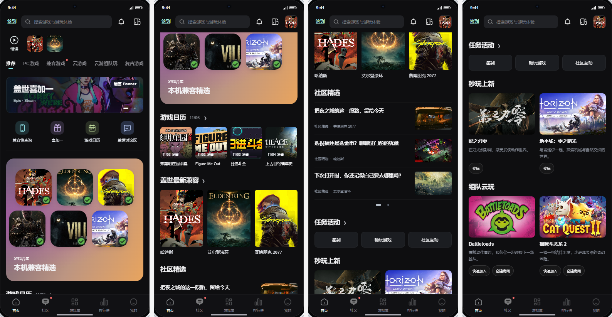

# 盖世7.0首页改版说明

**首页布局：**

- 顶部为签到、搜索、消息和设备入口；下方是继续按钮及最近游戏小图标，“继续”文字位于播放图标下方。
- 上划后，继续游玩收至右上角；回到顶部恢复。横屏和平板不显示继续游玩。
- 内容依次为频道Tab、运营Banner、金刚位及推荐栏目。
- 主导航依次为首页、社区、游戏库、排行榜、我的；横屏移至顶部，签到、搜索放大镜和消息位于右上角。

**首页内容：**

- 金刚位：兼容性查询、喜加一、游戏日历、盖世讨论区。
- 本机可玩：游戏图标合集展示适配当前设备的游戏，点击进入兼容游戏频道；横屏改为紧凑横条。
- 游戏日历：展示发售动态，详情按月份、今天及日期分组，支持订阅提醒。
- 盖世最新兼容：展示新增兼容游戏，点击查看完整列表。
- 社区精选：左文右图，每组三条，整组左右切换。

**福利与任务：**

- 喜加一：通过金刚位进入，按平台查看限免游戏、订阅提醒及添加桌面组件。
- 签到：标题“连续签到”，默认显示本周七天一行，点击“更多”同页展开整月，可收起；下方“获得更多积分”直接展示每日任务、成长任务Tab和任务列表。
- 任务活动展示签到、畅玩游戏、社区互动；秒玩上新和组队云玩后置。
- 首页移除Steam折扣列表和独立喜加一列表。

**配置与差异：**

- B端增加本轮栏目样式，沿用专题列表、栏目列表、编辑三层结构。
- iOS隐藏兼容查询、兼容游戏、本机可玩及最新兼容；海外版隐藏云游戏相关内容。

本图来自当前本地可操作Demo。积分、兼容、游戏准备、订阅和组队服务未实际接入。
