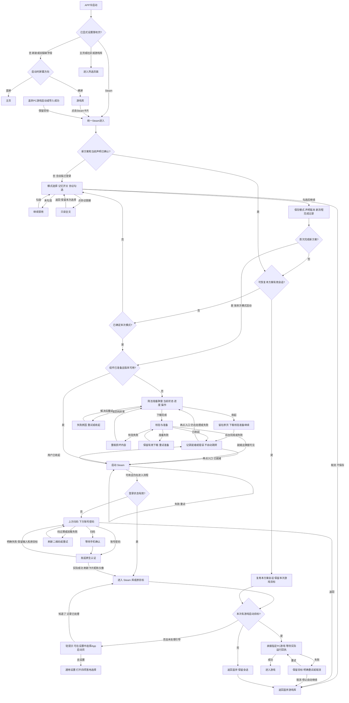
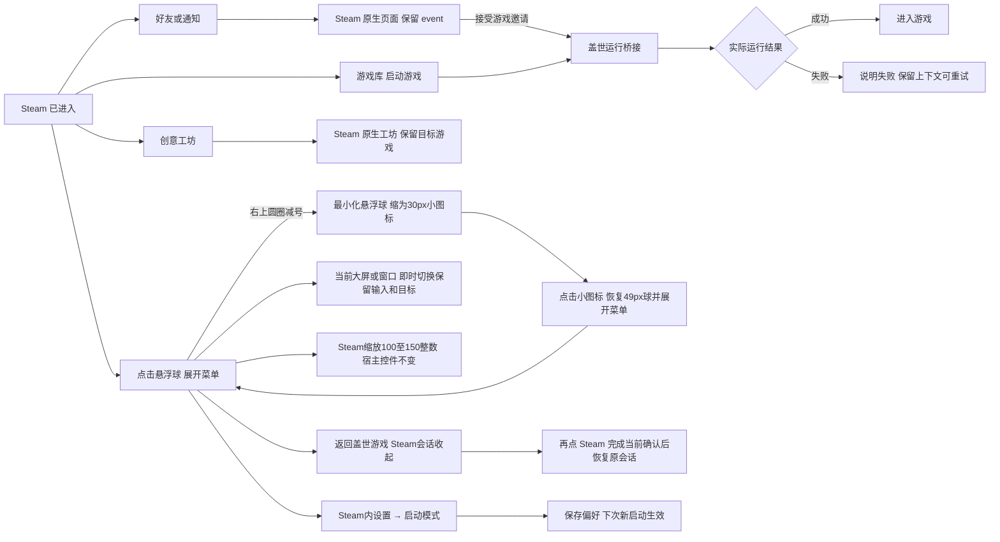

# Steam 新接入：方案与功能清单

2026-10-28 · 用户已确认的 Demo 方案 · Android 盖世游戏 APP

用户已明确回复“按推荐方案制作 Demo”。正式接入能力、免责声明定稿及真机验收仍不在此确认中。

直接查看：[交互 Demo](Steam接入Demo.html) · [已绘制的用户流程图](用户流程图.html) · [首次进入 SVG](首次进入流程.svg) · [返回与设置 SVG](返回与设置流程.svg)。

## 结论

保留盖世游戏库的 Steam 入口，替换入口后的旧 Steam 数据页。盖世负责启动落地页、首次使用准备、账号卡片、PC游戏承接与返回路径，Steam 原生界面负责库、好友聊天、商店和工坊；游戏运行仍需接回盖世引擎。本稿与 Demo 用于评审承接规则，不代表 SDK 已接通或 APK 已通过兼容性验收。

## 用户、问题与证据

- 用户：在手机、平板和 Android 掌机中通过盖世使用 Steam 游戏的玩家。
- 原有路径：盖世游戏库 → Steam 入口 → 盖世自建的 Steam 数据、成就、工坊、好友等页面；并有本机已下载和导入游戏。
- 本轮目标：进入 Steam 原生体验，同时保留首次下载可感知、启动模式可控、可返回盖世、既有游戏可找回的连续体验。
- 用户 2026-10-28 已确认：体验 APK，四项必需承接，核对聊天/工坊/账号/迁移，输出功能清单、流程图、Demo；活跃玩法仍待定。
- 输入《产品改动总结.md》标明由 AI 生成，属于会议摘要证据，不自动把其中全部事项纳入本期，也不将“确定执行”视为已实现。
- 用户截图：图 1/2 为桌面式 Steam，图 3 为大屏式详情，图 4 列出迁移、插件、手柄、账号、库打通等承接点。静态截图不证明交互或启动成功。
- APK 实测：MuMu Android 12，2026-10-28 安装成功；首屏显示 Window mode / Big Picture / Continue；随后 `Steam failed to start`，`libtier0_s.so` 加载失败；重启后仍失败。登录、库、聊天、工坊、游戏启动未能实测。证据见 experience/。
- APK 静态：com.steamdroid.client，SteamDroid 0.1(1)，minSdk 29，ARM64；有模式切换和系统悬浮球线索。静态存在不等于可用。

## /idea 收敛记录

1. 需求核对：用户已确认替换边界、四个承接点与交付物。
2. 第一性原理：玩家要能进入、能使用、能回来；不能丢账号及本机游戏，不能将下载完成误判成可启动。
3. 方案比较：A 保留入口并补最小承接（推荐）；B 旧库与新库并存（增加选择、同步及维护成本，偏离替换目标）；C 直接打开独立 APK（当前缺少盖世内返回与数据承接，无法覆盖目标）。
4. 奥卡姆剃刀：复用 Steam 好友/工坊，不新造聊天和任务中心；声明、模式、准备各承载必要动作，不夹带全局缩放、社区改版、皮肤和存档分享。
5. Reflection：用户视角要求两类模式分清、100%后明确准备阶段、悬浮球与宿主返回路径清楚；开发视角要求原生库兼容、系统球改应用内 View、模式切换以实际结果为准；商业视角要求迁移和运行桥接先验证。本方案把这些写成边界和接入门槛，不能以 Demo 覆盖未验证能力。

## 功能清单

状态含义：“本轮必需”为用户明确要求；“承接核对”为输入资料指向、需联调确认；“待定”为本次不作上线承诺。

| ID | 功能 | 页面及具体规则 | 状态 / 证据 |
|---|---|---|---|
| F01 | Steam 入口替换与账号卡片 | 保留PC/复古、三入口和我的游戏结构；未登录显示Steam，成功后显示Steam资料昵称与头像，不使用登录账号字符串。无头像用默认头像，昵称为空或资料失败显示“Steam 玩家”与默认头像，过期或切号移除旧资料；卡片点击行为不变 | 本轮必需；当前 6.3.1 实机 |
| F02 | 模式页协议确认 | 点击 Steam 不自动弹声明。首次新方案或声明版本变化时，在模式选择页底部主动勾选同意，未勾选不能继续；旧版已登录也必须完成一次。点继续才保存模式、声明版本及新流程完成记录，取消不保存本次变更；协议链接只读，返回保留本次选择。登录页不再重复勾选 | 本轮必需；正文采用免责声明.md，法律及事实表述未核验 |
| F03 | Steam 启动模式 | 整页选择大屏／窗口；无历史默认窗口，卡片下记忆开关首次关闭，与底部协议勾选区分。已完成当前确认后再次询问模式时回显协议已同意。窗口指 Steam 桌面界面，与盖世探索／掌机模式独立 | 本轮必需；默认窗口模式 |
| F04 | 记忆与设置修改 | 记忆开启并继续后保存具体模式，关闭则每次新启动询问；盖世通用设置移除Steam设置行；Steam宿主齿轮或悬浮菜单“设置”进入启动模式子页，可选每次询问/大屏/窗口，下次新启动生效。当前会话的模式和100%—150%缩放由悬浮菜单即时调整，不写回下次偏好 | 本轮必需；实际热切换保留输入/目标需联调 |
| F05 | 首次组件准备弹窗 | 游戏库上居中展示，仅保留当前状态、进度及操作，移除重复标题、启动模式、三阶段条和解释段落。实际字节进度，元信息未返回时显示获取中、不伪造总量 | 本轮必需；真实大小及分发形式待研发确认，256MB仅为演示值 |
| F06 | 持续下载与错误恢复 | 不支持暂停，没有手动或隐式暂停状态。收起仅关闭弹窗，组件下载/校验/准备继续；完成或失败不抢跳当前页，再点入口重开当前阶段/错误，已就绪则启动。网络/空间等失败保留有效内容、明确重试不建重复任务；Demo模拟App重启结束模拟任务但保留有效下载量 | 用户最新修订；真实续传/进程回收需联调 |
| F07 | 准备后的进入 | 下载100%继续校验准备；弹窗可见时就绪后启动，真实可用才进入登录/原目标。弹窗已收起则只记就绪，不自动开登录、Steam或游戏；用户再次进入才启动。失败复用有效组件重试 | 必需异常闭环；成功以实际结果为准 |
| F08 | 应用内悬浮球 | 盖世Logo常规球49px、最小化30px；两态可拖动吸边，同会话保留、新会话复位。菜单右上圆圈“−”直接收起菜单并缩成小图标，底部最小化项移除；不退出Steam。无关闭球、无开关，不依赖系统悬浮窗权限 | 本轮必需；“−”仅缩球，不关闭 |
| F09 | 收起与返回 | “返回盖世游戏”是与最小化悬浮球独立的动作，收起Steam并保留会话，再进恢复；不等于退出或注销。保留宿主返回控件/系统返回路径；没有关闭悬浮球操作 | 承接必需；跨 Activity/进程驻留与后台回收待联调 |
| F10 | 好友与消息 | 进入 Steam 原生好友/聊天；通知点击定位对应 event，准备或登录期间保留目标，完成后继续；失效事件展示不可用并允许返回 | 会议承接核对；Demo 仅示意路由，不发消息、不假造通知成功 |
| F11 | 创意工坊 | 进入对应 Steam 原生工坊；不维护两套展示；目标游戏上下文需保留，未提供 AppID 时不能假装定位成功 | 会议承接核对；Demo 示意原生落点 |
| F12 | PC游戏启动与导入承接 | 盖世库内已接入PC游戏（含已导入项）启动、既有PC导入成功结果，统一进入Steam模式；跨模式/协议/准备/登录保留游戏目标，实际运行回执才算成功。失败可明确重试，取消停止自动继续；不扩大到Epic、复古，不改变Steam权益 | 用户本轮补充；真实导入与运行桥接待联调 |
| F13 | 已下载/导入可见 | 升级后盖世我的游戏、本机已下载及导入项保持可见；Steam 拥有、已安装与本地导入是不同身份，不能混作购买权益 | 图 4；迁移与目录识别待验证，不承诺导入项自动成为 Steam 库权益 |
| F14 | 扫码、账号与迁移 | 当前原型上扫码下账号密码，仅演示认证状态与盖世承接。登录后从Steam顶部昵称打开按样图还原的账号管理，展示当前账号、扫码/密码/导入、已保存账号、选择与退出；导入弹窗显示用户名、Refresh token、显示/隐藏、加入列表与导入。列表与结果仅内存模拟，真实认证、账号保存及开发者选项以接入Steam Demo为准。旧登录态与迁移仍待核对 | 用户最新截图与边界；不保存或发送真实凭证 |
| F15 | 包版本与更新 | Steam 客户端/插件/引擎依赖需明确兼容组合；升级不能覆盖用户游戏与存档。失败保留最后有效组件或阻止启动，不破坏原数据 | 图 4；更新及回退策略待工程验证 |
| F16 | 手柄与输入 | 大屏导航、确认/返回、焦点；窗口模式输入与软键盘；蓝牙手柄问题单列实机检查，不能由键盘模拟宣称通过 | 图 4；Demo 提供键盘演示，实体手柄未测 |
| F17 | 网络可达性 | Steam 登录/商店/社区/下载分别验证可达性；失败显示所属阶段，允许重试和返回，不无限加载 | 会议承接核对；加速线路/资质/付费规则仍待定 |
| F18 | 活跃玩法 | 悬浮球可承载盖世活跃内容的方向保留；不在本版加入签到、积分、任务、奖励或广告 | 用户明确待定 |
| F19 | APP启动落地页 | 通用设置第一组下载任务之后保留“启动后进入”，移除Steam设置行；四项仅主页/社区/游戏库/Steam。新装及旧版缺字段保持未设置，冷启动竖屏主页、横屏游戏库；设置中回显当前方向默认，保存后为显式值、优先于方向。下次冷启动生效，旋转和回前台不跳转；Steam仍走统一门禁，取消留在库 | 用户最新明确；主页按最新截图，未设置不是第五选项 |
| F20 | 首次Steam库轻引导 | 首次成功进入Steam库且未处理时显示“可在设置中选择 App 启动页”，去设置直达四项弹层，知道了关闭；两操作记录已处理，去设置后取消也不再提示。旧版缺记录也覆盖；准备/登录/游戏启动中不显示，游戏目标承接延后至库 | 用户最新补充；非阻断，不自动保存偏好 |
| F21 | 当前模式与Steam缩放 | 悬浮菜单大屏/窗口即时切换，保留会话、当前页、登录输入及游戏目标，不修改下次启动偏好。缩放100%—150%整数默认100%，只影响Steam内容，宿主/菜单/球不变；会话内保留，新会话回100% | 用户最新补充；不等于盖世全局UI缩放 |

## 主流程与规则

最小化悬浮球只改变球的显示形态，不离开Steam；两种形态均可拖动吸边。当前会话往返盖世保持缩小态，新会话恢复常规球。

每次点击 Steam 先检查新方案与当前声明确认；旧版登录态或旧记忆偏好不能绕过。完成确认后，恢复会话仍需实际有效；不能只凭本地标记进入。声明更新不主动打断正在使用的页面，下次从入口进入时重新确认。

## Demo 边界

- 采用真实 DOM 实现模式与协议同页、简洁准备弹窗、扫码和账号密码登录、设置及悬浮球；可切竖屏/掌机横屏，二者独立布局。
- 外框提供可收起的悬浮演示面板，切换默认、旧版已登录、下载阶段与异常、二维码各状态、登录失败及 Steam 空库。枚举本需求的有限状态，新增启动落地、昵称头像缺省及PC游戏目标承接场景，不代表全部 Steam 能力；演示控件不属于产品功能；没有暂停演示态，收起后任务持续运行。
- Steam 桌面式/大屏式库、好友、工坊属于参考截图绘制的交互模拟，均在演示外框标识。APK实测未到登录页，本轮扫码与账号密码登录均属演示模拟，二维码不可用于真实认证；请仅输入测试内容，不保存或发送真实凭证，不发生真实下载/发消息/游戏启动。
- 声明正文采用用户提供的原文，保存于免责声明.md，不代表法律条款或事实表述已经核验。原文“使用即同意”“公布即生效”与本方案的明确同意及版本更新再确认存在差异，需法务核对；本轮交互按明确授权执行。
- Epic、复古等未接入平台不变；PC导入仅承接真实成功结果，Demo不实现真实文件导入；演示中未覆盖入口标为范围外，不伪造其实现。

## 接入前必须拿到的证据

1. ARM64 真机正常启动、两种模式切换、手机/掌机输入与返回测试。
2. Steam→盖世游戏启动/邀请桥接成功与失败回执。
3. 旧账号、下载记录、已下载文件、导入游戏的迁移前后对账；不得用清空重装验证迁移。
4. 应用内悬浮球在目标宿主进程/窗口中可见，不提供关闭及开关；宿主返回路径可用；无系统悬浮窗授权依赖。
5. 组件下载、校验、版本兼容及更新失败恢复；实际包体大小与所需空间。
6. 免责声明正式文本与分发许可、网络服务能力边界确认。

## 本次不纳入

盖世全局 UI 缩放（本期仅Steam内容100%—150%）、社区/主页布局重构、首页改社区、云存档分享、皮肤收费、加速线路商业化、活跃奖励。会议文档包含这些议题，不意味着本次全部实现。

原生账号管理与导入账号按用户样图展示并支持模拟切换和列表操作；“占位”表示未接通真实认证、凭据导入及账号保存，不再省略可见界面。开发者选项仍以接入Steam Demo为准；不在盖世通用设置另建账号管理页。
