# 【PRD】《盖世游戏》7.0首页改版需求

## 修订记录

| 修订日期 | 修订内容 | 版本 | 修订人 |
|---|---|---|---|
| 2026/11/2 | 创建首页改版评审稿；移除手柄专区，整理首页模块、优惠列表和领免订阅规则 | V1.0 评审稿 | 郑群超 |
| 2026/11/2 | 合并重复说明，简化表述，保留交互、状态和待确认项；提供Word导入版 | V1.1 评审稿 | 郑群超 |
| 2026/11/2 | 增加盖世喜加一Android桌面小组件，展示订阅平台可领数量和最近截止剩余时间 | V1.2 评审稿 | 郑群超 |
| 2026/11/3 | 首页日历增加“更多”，改造现有游戏发售日历，补充月份、日期定位和每日发售提醒 | V1.3 评审稿 | 郑群超 |
| 2026/11/5 | 按“本机开玩”更新首页、兼容频道和最新兼容，补导航、继续游玩、签到积分与后台栏目样式；横屏右上入口和合集；折扣、租号延期 | V1.4 评审稿 | 郑群超 |

**备注：** 搜2026.11.5修改；正文以V1.4为准。

## 一、文档概述

### 1.1 背景概述

用户目前主要通过导入游戏、Steam和秒玩入口游玩。用户提供的使用结构为：约六至七成导入游戏、二至三成Steam、一成秒玩。本次选定“本机开玩”方向，首页集中展示本机兼容游戏、动态、社区内容和常用入口。

### 1.2 需求边界

| 边界类型 | 范围说明 |
|---|---|
| 产品边界 | Android、iOS，国内、海外；手机横竖屏和平板。更新推荐首页、兼容游戏、发售日历、最新兼容及喜加一；保留Android桌面小组件。 |
| 业务边界 | 游戏详情、准备和启动、积分额度与任务结算、秒玩与组队沿用现有业务。Steam折扣、租号延期；不含手柄专区、大游戏卡、玩法视频、内核升级、Steam模式和社区整体改版。 |
| 运营边界 | 在现有“新版专题管理”中补充本次栏目样式，配置Banner、合集候选、社区精选、任务及栏目顺序；不新增独立后台系统。 |
| 人力边界 | 运营提供内容；客户端负责页面与系统能力；服务端提供内容、兼容记录和订阅；设计、测试核对各端表现。 |

### 1.3 术语定义

| 术语 | 说明 |
|---|---|
| 本机兼容 | 有当前设备、游戏版本及运行环境对应的兼容记录，不代表已拥有或已准备游戏。 |
| 最新兼容 | 按兼容记录更新日期展示的动态，不等于所有设备均可运行。 |

## 二、产品说明

### 2.1 产品／方案简介

| 项目 | 说明 |
|---|---|
| 目标用户 | 导入游戏、Steam及查找可玩游戏的用户。 |
| 使用场景 | 继续游戏，查询本机兼容，查看近期动态，浏览社区或领取游戏。 |
| 方案 | 首屏依次为搜索、继续游玩、频道Tab、运营资源位和金刚区；下方展示本机合集、日历、最新兼容、社区、任务，秒玩和组队后置。 |

### 2.2 产品流程

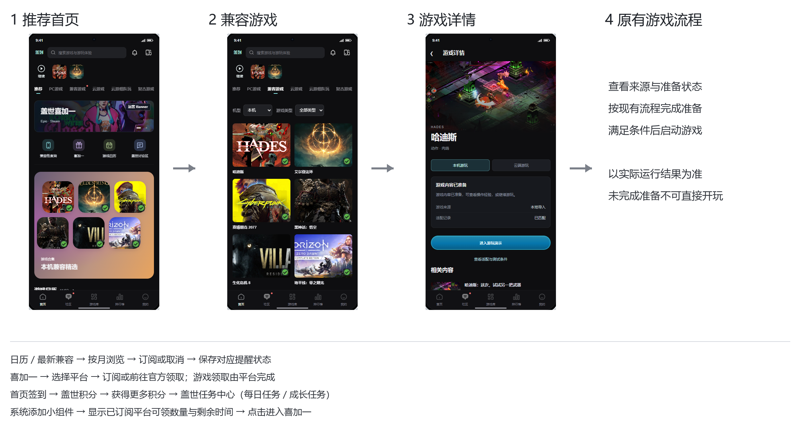

*图2.2-1：主要入口与结果；打开详情、保存订阅不代表游戏已运行或通知已送达。*

## 三、功能需求

### 3.1 App功能需求

#### 3.1.1 推荐首页

| 要素 | 内容说明 |
|---|---|
| 功能简介 | 展示本机合集、动态、社区和业务入口。 |
| 场景描述 | 用户进入首页“推荐”，或从下级页面返回。 |
| 输入／前置条件 | 读取运营配置、当前设备兼容记录、最近游玩及现有任务数据；公共内容可未登录浏览。 |
| 需求描述 | **图示：** 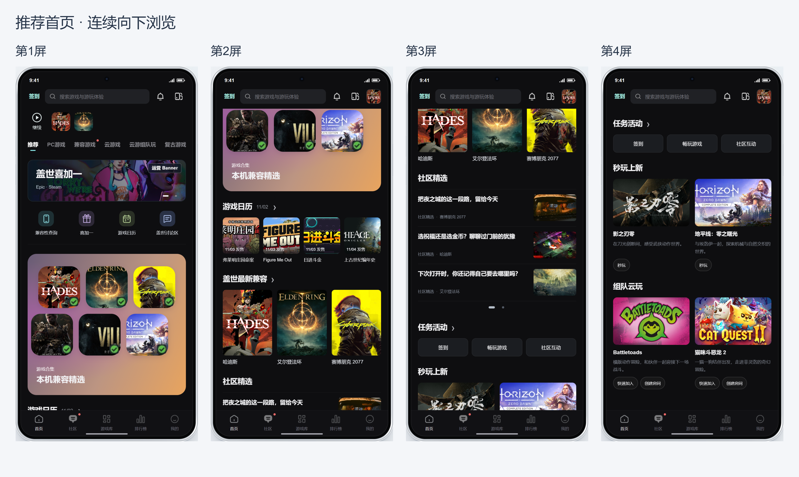 *图3.1.1-1：竖屏首页连续向下浏览的四屏总览。*  *图3.1.1-2：右上为签到、搜索与消息；Banner在左、金刚区在右。* **详细说明：** **展示说明：** 1. 首页频道依次为“推荐、PC游戏、兼容游戏、云游戏、云游组队玩、复古游戏”；兼容游戏插在PC游戏右侧。PC游戏等未改频道沿用现有内容。 2. 竖屏搜索行下方为播放按钮，按钮下方显示“继续”，右侧横向排列多个最近游戏小图标，不加游戏名或大卡片；其后依次为频道Tab、运营资源位、金刚区及内容栏目。无最近记录或没有满足原准备条件的最近游戏时整行隐藏，无有效资源位时后方内容上移。 3. 竖屏向上浏览、继续行离开原位置后，将继续入口缩至右上角；回到顶部恢复原位。收起入口仍承接最近游戏，不能遮挡搜索及消息操作。 4. 内容默认顺序为本机合集、游戏日历、盖世最新兼容、社区精选、任务活动、秒玩上新、组队云玩；运营可调整栏目顺序，无有效配置时隐藏对应栏目。 5. 有下级页的栏目在标题后紧跟箭头；游戏日历按“标题、月日、箭头”排列，不写“更多”，不将箭头右对齐。 **交互说明：** 1. 各区域按下表跳转；下级页左上用箭头返回，恢复来源及首页纵向位置、社区当前页。 2. 主导航依次为“首页、社区、游戏库、排行榜、我的”，点击进入对应页面；搜索、消息沿用现有行为。社区及有更新的相关Tab显示红点，进入对应Tab后清除。 |
| 输出／后置条件 | 进入所选内容或业务，返回后恢复首页浏览位置。 |
| 补充说明 | 读取失败不按“无配置”处理，也不清空其他有效模块；具体加载、失败文案及恢复方式见第五章。评审Demo左栏可切换无继续游戏、无资源位样式，不新增App设置。 |

| 场景 | 共同行为 | 端／地区差异 | 限制与降级 |
|---|---|---|---|
| 手机竖屏 | 内容纵向浏览 | 底部为首页、社区、游戏库、排行榜、我的；继续行在搜索后、频道Tab前 | 无最近记录时隐藏继续游玩。 |
| 手机横屏 | 各栏目占完整一行 | 顶部主导航同五项顺序；右上同栏放签到、搜索放大镜和消息，不显示完整搜索框；不显示继续行及收起图标；Banner与金刚区宽度4:1，金刚四行、左图标右名称 | 不在半屏区域内增加游戏卡横滑。 |
| 平板 | 独立适配内容宽度 | 顶部主导航同五项顺序；不显示继续行及收起图标；搜索、频道Tab、资源位及金刚区依次排列 | 不整体放大竖屏页面。 |
| iOS | 保留公共内容 | 隐藏兼容性查询金刚、顶部设备兼容信息图标、兼容游戏频道、本机合集、盖世最新兼容 | 其余内容顺序不变，不保留空位。 |
| 海外 | 安卓保留兼容能力 | 隐藏云游戏、云游组队玩及相关云服务入口；保留秒玩 | 游戏详情、游戏库、准备说明和云时长入口一并处理，不能留下无效按钮。 |

##### 页面子功能汇总

| 类型 | 图示 | 内容 | 说明 |
|---|---|---|---|
| 内容 | 图3.1.1-1、2顶部 | 运营Banner | **展示说明：** 1. 图片、顺序及目标由运营配置，轮播与正文内容独立。 **交互说明：** 1. 点击图片进入配置目标，点击指示器切换图片；自动轮播规则待确认。 |
| 入口 | 图3.1.1-1、2 | 金刚区 | **展示说明：** 1. 顺序为兼容性查询、喜加一、游戏日历、盖世讨论区；iOS移除第一项，其余顺序不变。 **交互说明：** 1. 分别进入兼容游戏频道、喜加一、发售日历、社区“盖世游戏”子分区。 |
| 内容 | 图3.1.1-1 | 本机合集 | **展示说明：** 1. 竖屏渐变卡内放两排方形游戏图标，竖屏合集名在底部；横屏为紧凑横条，左侧合集名、右侧六个图标同排，窄预览时标题上移；平板保留原布局；不加卡外标题、箭头、副标题。兼容标识位于封面右下角，不显示“官方实机”。 2. 运营配置候选游戏，最终展示须有当前设备、游戏版本和环境对应的兼容记录。 **交互说明：** 1. 点击整张合集进入兼容游戏频道，不直接启动游戏。 |
| 内容 | 图3.1.1-1 | 游戏日历、盖世最新兼容 | **展示说明：** 1. 日历为一行小卡片，显示图片、游戏名和发售日期；最新兼容为一行封面及名称。 **交互说明：** 1. 日历卡片进入对应月份的发售日历，标题箭头进入日历；最新兼容标题箭头进入兼容时间轴，游戏封面进入对应详情。 |
| 内容 | 图3.1.1-1 | 社区精选 | **展示说明：** 1. 每页三条，左文右图，整组左右翻页；内容、顺序、图片和目标均由运营配置；无标题箭头。 **交互说明：** 1. 点击条目进入对应内容；返回保留当前页。 |
| 按钮 | 图3.1.1-1 | 任务活动 | **展示说明：** 1. 配置的任务横向一行，各为独立按钮，显示任务名，不显示奖励及进度；示例为签到、畅玩游戏、社区互动。 **交互说明：** 1. 标题箭头进入盖世任务中心；签到进入签到积分页，其余按钮进入对应现有任务，不改变完成条件与结算规则。 |
| 内容 | 图3.1.1-1底部 | 秒玩上新、组队云玩 | **展示说明：** 1. 放在内容之后，保留原游戏卡与操作按钮，不加标题箭头。 **交互说明：** 1. 秒玩、快速加入及创建房间沿用现有流程。 |

#### 3.1.2 兼容游戏频道

| 要素 | 内容说明 |
|---|---|
| 功能简介 | 按设备与类型查看兼容游戏。 |
| 场景描述 | 点击首页频道、兼容性查询金刚或本机合集进入。 |
| 输入／前置条件 | 设备识别、机型及对应游戏版本和运行环境的兼容记录。 |
| 需求描述 | **图示：** 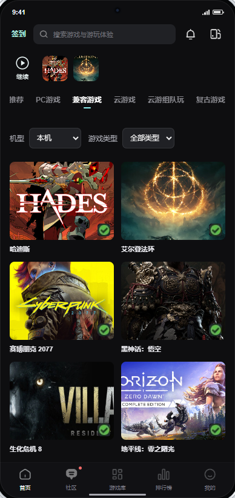 *图3.1.2-1：机型、类型筛选与游戏卡。* **详细说明：** **展示说明：** 1. 默认当前设备、全部类型；列表按所选机型与类型的交集展示。封面只显示一个游戏名称，不加平台、启动按钮或“沿用上次配置”等说明。 2. 只有对应记录支持时才显示右下角“完美兼容”标识；兼容不代表已拥有或已准备游戏。 **交互说明：** 1. 切换机型或类型后更新列表；点击游戏进入现有详情，仍需满足原准备及启动条件。 |
| 输出／后置条件 | 显示匹配结果，或进入所选游戏详情。 |
| 补充说明 | 设备未知、机型无数据和筛选无结果分别显示对应空态，保留筛选；不显示兼容标识，不承诺可玩。真实机型范围和列表加载规则待接入确认。 |

#### 3.1.3 游戏发售日历

| 要素 | 内容说明 |
|---|---|
| 功能简介 | 按月、按日查看发售安排，订阅每日发售提醒。 |
| 场景描述 | 从日历金刚、标题箭头或首页卡片进入。 |
| 输入／前置条件 | 游戏资料、发售日期、平台及有效状态；读取用户发售提醒订阅。 |
| 需求描述 | **图示：** 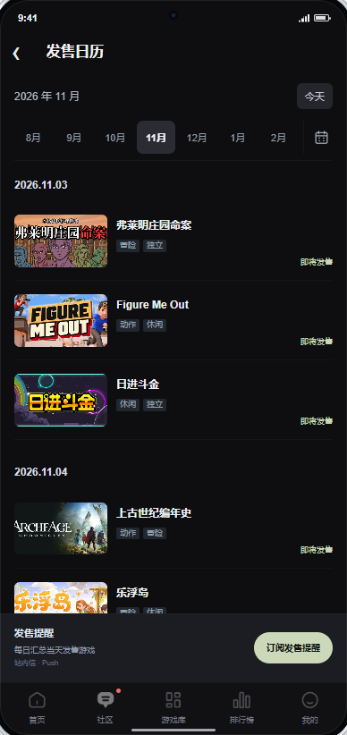 *图3.1.3-1：月份、日期分组和订阅。* **详细说明：** **展示说明：** 1. 顶部显示月份及“今天”；整月内容按日期升序分组，游戏显示封面、名称、类型与发售状态，不增加筛选。发售状态取有效来源，不能只按日期推断已发售。 2. 底部为“订阅发售提醒／已订阅”，国内外均使用站内信和Push，每日汇总当日发售内容。 **交互说明：** 1. 首次默认当前月；首页卡片进入对应月，切月更新列表，“今天”回当前月并定位今天附近记录。 2. 点击订阅或取消，保存成功才更新按钮；与领免及兼容提醒分别保存。左箭头返回首页。 |
| 输出／后置条件 | 显示所选月份的发售安排；保存当前用户的订阅状态。 |
| 补充说明 | 无记录显示“本月暂无发售游戏”；请求失败不作空月。延期、取消、时区和提醒发送时刻待确认。旧稿“查看游戏”链路在当前Demo中未实现，是否本期保留见第五章。 |

#### 3.1.4 盖世最新兼容

| 要素 | 内容说明 |
|---|---|
| 功能简介 | 按兼容更新日期查看记录，订阅新增兼容提醒。 |
| 场景描述 | Android用户点击首页“盖世最新兼容”后的箭头进入。 |
| 输入／前置条件 | 新增兼容记录、更新日期、对应游戏及用户订阅状态。 |
| 需求描述 | **图示：** 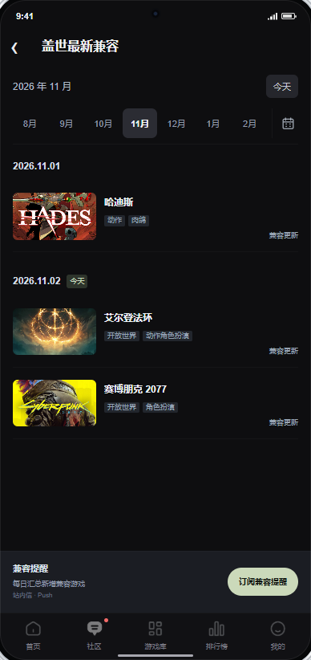 *图3.1.4-1：兼容更新的日期分组。* **详细说明：** **展示说明：** 1. 默认当前月，按兼容更新日期升序分组，显示封面、名称、类型和“兼容更新”。此日期不是游戏发售日期。 2. 底部为“订阅兼容提醒／已订阅”，站内信和Push每日汇总新增兼容游戏；不新增单款“求适配”。 **交互说明：** 1. 切月更新列表，“今天”回本月并定位；订阅或取消保存成功后更新按钮。左箭头返回首页。 |
| 输出／后置条件 | 显示当月兼容更新；保存兼容提醒状态，不改变发售、领免订阅。 |
| 补充说明 | 无记录显示“本月暂无兼容更新”；失败保留已确认内容。新增记录不等于所有设备均可玩，需查看对应机型与环境；iOS不显示本页入口。 |

#### 3.1.5 盖世喜加一

| 要素 | 内容说明 |
|---|---|
| 功能简介 | 查看Epic、Steam可领取游戏，分别订阅平台提醒。 |
| 场景描述 | 从喜加一金刚、运营Banner或系统小组件进入。 |
| 输入／前置条件 | 平台、游戏、地区资格、起止时间和官方链接；读取对应平台订阅状态。浏览不要求绑定商店账号。 |
| 需求描述 | **图示：** 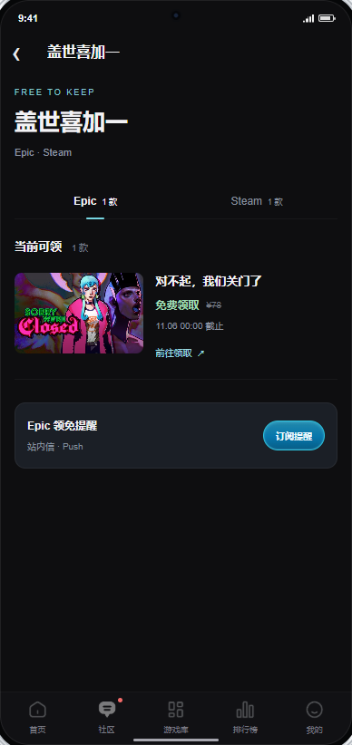 *图3.1.5-1：平台列表及提醒订阅。* **详细说明：** **展示说明：** 1. 首次默认Epic，再次进入保留本次会话平台；Tab为Epic、Steam，本期不含GOG。各平台显示当前可领数量、有效项目及已结束项目。 2. 卡片显示封面、名称、截止时间和领取状态；未知原价不补零。到期移除领取操作，显示“已结束”，不自动标“已领取”。 3. 底部为当前平台“订阅提醒／已订阅”，国内外均使用站内信和Push；不加桌面组件重复入口，首页不重复放领取列表。 **交互说明：** 1. 切平台更新列表及订阅状态；订阅或取消只作用于当前平台，保存成功后更新，失败保留原状态，结果未知先查询。 2. 点击“前往领取”再次校验有效期和地区，仍有效则打开官方页面，由用户完成登录和领取；返回保留列表位置。到期不打开领取链接，也不取消订阅。 |
| 输出／后置条件 | 显示平台内容，保存平台订阅，或打开对应官方领取页。 |
| 补充说明 | 无有效项目显示“暂无当前限免”；列表或订阅读取失败不能当成零款或未订阅。外部页面无法访问时保留列表及返回路径。商店容器与正式账号规则待确认。 |

#### 3.1.6 Android桌面小组件

| 要素 | 内容说明 |
|---|---|
| 功能简介 | 显示已订阅平台的可领数量及最近截止剩余时间。 |
| 场景描述 | 用户从Android系统小组件列表添加“盖世喜加一”，在桌面查看和点击。 |
| 输入／前置条件 | 系统支持小组件；当前账号的平台订阅、地区有效限免及截止时间。订阅不自动添加组件，添加组件不代用户订阅。 |
| 需求描述 | **图示：** 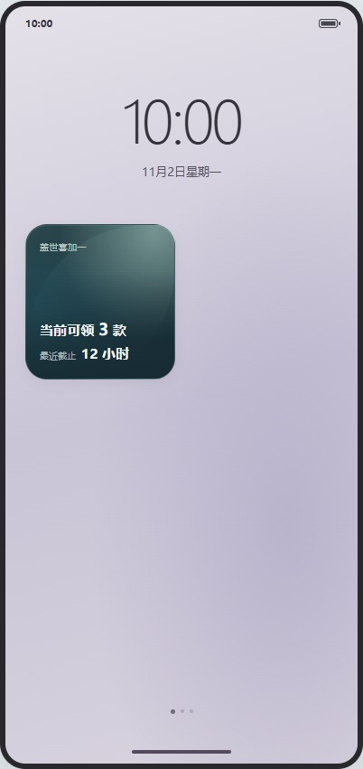 *图3.1.6-1：沿用已确认的小组件状态，未新增App内入口。* **详细说明：** **展示说明：** 1. 标题“盖世喜加一”，显示“当前可领X款”及最近一款的截止剩余时间，不显示游戏名、封面和价格。数量只包含已订阅平台且当前地区有效的项目。 2. 未订阅显示“开启领免订阅”；已订阅但无项目显示“暂无可领游戏”，不显示剩余时间。取得更新机会时剔除到期项目并重新汇总，不保留过期倒计时；不承诺系统准点刷新，不将未知数据显示为零款。 3. 剩余时间取最近截止项：不少于1小时向上取整显示小时；不足1小时、不少于1分钟向上取整显示分钟；不足1分钟显示“即将结束”；0秒即过期。 **交互说明：** 1. 点击任一状态进入喜加一，首次默认Epic、会话内保留所选平台，不自动切到最近截止平台；桌面不执行领取、订阅或取消操作。 |
| 输出／后置条件 | 系统桌面显示对应状态，或打开App喜加一。 |
| 补充说明 | 切账号重新读取，不沿用另一账号订阅；首次读取显示“正在更新”，失败显示“暂时无法更新”，不能补零；缓存有效性、刷新调度和跨平台同游戏计数待联调。iOS小组件不在本期范围。 |

#### 3.1.7 签到积分页

| 要素 | 内容说明 |
|---|---|
| 功能简介 | 签到获得盖世积分，并进入任务中心。 |
| 场景描述 | 用户点击首页签到或任务中的签到入口。 |
| 输入／前置条件 | 当前账号的签到状态、积分余额与奖励结果；登录及资格沿用现有签到规则。 |
| 需求描述 | **图示：** 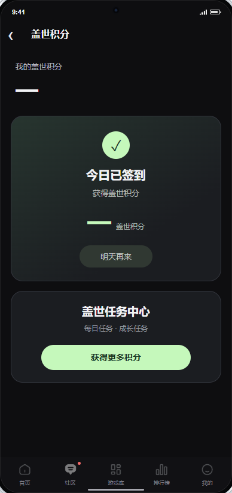 *图3.1.7-1：盖世积分与获得更多积分入口。* **详细说明：** **展示说明：** 1. 页面标题为“盖世积分”，显示积分余额、签到状态、获得积分及“获得更多积分”按钮。积分和奖励取现有业务结果，未知不补零；不增加参考图的购物任务或连签翻倍规则。 **交互说明：** 1. 点击签到后提交现有签到业务；取得成功结果后显示“今日已签到”及实际获得积分，已签到不可重复领取。 2. 点击“获得更多积分”进入独立的盖世任务中心；左箭头返回来源页。 |
| 输出／后置条件 | 签到记录和积分按实际结算结果更新，或进入任务中心。 |
| 补充说明 | 失败不改变已确认积分与签到状态；结果未知先读取签到结果再允许重试。切账号重新读取。正式积分额度、积分展示及跨日规则见第五章。 |

#### 3.1.8 盖世任务中心

| 要素 | 内容说明 |
|---|---|
| 功能简介 | 分组查看每日任务和成长任务。 |
| 场景描述 | 用户从签到页“获得更多积分”或首页任务活动进入。 |
| 输入／前置条件 | 当前账号的任务分组、名称、条件、奖励、进度及状态，复用现有任务服务。 |
| 需求描述 | **图示：** 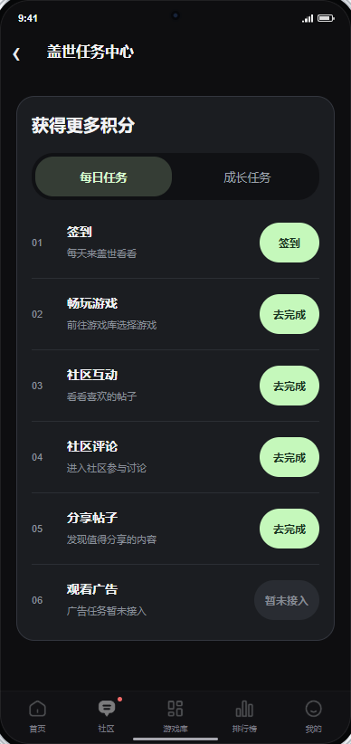 *图3.1.8-1：每日任务与成长任务。* **详细说明：** **展示说明：** 1. 标题“盖世任务中心”，仅两个Tab：“每日任务”“成长任务”；首次进入默认每日任务。任务按正式分组展示，不凭任务名称推断成长任务或奖励。 **交互说明：** 1. 切换Tab显示对应任务，任务操作进入现有业务；完成和奖励状态以任务服务结果为准。 2. 左箭头返回来源，保留首页位置；本次不新增领取方式或任务完成条件。 |
| 输出／后置条件 | 显示所选分组，或进入对应任务；完成后读取实际任务结果。 |
| 补充说明 | 无任务显示当前分组空态；读取失败不当作零任务。未知奖励不补数值，不把打开页面或点击“去完成”算作任务完成。 |

### 3.2 B端功能需求

#### 3.2.1 新版专题管理

| 要素 | 内容说明 |
|---|---|
| 功能简介 | 按现有专题范围管理首页栏目。 |
| 场景描述 | 有权限的运营进入“首页卡片管理—新版专题管理”。 |
| 输入／前置条件 | 沿用现有后台账号权限、专题及App协议、渠道、语言、屏幕方向和平台分类。 |
| 需求描述 | **图示：** 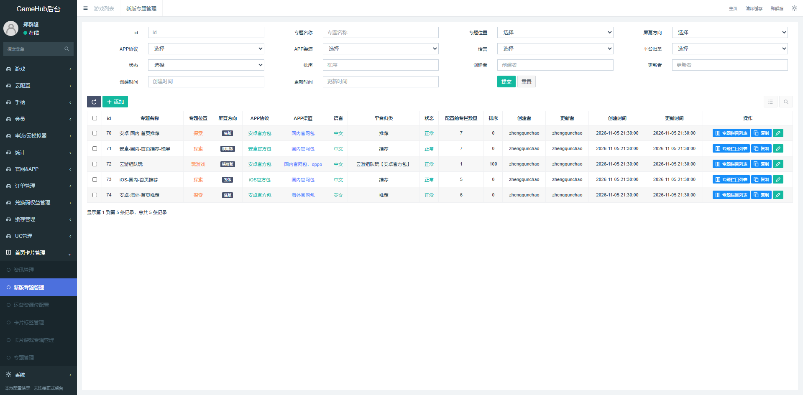 *图3.2.1-1：保留原筛选和专题列表。* **详细说明：** **展示说明：** 1. 保留专题名称、位置、屏幕方向、App协议、渠道、语言、平台分类、状态、排序、创建及更新信息和配置栏目数量。 **交互说明：** 1. 提交筛选显示匹配专题，重置恢复原默认筛选；点击“专题栏目列表”进入该专题，不改变其配置范围。新增、复制、删除等既有操作本次不改。 |
| 输出／后置条件 | 展示匹配专题，或进入所选专题的栏目列表。 |
| 补充说明 | 无结果保留筛选；失败不删除原数据。越权处理、旧字段限制、默认筛选及分页沿用现有后台，具体依据待接入核对。 |

#### 3.2.2 专题栏目列表

| 要素 | 内容说明 |
|---|---|
| 功能简介 | 查看和编辑专题中的栏目样式。 |
| 场景描述 | 运营打开某专题的栏目列表，配置首页新增栏目。 |
| 输入／前置条件 | 当前专题、栏目配置与账号编辑权限。 |
| 需求描述 | **图示：** 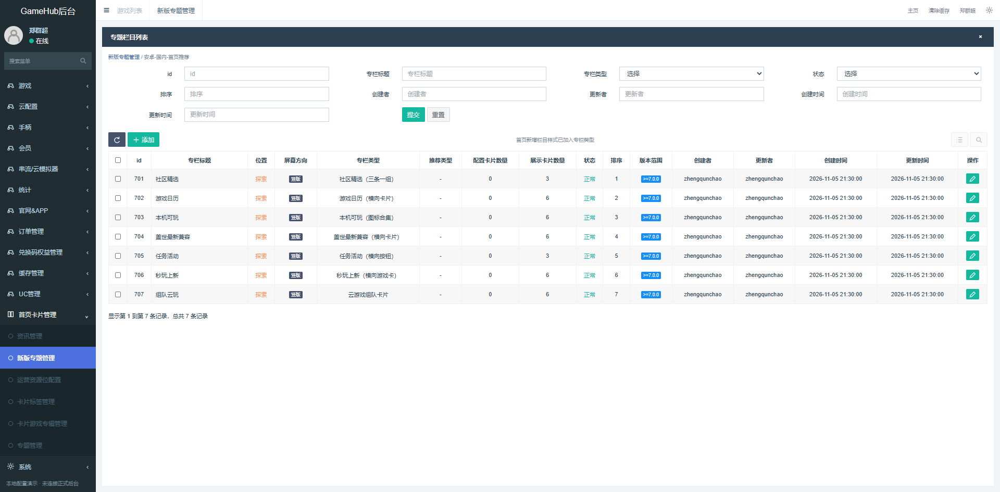 *图3.2.2-1：栏目类型、显示设置和版本范围。* **详细说明：** **展示说明：** 1. 保留标题、位置、屏幕方向、栏目类型、推荐类型、配置卡片数、展示卡片数、状态、排序、版本范围及创建更新信息。 2. 栏目类型增加本次使用的本机合集、游戏日历、最新兼容、社区精选及任务活动样式；原秒玩、云游戏组队及其他类型继续可用。 **交互说明：** 1. 点击添加或编辑打开栏目编辑；保存后返回当前专题，更新该行及栏目数量，不跨专题修改。筛选、重置和旧操作保留原行为。 |
| 输出／后置条件 | 展示当前专题配置，或进入指定栏目的编辑状态。 |
| 补充说明 | 关闭编辑不保存；列表失败保留当前专题。新样式只在支持该样式的客户端版本生效，旧客户端不展示无法识别的栏目。 |

#### 3.2.3 栏目编辑

| 要素 | 内容说明 |
|---|---|
| 功能简介 | 在原编辑窗口中选择本次新增样式并保存显示规则。 |
| 场景描述 | 运营添加或调整当前专题栏目。 |
| 输入／前置条件 | 当前专题、栏目类型及原卡片内容；有编辑权限。 |
| 需求描述 | **图示：** 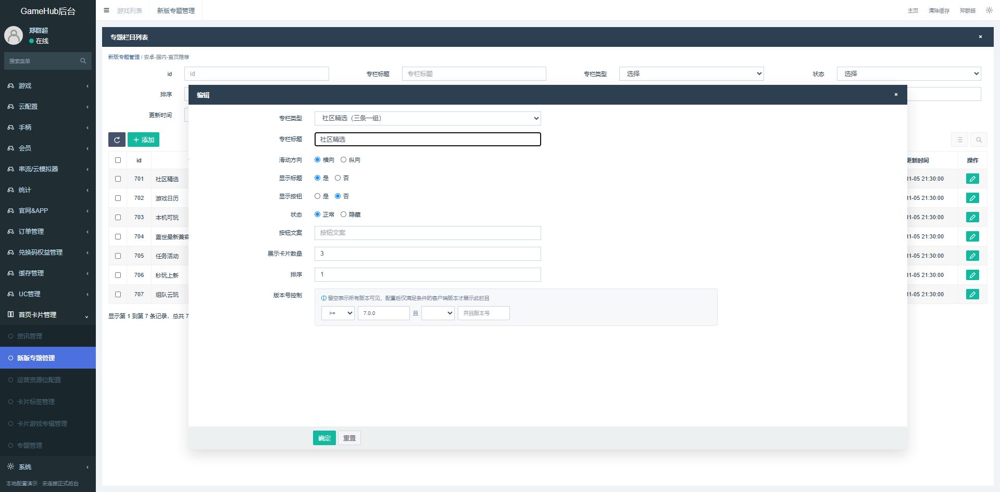 *图3.2.3-1：复用原表单，不另建配置系统。* **详细说明：** **展示说明：** 1. 保留栏目类型、栏目标题、滑动方向、显示标题、显示按钮、状态、按钮文案、展示卡片数量、排序与版本号控制。编辑时读取原值；新增默认及校验沿用现有表单。 2. 新样式在C端的固定表现为：本机合集竖屏双排图标、横屏紧凑横条，日历横向小卡、最新兼容横向封面、社区精选三条左文右图整组翻页、任务独立按钮。运营内容不覆盖系统、地区及兼容限制。 **交互说明：** 1. 点击“确定”校验并提交；取得保存成功结果才关闭窗口并更新列表，失败保留输入；关闭不保存，“重置”恢复本次打开时的值。 2. 正常且命中专题范围、客户端版本并有有效内容的栏目才可展示；隐藏或无有效内容时不占位，下方内容上移。 |
| 输出／后置条件 | 保存当前专题的栏目配置，客户端在取得生效配置后显示对应样式。 |
| 补充说明 | 标题、按钮文案长度，数量及排序范围、版本比较、素材规格与保存生效时点均需核对现有约束；不得将Demo宽松输入当作正式规则。保存超时先核实结果，避免重复新增。 |

## 四、支撑及非功能需求

### 4.1 埋点与数据需求

**数据结论：** 改造首页模块统计，增加兼容提醒结果；保留领免、发售订阅及组件点击统计。以下名称为建议，接入前对齐旧事件。

| 事件 | 页面／类型 | 触发与成功 | 参数 |
|---|---|---|---|
| home_recommend_view | 首页／改造 | 每次进入并实际显示记一次 | visit_id、user_key、region、os、app_version |
| home_module_view | 首页／改造 | 模块实际可见，每次访问每模块一次 | visit_id、user_key、region、os、app_version、module |
| home_entry_click | 首页／改造 | 每次有效点击；不作为运行成功 | visit_id、user_key、region、os、app_version、module、target_id |
| home_calendar_view | 发售、兼容日历／新增 | 页面实际显示，每次进入一次；页内切月不重复记 | visit_id、user_key、region、os、app_version、calendar_type |
| home_subscription_result | 喜加一、发售、兼容／改造 | 取得明确保存结果，同次操作只记最终结果；未知先核实 | user_key、region、os、app_version、subscription、operation、result |
| giveaway_widget_click | Android组件／复用 | 每次点击，不据此计桌面曝光或领取 | user_key、region、os、app_version |

| 参数 | 类型／必填 | 说明 | 枚举／示例 |
|---|---|---|---|
| visit_id | string／条件必填 | 首页曝光、点击必填；首页来源的日历浏览保留，其他入口可空 | 例：一次首页进入生成的访问标识。 |
| user_key | string／是 | 稳定统计身份，游客与登录分开 | 例：现有匿名或登录统计标识。 |
| region | enum／是 | 服务地区 | domestic＝国内；overseas＝海外。 |
| os | enum／是 | 客户端系统 | android＝安卓；ios＝iOS。 |
| app_version | string／是 | 客户端版本 | 例：7.0.0。 |
| module | enum／是 | 首页区域 | banner＝运营Banner；continue＝继续游玩；shortcuts＝金刚区；playable＝本机合集；calendar＝游戏日历；latest＝最新兼容；community＝社区精选；tasks＝任务活动；instant＝秒玩；team＝组队。 |
| target_id | string／否 | 游戏、文章、任务或固定入口标识 | 例：游戏唯一标识；无对象留空。 |
| calendar_type | enum／是 | 日历类型 | release＝发售；compatibility＝最新兼容。 |
| subscription | enum／是 | 独立订阅对象 | epic＝Epic领免；steam＝Steam领免；release＝发售；compatibility＝兼容。 |
| operation | enum／是 | 订阅操作 | subscribe＝订阅；unsubscribe＝取消。 |
| result | enum／是 | 服务端明确结果 | success＝保存成功；failure＝明确失败。 |

模块点击率按点击人数÷实际曝光人数计算；次日回访按当日首页用户中次日访问App的人数÷当日首页人数计算。均按用户、地区、系统、版本及统计日去重；游戏运行复用实际运行结果，不能用点击代替。曝光判定、统计时区及旧事件映射待数据确认。

### 4.2 内容与接入

| 需求项 | 具体要求 |
|---|---|
| 配置 | Banner维护图片、顺序和目标；合集维护候选及合集名；社区维护文章、图片、顺序；任务维护现有任务及排序。客户端按系统、地区和兼容记录过滤，运营配置不能覆盖能力限制。 |
| 数据 | 发售取有效日期和状态；兼容取适用机型、游戏版本及环境；领免取对应地区、资格和有效期。封面、文章和外采信息须有来源及使用权限。 |
| 订阅 | 订阅保存、Push授权、发送及送达分别判断；通知失败不撤销订阅。切账号重读，提交中不重复保存，未知结果先查询。 |
| 业务 | 本次不新增支付，不另定积分额度和任务结算规则；签到与任务使用现有积分业务。设备采集、消息设置和商店权限沿用现有授权。 |

## 五、待确认项

| 待确认问题 | 建议或条件式选项 | 未确认的影响 | 具体阻塞范围 |
|---|---|---|---|
| 数据与配置 | 确认供给来源、机型范围、列表排序／分页、轮播及加载失败恢复；后台补标题／按钮文案长度、素材规格、数量／排序范围、版本比较、权限和生效时点；发售补延期／取消 | 演示样例不能直接作为正式供给 | 数据、配置及异常接入；不阻塞已确认布局。 |
| 提醒与账号 | 确认登录、持久保存、时区、每日发送时刻、无内容是否不发、消息内容、点击目标、去重及频控 | 不能直接接通知发送 | 三类订阅、账号恢复及送达验收。 |
| 既有业务落点 | 核对日历“查看游戏”是否保留、各分组的实际任务、签到积分额度与余额展示、登录／跨日／结算结果、商店容器 | 防止占位页承担正式业务 | 日历详情跳转、任务及商店联调。 |
| 组件与统计 | 确认Android支持范围、刷新及缓存、跨平台同游戏计数；对齐旧事件、曝光判定、身份和统计时区 | 数量、状态与统计可能不一致 | 组件接入及数据验收。 |
