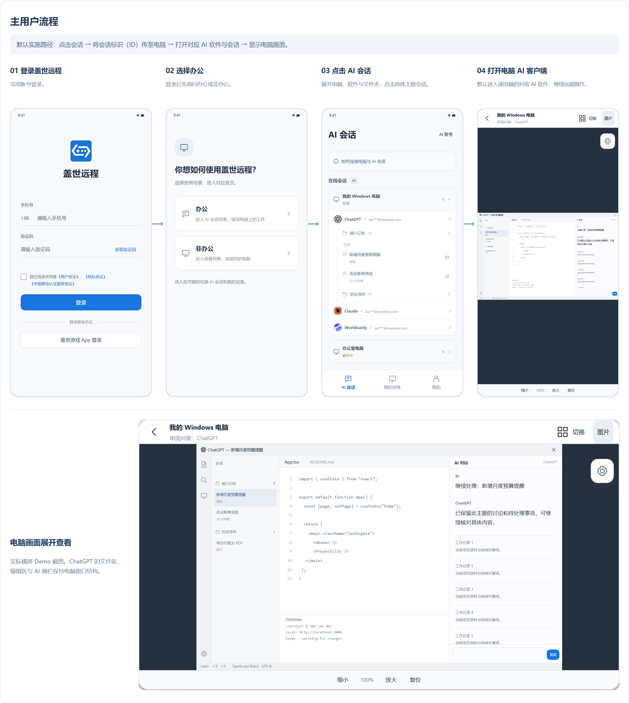
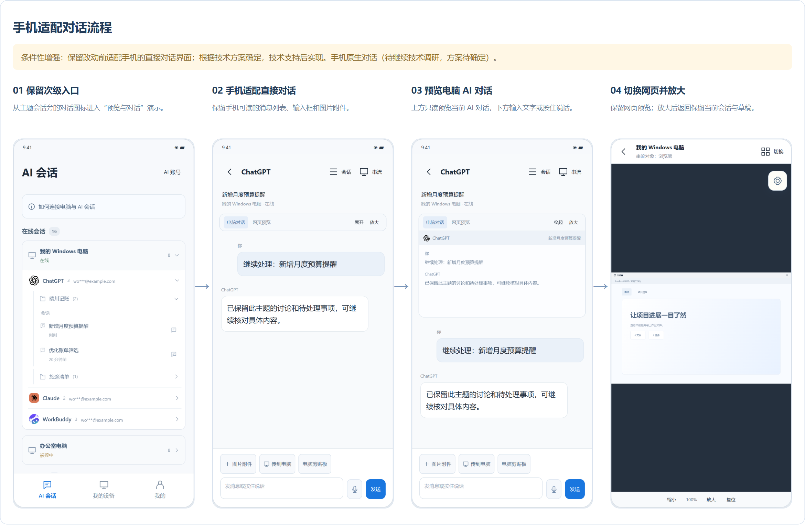
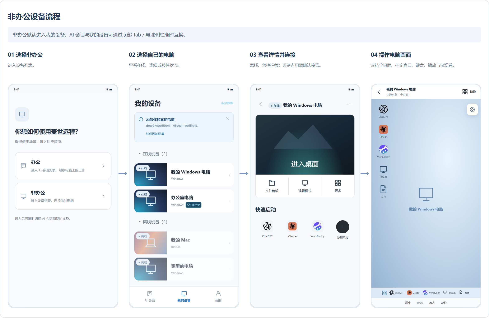
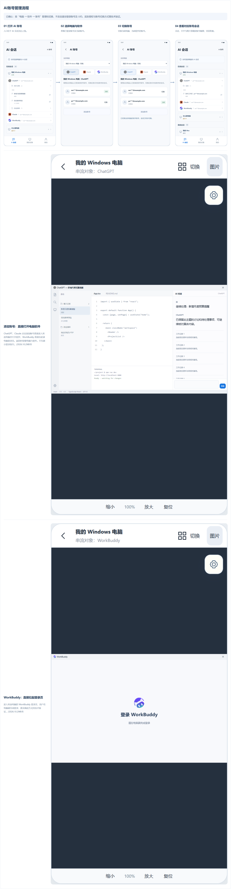
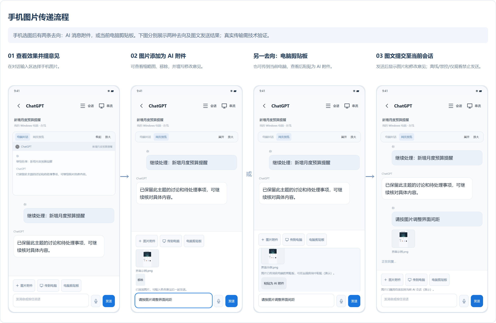
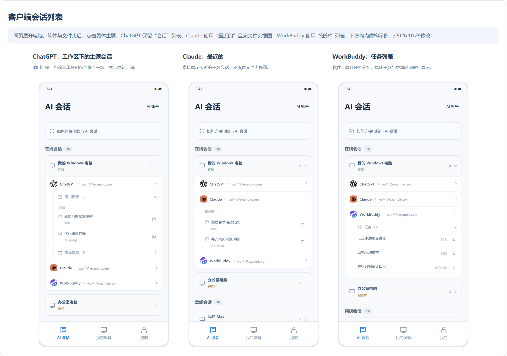
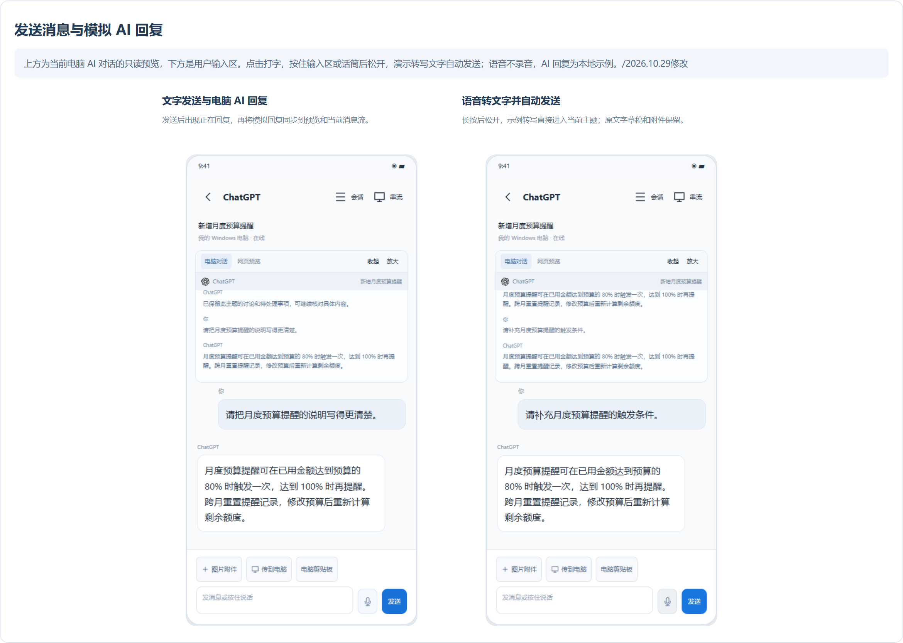

# 盖世远程方案评审稿｜功能点与界面流程

V4.17 · 2026.10.29

**默认方案：**将会话标识（ID）传至电脑，打开对应 AI 软件及会话，显示电脑画面。

**保留方案：**此前适配手机的直接对话界面予以保留，根据技术方案确定，技术支持后实现。手机原生对话（待继续技术调研，方案待确定）。

## 功能点总结

| 功能 | 方案说明 |
|---|---|
| 登录与场景分流 | 登录成功后选择“办公 / 非办公”。办公进入 AI 会话，非办公进入设备列表，之后可通过底部 Tab 或侧栏切换。 |
| AI 会话列表 | 按在线/离线分组，在电脑 → 软件 → 文件夹／工作区下展示具体主题会话；图标与名称统一为 ChatGPT，保留工作区 / 文件夹 / 会话框架；ChatGPT 按工作区展示会话，Claude 以“最近的”直接列出会话且无文件夹视图，WorkBuddy 用任务列表，主题显示更新时间；同页展开，保留连接指引和异常演示状态。/2026.10.29修改 |
| 连接指引 | 说明两端登录同一盖世账号、电脑开启远控权限，以及打开支持的 AI 客户端建立会话。无设备、无会话时也可查看。 |
| 三款客户端电脑画面 | 默认方案：将会话标识（ID）传至电脑，打开对应的 ChatGPT、Claude 或 WorkBuddy，并进入相应电脑画面；支持全桌面与指定窗口。 |
| 手机适配直接对话（条件性增强） | 上方默认只读预览电脑 AI 对话，下方发送消息，同步展示模拟 AI 回复；保留网页预览切换、按目标放大及草稿恢复。根据技术方案确定，技术支持后实现。/2026.10.29修改 |
| 文字与语音输入 | 输入框提示“发消息或按住说话”：点击打字，按住输入区或话筒，松手模拟转文字并自动发送；Enter 发送，Shift+Enter 换行。保留原文字草稿和图片附件，取消或切换上下文不发送；语音与 AI 回复均为本地演示，不启用麦克风。/2026.10.29修改 |
| 手机图片与修改意见 | 手机选图后可预览、移除，与文字一起发送到 AI 附件；也可传到当前电脑的剪贴板，再在远端使用。串流页顶部提供图片入口。 |
| AI 账号管理 | 按电脑和软件管理已登录账号；切换账号后显示对应会话。ChatGPT、Claude 添加账号直接打开所选电脑对应软件登录；WorkBuddy 直接拉起该电脑登录页；离线、禁控或占用时阻止跳转。/2026.10.29修改 |
| 触屏交互优化（重点攻坚） | 重点优化串流中的网页翻页、浏览器和长会话滚动，以及滚动条操作。针对双指滚动、上下滑动容易误触点击或拖动等问题，提升键鼠 / 触屏连续操作的流畅度，作为用户可直接感知的体验优化重点；效果需通过真机串流验证。 |
| 鼠标 / 触控模式选型 | 参考盖世 InGame 侧边栏已有的点对点映射、触屏、拖动等操作模式及窗口自由缩放能力，在网页浏览、会话滚动、点击、拖动和缩放场景下对比验证，选定一种最适合本期的默认操作方式进行替换和打磨。当前待评估选型，不全部照搬。 |
| 通用远控与异常 | 设备列表连接电脑；保留桌面 / 单窗口、缩放、键盘、仅观看等操作。离线或禁控不允许连接，设备占用需确认接管。 |
| Demo 评审状态 | 页面外侧提供缺省态、穷举态、无会话、加载、失败、离线、禁控、忙碌；手机另有预览与对话、预览关闭状态。 |

## 实际界面流程图

### 主用户流程

### 手机适配对话流程

### 非办公设备流程

### AI账号管理流程

### 手机图片传递流程

### 客户端会话列表

### 发送消息与模拟 AI 回复

截图来自当前 Demo，使用演示数据；真实服务接入与技术方案仍需验证。
