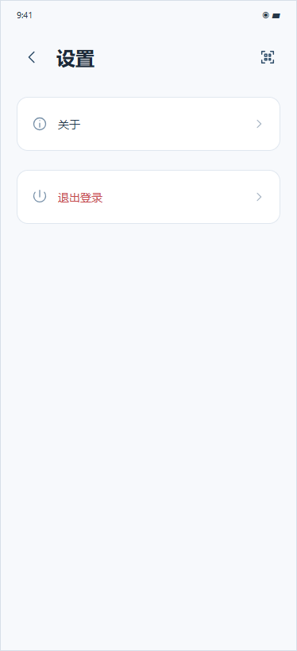
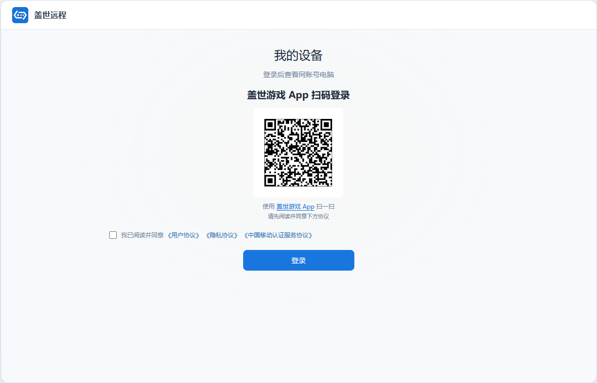
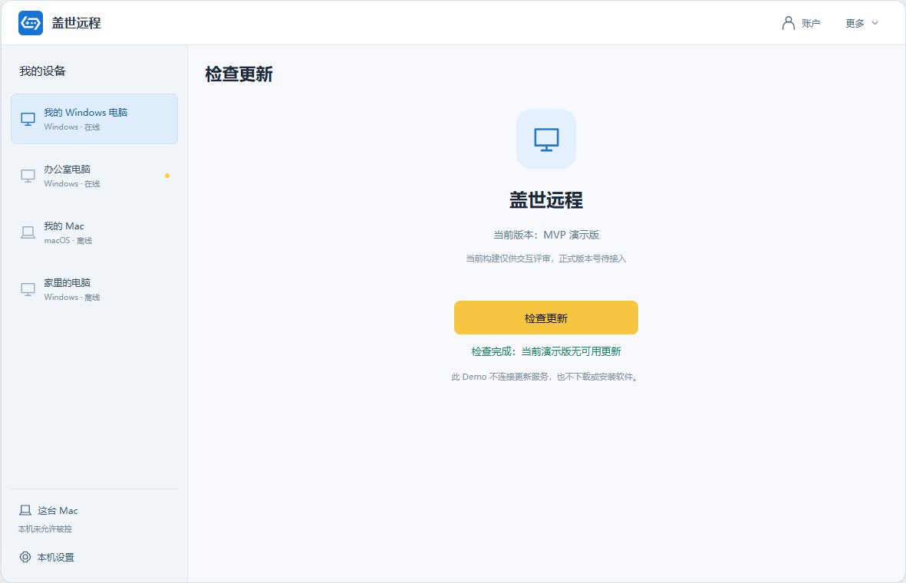

# 【PRD】盖世远程独立客户端与移动 App

> **飞书导入说明（2026.10.26）**：本 Markdown 中的 `assets/` 图片引用用于本地阅读版。导入飞书请使用同目录的《独立远程电脑PRD-飞书导入版.docx》，图片已直接内嵌；直接导入本 Markdown 时，飞书不会自动携带本地图片文件。

## 修订记录

| 修订日期 | 修订内容 | 版本 | 修订人 |
|---|---|---|---|
| 2026/10/24 | 远程电脑独立为移动 App 和电脑客户端，参照 UU 远程重做独立入口、登录和设备流程；保留既有远控交互 | V4.0-Draft | 产品 |
| 2026/10/26 | 收敛 MVP；按国内/海外区分登录方式，补协议同意、精简登录品牌区和电脑端首次使用引导 | V4.1-Draft | 产品 |
| 2026/10/26 | 按端和页面重排六要素表，集中展示、交互、成功与异常；同步支撑要求与阅读版 | V4.2-Draft | 产品 |
| 2026/10/26 | 移动端保留我的设备/我的两Tab，账号、扫一扫、帮助、检查更新和设置移至我的；关于仅条款清单，补Mac更多，默认浅色且无风格入口，移除横竖屏切换 | V4.3-Draft | 产品 |
| 2026/10/26 | 电脑未登录首页及登录页展示二维码和盖世游戏官网下载入口；未登录隐藏账户/更多，登录与退出同步显示状态 | V4.4-Draft | 产品 |

备注：搜2026.10.26修改（两Tab、我的、扫一扫、浅色模式、未登录二维码及账户入口）。本稿替代 V3.10 中的游戏库入口、盖世 Mac 侧栏、默认沿用盖世登录态及首次安装引导。工作名为“盖世远程”。本期为 MVP，保留现有 Demo 远控能力，补登录、登录协议、电脑端新手引导、我的/设置与帮助入口。国内手机号验证码、海外邮箱验证码/Google、电脑端扫码已确认；移动端保留盖世游戏 App 拉起登录，并在我的Tab提供扫一扫，用于扫描电脑端登录码，不展示供本机扫描的二维码。配图为本地 Demo，不代表登录服务或远控引擎已经接通。

## 一、文档概述

### 1.1 背景概述

用户希望通过手机或另一台电脑继续使用自己电脑上的游戏、文件和软件。当前方式是使用第三方远控，或先进入盖世游戏的游戏库或 Mac 侧栏，账号和入口依附于盖世游戏。本次将远程电脑独立成一套产品，用户打开独立 App 或电脑客户端，使用盖世账号登录后查看自己的电脑，再主动发起连接。流程参照已留存的 UU 远程实机资料；远控操作沿用已评审版本，不因独立化额外引入远程协助、陌生设备连接或会员规则。

### 1.2 需求边界

| 边界类型 | 范围说明 |
|---|---|
| 产品边界 | 独立移动 App 的竖屏界面、独立电脑客户端；本轮移除横竖屏切换入口，不扩展横屏工作区。电脑 Demo 使用 Mac 视觉和已有模块；Windows 的发版时间不由 Demo 推定。 |
| 业务边界 | 现有 Demo 的同账号电脑列表、详情、本机被控设置、连接与退出，以及既有观看、输入、文件、电源、快捷启动；本轮补登录、协议同意、电脑端首次使用引导、移动端我的/设置及双端帮助、版本和关于入口。两端统一浅色模式，不提供黑夜模式。国内手机号验证码+盖世授权，海外邮箱验证码+Google+盖世授权；移动端拉起盖世游戏 App 或从我的Tab扫一扫，电脑端展示登录二维码。连接范围仍沿用一期局域网。 |
| 排除范围 | 手机被控、远程协助、设备码连接、会员计费、Steam/Epic 会话继承、真实串流引擎及 GPT 接入；盖世游戏原游戏库和商店不随本产品展示。 |
| 运营边界 | 无新增运营后台、商业化或地区切换设置。地区由对应发行版本/账号配置确定；Demo 的地区切换仅位于评审工具。盖世游戏 App 下载链接使用对应地区官网；独立盖世远程的正式品牌素材、下载指向与协议主体需接入。 |
| 人力边界 | 产品与设计确认页面和规则；移动/电脑客户端承接登录、设备与远控交互，账号服务提供盖世身份、独立会话与授权，设备/远控服务处理设备状态与会话；测试按端和地区核对，数据核对事件及历史映射。无新增运营后台。 |

### 1.3 术语定义

| 术语 | 说明 |
|---|---|
| 盖世账号 | 复用盖世游戏的用户身份，以服务端返回的同一 UID 识别用户；独立产品不另建一套同手机号账号。 |
| 登录 | 当前独立客户端取得有效的盖世账号会话。拉起盖世 App、扫码识别或手机确认本身均不等于该客户端登录完成。 |
| 允许被控 | 用户在电脑客户端开启被控能力，并满足系统权限。与账号登录、主控端连接及远端系统锁屏解锁分别判断。 |
| 同账号电脑 | 已在独立电脑客户端登录当前盖世账号的电脑；是否在线、是否允许被控分别展示。登录手机 App 不会把手机列为被控电脑。 |

## 二、产品说明

### 2.1 产品／方案简介

| 项目 | 说明 |
|---|---|
| 产品／方案定位 | 独立移动 App 与电脑客户端，复用盖世账号，访问自己的电脑。 |
| 目标用户 | 希望在手机或另一台电脑继续使用个人电脑的用户。 |
| 核心目标 | 两端登录同一盖世身份后，找到有权限的电脑，主动连接并使用，退出后远端程序继续运行。 |
| 使用场景 | 手机或另一台电脑作为主控；一期仍限局域网，目标电脑完成独立客户端登录及被控权限。 |
| 功能概述 | 地区登录和授权衔接同账号设备、详情及远控；移动端底部为我的设备/我的，扫一扫、帮助中心、检查更新和设置集中在我的；电脑更多下拉承接设置和帮助。双端采用浅色模式，远控沿用当前 Demo 的输入、观看、文件、电源与快捷启动。 |

### 2.2 产品流程

*图2-1：①电脑端完成或跳过首次引导；②两端同意协议并登录同一盖世账号；③电脑端配置允许被控与系统权限；④另一端选择电脑；⑤检查状态并发起连接；⑥首帧可显示且会话可用；⑦退出后回原设备详情，远端程序继续运行。移动端拉起盖世 App、电脑端扫码领取会话均在登录阶段完成，不自动建立远控。*

## 三、功能需求

### 3.1 移动端功能需求

#### 3.1.1 登录页

| 要素 | 内容说明 |
|---|---|
| 功能简介 | 手机号/邮箱验证码及第三方授权入口。 |
| 场景描述 | 无有效会话时打开独立 App，或退出账号后重新登录。 |
| 输入／前置条件 | 独立移动 App；地区来自发行版本/账号配置。仅 Demo 外部工具可切地区。 |
| 需求描述 | **图示：**  <em>图3-1 国内登录</em>  <em>图3-2 海外登录</em> **详细说明：** **展示说明：** 1. 顶部只显示盖世游戏 Logo 和“盖世远程”，删除电脑插画、宣传标题/副文案，不显示原游戏、社区、游戏库底部栏。 2. 国内显示+86手机号、验证码、“获取验证码”“登录”“盖世游戏 App 登录”；海外显示邮箱、邮箱验证码、“获取验证码”“登录”“Google 登录”“盖世游戏 App 登录”。不显示微信、QQ和账号密码，移动端不显示供本机扫描的二维码。 3. 协议默认未勾选；国内显示“我已阅读并同意《用户协议》《隐私协议》《中国移动认证服务协议》”，海外只显示用户协议和隐私协议。 **交互说明：** 1. 先校验协议，再获取验证码/提交登录/发起 Google 或盖世 App 授权；未同意时就地提示，不发送或授权。 2. Demo 国内手机号最多11位数字并按11位国内手机号校验；海外邮箱最多254字符，去首尾空格后校验邮箱格式；验证码最多6位数字。空值或格式错误不发送、不提交；未发送、错误或失效验证码不能登录。 3. 点击“登录”，核实本次验证码及有效会话后获取当前盖世 UID 的设备；点击 App/Google 入口进入本次授权。 4. 点击协议标题只阅读对应内容，不自动勾选；关闭阅读返回时保留原输入和勾选值。 |
| 输出／后置条件 | 取得本独立 App 的有效盖世会话，首次进入“我的设备”；有仍有效的登录前目标则返回目标，目标失效回列表，不自动连接。 |
| 补充说明 | 1. 已有有效会话时直接进入设备列表，不重复授权。 2. 撤销同意作废验证码及未完成授权；重新勾选需重新获取验证码/发起授权。切换评审地区清空输入并恢复未勾选，旧结果不得登录。 3. Demo 样例码123456，不发送短信或邮件。254字符等为演示限制，正式国家码、长度、邮箱大小写、注册判断、发送间隔和有效期需与盖世账号组件核对。 4. 协议正文未接入时仅显示待接入预览，不编造条款；正式主体/版本/链接及中国移动适用认证方式见第五章。 |

#### 3.1.2 盖世 App／Google 授权页

| 要素 | 内容说明 |
|---|---|
| 功能简介 | 确认当前账号并返回独立 App。 |
| 场景描述 | 从移动登录页点击本地区可用的授权方式。 |
| 输入／前置条件 | 已主动同意本地区登录协议；Google 仅海外；盖世 App 授权需能拉起已安装 App。 |
| 需求描述 | **图示：**  <em>图3-3 盖世授权确认模拟</em> **详细说明：** **展示说明：** 1. 盖世侧显示当前使用账号及确认/取消；未登录先显示盖世自身登录。Google 使用该渠道原授权页，本产品不收集 Google 密码。图示为盖世侧模拟，不代替真实 Google 页面。 **交互说明：** 1. 盖世 App 已登录时确认本次授权；未登录/失效时先完成盖世原登录，再继续仍有效授权。 2. 确认后回到发起端，核对本次授权和独立会话，再取当前 UID 设备；不复制盖世 App 令牌，不要求绑定 Steam/Epic。 3. 点击取消或拒绝，返回独立登录页，可重新选择本地区方式。 |
| 输出／后置条件 | 本次授权有效且独立 App 已取得盖世会话，返回登录前有效目标或设备列表。 |
| 补充说明 | 1. 打开外部 App、外部登录完成或模拟确认按钮均不代表独立 App 正式登录成功。 2. 未安装/无法拉起时留在登录页；国内可用手机号，海外可用邮箱/Google，不跳虚构下载地址。 3. 网络失败、超时或未知结果就地显示未完成，不取设备；重试使用新授权。取消、撤勾、切地区和退出后的晚到回调不能恢复登录。 |

#### 3.1.3 我的设备与连接教程

| 要素 | 内容说明 |
|---|---|
| 功能简介 | 查看同账号电脑，了解添加电脑步骤。 |
| 场景描述 | 移动端登录后默认进入，或点击底部我的设备Tab返回。 |
| 输入／前置条件 | 当前独立App盖世会话有效；数据来自同UID设备服务。 |
| 需求描述 | **图示：**  <em>图3-4：我的设备；顶部仅保留连接教程，底部为我的设备/我的。</em> **详细说明：** **展示说明：** 1. 页面采用浅色模式；标题为“我的设备”，右上只显示“连接教程”，不放设置、账户或扫一扫按钮。底部固定两个Tab：“我的设备”“我的”，当前选中我的设备；登录和远控页不显示这组根导航。 2. 列表取当前盖世UID下支持被控的电脑，按已有在线/离线分组显示名称、系统和状态；不把手机列为被控电脑。加载、确定空态和失败状态分开，不显示旧账号缓存。 3. 添加其他电脑提示显示安装独立客户端和登录同账号说明，右上有关闭按钮；长设备名在卡片省略，属性可查看原文，不截断存储。 **交互说明：** 1. 点击电脑卡片进入对应详情，不自动连接；点击我的Tab打开我的页，切Tab不退出账号，不建立或恢复旧远控。 2. 点击连接教程，说明目标电脑安装独立客户端、登录同账号、开启允许被控及系统权限；关闭回原页。点击提示卡关闭按钮，只隐藏本次演示中的提示卡，不删除设备；教程入口仍保留。 3. 失败时点击重试，以当前UID返回结果更新；账号过期停止受限操作并回登录。 |
| 输出／后置条件 | 显示当前账号设备或确定的空列表；选中电脑进入其详情，切换我的后显示当前账号资料。 |
| 补充说明 | 1. 移除横竖屏切换按钮和横屏设备工作区入口；竖屏浏览不改变设备与会话归属。 2. 正式排序、同值顺序、列表规模、分页与刷新周期沿用设备服务实际能力；旧设备迁移仍待接入。提示卡关闭记录是否跨启动保存需正式客户端核对，当前Demo不作持久化承诺。 |

#### 3.1.4 设备详情

| 要素 | 内容说明 |
|---|---|
| 功能简介 | 查看目标状态，发起控制、观看和工具。 |
| 场景描述 | 在移动列表选择一台电脑，或远控退出返回。 |
| 输入／前置条件 | 当前会话有效，目标属于当前 UID；允许控制与系统权限独立判断。 |
| 需求描述 | **图示：**  <em>图3-6 设备详情</em> **详细说明：** **展示说明：** 1. 在线、允许被控且无占用时，显示进入桌面、文件传输、观看模式和更多；进入详情不建立连接。 2. 在线但被其他主控占用时显示正在被控，沿用接管确认；禁控/缺权限显示“请在该设备的『设置』中开启允许远程控制。”，需要控制权限的入口不可用。 3. 离线显示“设备已离线”，在线操作不可用；Windows 可按原规则尝试开机，Mac 开机不可用。 **交互说明：** 1. 点击进入桌面或观看，核对实时在线、权限、同一局域网及占用；符合后显示连接中，避免重复发起。首帧可显示且会话可用才算连接成功。 2. 占用时确认接管才发起；取消不影响原会话。连接中取消回详情，失败/超时留在原流程，可检查设备后重试。非同一局域网阻止连接，教程可查看条件。 3. 设备菜单保留属性、刷新、重命名、删除。重命名最多40个汉字、空值不提交、超限不能保存；取消不改，服务成功后更新。删除二次确认，取消不删；成功退出该详情并更新列表，不删除磁盘文件。 |
| 输出／后置条件 | 连接成功进入目标控制/观看会话；管理操作成功后更新该设备或列表。 |
| 补充说明 | 1. 手机不能替代目标电脑系统授权；刷新后按实时状态重判。 2. 连接失败、取消、离线、权限不足不显示成功桌面。删除的设备关系语义及旧关系迁移见第五章。 |

##### 页面子功能汇总

| 类型 | 图示 | 内容 | 说明 |
|---|---|---|---|
| 工具 | 设备详情上下文见图3-6 | 电源：Windows远程开机、重启、关机。 | **展示说明：** 1. 显示当前系统支持的电源入口，不支持项不可用。 **交互说明：** 1. 按已有确认流程发起；受理与完成分开，超时显示结果未知，不推断未执行；重新获取在线状态后才允许连接，关机/重启导致断开不画成普通网络重试。 |
| 快捷启动 | 设备详情上下文见图3-6 | ChatGPT、盖世游戏、Steam及添加应用。 | **展示说明：** 1. 按设备隔离应用列表，手机一排四项、超出换行；游戏保留既有虚拟按键开关/布局；本轮不提供横竖屏切换；仅观看时隐藏可操作虚拟按键。 **交互说明：** 1. 点击盖世游戏启动远端盖世客户端；Steam直接打开远端Steam，未登录由用户在原生页面登录，本产品不代登或收集凭证。只有可信远端结果才算启动成功。 |
| 工具工作区 | 设备详情上下文见图3-6 | ChatGPT历史、附件、发送/停止及桌面切换。 | **展示说明：** 1. 沿用当前移动工作区，不新增模型、收费或生产授权。 **交互说明：** 1. 保持已有历史/附件/发送/停止交互，退出账号清账号缓存；真实GPT接入仍在本期范围外。 |

#### 3.1.5 远程桌面与操作面板

| 要素 | 内容说明 |
|---|---|
| 功能简介 | 控制/观看电脑画面及输入。 |
| 场景描述 | 移动端连接目标成功后进入。 |
| 输入／前置条件 | 首帧可显示且会话可用；输入须为控制模式，目标权限仍有效。 |
| 需求描述 | **图示：**  <em>图3-7 移动远控</em> **详细说明：** **展示说明：** 1. 画面按原比例；竖屏16:9居中、上下留黑，不拉伸。本轮不显示横竖屏切换入口。 2. 操作、显示、键盘、更多使用当前面板；悬浮鼠标默认收起，可点击展开及长按空白/握柄拖动。 **交互说明：** 1. 展开/收起/切面板不结束会话；操作面板内切开关或虚拟方案保留滚动位置，其余面板从顶部显示。 2. 悬浮鼠标限位到可见范围，可到右侧和底部黑区，拖动不扩大画面或触发点击；收起面板不重新连接。 3. 仅观看阻止键鼠、文本、窗口、虚拟按键和显示设置等写操作，保留退出、声音及恢复操作；恢复后才能输入，普通重连不继承上次仅观看。 4. 退出直接结束连接并返回原详情，无新增确认，远端程序继续运行；显示/声音/窗口/桌面切换以远端确认结果为准。 |
| 输出／后置条件 | 控制模式可向当前目标输入；观看模式只观看；主动退出后结束本端连接并返回原设备详情。 |
| 补充说明 | 1. 被接管、断网、离线或权限撤销，立即停止输入、释放按键并显示结束/需重连；恢复网络不重放断开输入。 2. 远端不支持或设置失败保留原有效值，不以按钮选中代替成功；多物理屏能力需实测。 |

##### 页面子功能汇总

| 类型 | 图示 | 内容 | 说明 |
|---|---|---|---|
| 输入面板 |  <em>图3-8 双页电脑键盘</em> | “输入法”“电脑键盘”两Tab及组合模式。 | **展示说明：** 1. 输入法用真实输入框唤起手机系统键盘；电脑键盘第一页数字/字母/常用键，第二页Esc/Tab/F1–F12/导航/方向。修饰键按目标系统显示Ctrl/Alt/Win或Control/Option/⌘，组合模式与四修饰键同排。 **交互说明：** 1. 左右滑动或点分页换页，保留组合模式和修饰键选择；中文候选确认后提交，组合中不重复发送，回车换行不代替远端发送。组合默认关；开启后选修饰键再点目标键，发送一次释放选择、模式保持开；关闭模式/键盘、失焦/退出释放选择，仅观看禁输入。输入长度和长文本发送沿用V3.10对应规则，本轮不新增上限。 |

#### 3.1.6 文件传输页

| 要素 | 内容说明 |
|---|---|
| 功能简介 | 选择目录和手机文件，管理传输任务。 |
| 场景描述 | 从移动设备详情、更多或会话进入。 |
| 输入／前置条件 | 当前会话及目标文件权限有效；沿用当前Demo文件能力。 |
| 需求描述 | **图示：**  <em>图3-9 移动文件传输</em> **详细说明：** **展示说明：** 1. 显示远端目录、手机文件选择与当前任务状态/目标路径；样例不发送真实文件。 **交互说明：** 1. 选择文件按原授权和选择规则发起；接收端确认后才显示完成。 2. 暂停、继续、取消、失败重试和同名处理沿用V3.10；返回回原来源，清完结记录不删磁盘文件。 |
| 输出／后置条件 | 接收端确认的任务显示完成，其余保留实际任务状态与目标路径。 |
| 补充说明 | 1. 断网不标完成；选择数量、目录授权、文件限制与同名规则沿用原能力，不新增格式/大小/数量上限。 2. 退出账号终止本端任务并隔离账号缓存，真实传输中断与缓存规则接入见第五章。 |

#### 3.1.7 我的

| 要素 | 内容说明 |
|---|---|
| 功能简介 | 查看个人账号，进入扫一扫和设置。 |
| 场景描述 | 移动端已登录，点击底部我的Tab。 |
| 输入／前置条件 | 当前独立App盖世会话有效；头像、昵称和账号由当前盖世身份提供。 |
| 需求描述 | **图示：**  <em>图3-10：我的；头像账号、右上扫一扫，以及帮助中心、检查更新、设置。</em> **详细说明：** **展示说明：** 1. 页面标题为“我的”，右上显示扫一扫；个人账号卡显示头像按钮、昵称和脱敏账号；卡片下方依次显示帮助中心、检查更新、设置，检查更新行显示“当前版本：MVP 演示版”。底部仍保留我的设备/我的两个Tab，当前选中我的。 2. Demo使用演示头像和昵称；账号随当前登录身份变化，不把样例头像或“盖世玩家”当作正式账号资料。 **交互说明：** 1. 点击头像按钮或个人账号卡，显示当前个人账号和头像按钮；关闭后回我的页。本期不增加头像上传、昵称编辑或绑定渠道。 2. 点击扫一扫打开扫码登录页；点击帮助中心、检查更新、设置，分别打开对应页；点击我的设备Tab返回设备列表，不自动连接电脑。 |
| 输出／后置条件 | 显示当前账号资料，或进入所选扫一扫、帮助中心、检查更新、设置和设备列表页面。 |
| 补充说明 | 1. 账号失效后回登录，不能继续扫码确认；退出或切账号后不显示上一账号资料。 |

#### 3.1.8 设置

| 要素 | 内容说明 |
|---|---|
| 功能简介 | 进入关于，并退出当前账号。 |
| 场景描述 | 从我的页点击设置。 |
| 输入／前置条件 | 当前独立App已登录。 |
| 需求描述 | **图示：**  <em>图3-21：移动端设置；关于与退出登录。</em> **详细说明：** **展示说明：** 1. 页面标题为“设置”，左上返回我的，右上可进入扫一扫。列表仅显示关于、退出登录；帮助中心和检查更新入口位于我的页，不在设置列表重复。 2. 页面默认浅色，不显示风格、浅色模式或黑夜模式入口。 **交互说明：** 1. 点击关于打开条款与信息清单页；返回我的不修改账号或设备。点击扫一扫进入扫码登录页，关闭扫码返回设置。 2. 点击退出登录，结束本端会话和未完成扫码确认，清理设备、选中目标、临时授权及账号相关缓存，回独立登录页；再次登录按UID重新取设备，不恢复旧连接，不退出盖世游戏App和其他电脑。 |
| 输出／后置条件 | 进入所选支持页面；退出完成后显示独立登录页。 |
| 补充说明 | 1. Demo只模拟会话及任务清理；真实会话撤销和传输中断仍须接入，页面清空不代表服务端解绑，也不删除用户磁盘文件。 |

#### 3.1.9 帮助中心

| 要素 | 内容说明 |
|---|---|
| 功能简介 | 浏览帮助文章并搜索问题。 |
| 场景描述 | 从移动端我的页点击帮助中心。 |
| 输入／前置条件 | 使用当前Demo内置帮助文章；不依赖线上搜索服务。 |
| 需求描述 | **图示：**  <em>图3-22：移动端帮助中心；问题搜索与文章列表。</em> **详细说明：** **展示说明：** 1. 标题为“帮助中心”；顶部搜索框提示“搜索问题或关键词”，下方为常见问题文章，包含添加电脑、设备不显示、离线、扫码登录、Mac权限、观看/控制、文件、地区登录和退出登录说明。 2. 每篇文章显示标题和分类；搜索无匹配时显示“没有找到相关问题”及可尝试的登录、扫码、设备关键词。 **交互说明：** 1. 搜索框不另设业务输入长度上限，输入后立即在当前文章标题、分类和正文中匹配；忽略首尾空格及英文字母大小写，清空后恢复全部文章。不提交或持久保存搜索词。 2. 点击文章打开对应帮助详情；返回我的不修改账号、设备或会话。 |
| 输出／后置条件 | 按当前关键词显示匹配文章或确定的无结果状态；选择文章后显示其详情。 |
| 补充说明 | 1. 当前内容为演示内置文章，不新增反馈提交或客服流程；正式文章内容、更新来源与审核责任待运营确认。 |

#### 3.1.10 帮助详情

| 要素 | 内容说明 |
|---|---|
| 功能简介 | 阅读所选帮助文章。 |
| 场景描述 | 在移动端帮助中心点击一篇文章。 |
| 输入／前置条件 | 当前文章可在帮助列表中找到。 |
| 需求描述 | **图示：**  <em>图3-23：移动端帮助详情；分类、标题和步骤正文。</em> **详细说明：** **展示说明：** 1. 页面标题为“帮助详情”；正文显示所选文章分类、标题及操作步骤，底部保留返回帮助中心。 **交互说明：** 1. 点击左上返回或返回帮助中心按钮，回文章列表；文章只是说明，不自动开启系统权限、不建立远控、不发送文件。 |
| 输出／后置条件 | 显示所选文章完整内容，返回后恢复帮助中心。 |
| 补充说明 | 1. 文章不存在时显示“未找到这篇帮助，请返回帮助中心。”，仍可返回。 |

#### 3.1.11 检查更新

| 要素 | 内容说明 |
|---|---|
| 功能简介 | 查看当前版本并检查可用更新。 |
| 场景描述 | 移动端我的页点击检查更新。 |
| 输入／前置条件 | 版本信息来自当前客户端；本轮Demo无更新服务。 |
| 需求描述 | **图示：**  <em>图3-24：移动端检查更新；版本与模拟检查结果。</em> **详细说明：** **展示说明：** 1. 标题为“检查更新”，显示产品名和“当前版本：MVP 演示版”，说明正式版本号待接入；提供检查更新按钮。 **交互说明：** 1. 点击检查更新，Demo就地显示“检查完成：当前演示版无可用更新”；不下载、不安装、不声称已查询正式版本服务。返回回我的。 |
| 输出／后置条件 | 显示本次模拟检查结果，当前安装状态不变。 |
| 补充说明 | 1. 正式更新来源、可更新/失败状态及安装流程待接入后单独核对，本轮不编造更新包或版本。 |

#### 3.1.12 关于

| 要素 | 内容说明 |
|---|---|
| 功能简介 | 阅读用户协议、隐私协议及信息清单入口。 |
| 场景描述 | 移动端设置点击关于。 |
| 输入／前置条件 | 独立客户端；正式协议及清单正文尚待接入。 |
| 需求描述 | **图示：**  <em>图3-25：移动端关于；仅协议与信息清单入口。</em> **详细说明：** **展示说明：** 1. 页面标题为“关于盖世远程”；内容仅显示用户协议、隐私协议、个人信息收集清单、第三方信息共享清单四项，不放检查更新、当前版本、Logo或产品介绍。 **交互说明：** 1. 点击协议或清单，当前Demo只就地显示“正式内容与地址待接入，当前 Demo 仅展示入口。”，不显示编造正文，不改变登录同意状态。返回回设置。 |
| 输出／后置条件 | 显示四项条款/清单入口及对应待接入说明。 |
| 补充说明 | 1. 关于页中的协议阅读不代表同意登录协议；中国移动认证服务协议仍在国内适用登录场景展示。 |

#### 3.1.13 扫一扫与扫码登录确认

| 要素 | 内容说明 |
|---|---|
| 功能简介 | 扫描电脑登录码，并以当前盖世账号确认电脑端登录。 |
| 场景描述 | 从我的右上扫一扫进入；设置右上可复用同一入口。 |
| 输入／前置条件 | 手机已登录；电脑端已主动同意适用协议并生成仍有效的登录码。移动/电脑地区一致，码属于本产品本次电脑登录。 |
| 需求描述 | **图示：**  <em>图3-26：扫一扫；从我的或设置进入。</em>  <em>图3-26a：电脑登录确认；确认仅登录，不自动远控。</em> **详细说明：** **展示说明：** 1. 扫一扫页显示关闭按钮、扫描区域和“扫描电脑端盖世远程登录二维码”；开启摄像头前显示授权说明。扫码确认页显示“登录电脑端盖世远程”、当前脱敏盖世账号、“确认登录”“取消登录”，明确确认仅用于登录。 2. 手机确认后显示“已确认本次登录”和返回电脑查看结果的说明；电脑端仍须取得并核实本次会话后才算登录成功。 **交互说明：** 1. 点击开启摄像头请求授权，仅本地识别二维码，不上传画面；识别正确且仍有效的登录码后停止摄像头，显示确认页。 2. 点击确认登录，再核对本次码、地区和有效状态，提交当前账号对本次电脑登录的确认；点击取消登录使本次码失效，关闭扫码回原我的或设置页。 3. 关闭、返回、离开页面或退出账号时释放摄像头；点击完成返回原入口，不连接电脑、不替电脑开启允许被控。 |
| 输出／后置条件 | 当前有效登录码得到手机确认，手机回原入口；电脑领取成功后登录当前账号并加载其设备。 |
| 补充说明 | 1. 拒绝摄像头权限或浏览器不支持时就地说明，可重新授权后重试。非本产品登录码、地区不同、已取消/过期/已用码不能确认，提示电脑刷新后重新扫描。 2. Demo二维码为同源本地记录，只在共享同源存储的演示页面间模拟状态；真实跨设备身份认证未接通。外部评审模拟入口不属于正式App功能；不能用该按钮证明真实扫码服务成功。 |

### 3.2 电脑端功能需求

#### 3.2.1 首次使用引导

| 要素 | 内容说明 |
|---|---|
| 功能简介 | 说明远程自己电脑的准备步骤。 |
| 场景描述 | 本机首次打开、无有效登录态且没有已看过记录。 |
| 输入／前置条件 | 本机引导记录与账号登录、允许被控、系统权限分别记录。 |
| 需求描述 | **图示：**  <em>图3-11 电脑首次引导</em> **详细说明：** **展示说明：** 1. 标题“远程自己的电脑”；三步为“两端安装并登录同一盖世账号”“电脑开启远程控制并完成权限”“在另一台设备选择你的电脑”，按钮“开始使用”“跳过”和关闭。 2. 不展示远程协助、设备码、收藏、会员或公网承诺。 **交互说明：** 1. 点击开始，记录本机已看过并进入登录页；点击跳过或关闭，记录已看过并进入未登录首页。 2. 再次启动按会话进入未登录首页或工作区；退出账号不重弹。连接教程继续保留，首次引导重放只在外部Demo评审工具。 |
| 输出／后置条件 | 本机记录已看过引导，进入所选登录页或未登录首页。 |
| 补充说明 | 1. 开始/跳过均不直接登录、不自动连接、不打开允许被控或代替系统授权。 |

#### 3.2.2 未登录首页

| 要素 | 内容说明 |
|---|---|
| 功能简介 | 提供独立客户端的登录入口。 |
| 场景描述 | 首次引导跳过/关闭后，或本机已看过引导但无有效会话时打开。 |
| 输入／前置条件 | 当前独立电脑客户端未登录。 |
| 需求描述 | **图示：**  <em>图3-12 未登录首页</em> **详细说明：** **展示说明：** 1. 显示独立远程产品外壳、“我的设备”“登录后查看同账号电脑”，下方显示电脑登录二维码、本地区登录协议和“登录”按钮；右上不显示账户和更多，不展示个人设备或旧账号资料。 2. 协议默认未勾选；此时二维码仅供展示，不能用于扫码授权。扫码说明中的“盖世游戏 App”为官网下载链接。 **交互说明：** 1. 点击“登录”进入本端登录页，个人设备在会话有效后获取。扫码须先同意本地区协议，再由手机确认；电脑核实并取得会话后进入工作区，不自动远控。 2. 点击“盖世游戏 App”，在浏览器打开相应地区的盖世游戏官网下载入口：国内 https://gamehub.xiaoji.com/zh-cn/，海外 https://gamehub.xiaoji.com/en/。不代替用户下载安装或勾选协议。 |
| 输出／后置条件 | 进入所选登录方式；扫码完成并取得有效会话后进入当前账号工作区。 |
| 补充说明 | 1. 存在有效会话时直接进入设备工作区；不因首页展示判定已添加电脑。 2. 撤勾、取消、切换地区、离开本页或退出时作废未完成授权，旧结果不得登录；重试使用新的登录码。打开官网下载页不改变本端登录态，下载失败可在浏览器重试或返回继续登录。 |

#### 3.2.3 登录页

| 要素 | 内容说明 |
|---|---|
| 功能简介 | 本地区验证码/Google和电脑登录码扫码登录。 |
| 场景描述 | 未登录首页点击登录，或独立电脑客户端退出后重新登录。 |
| 输入／前置条件 | 独立电脑客户端；地区来自发行版本/账号配置，Demo外部工具/URL只供评审。 |
| 需求描述 | **图示：**  <em>图3-13 国内电脑登录</em>  <em>图3-14 海外电脑登录</em> **详细说明：** **展示说明：** 1. 品牌区只盖世游戏Logo和“盖世远程”，无电脑插画、宣传标题/副文案。左侧默认展示电脑登录二维码，右侧国内手机号验证码；海外邮箱验证码及Google，不显示账号密码/微信/QQ。未登录时右上不显示账户和更多。 2. 底部统一协议默认未勾选：国内用户/隐私/中国移动认证三项，海外用户/隐私两项。未同意时保留二维码展示，并提示先阅读并同意协议；该码不能用于扫码授权，不得据扫码或迟到结果完成登录。扫码说明中的“盖世游戏 App”为官网下载链接。 **交互说明：** 1. 未同意不请求验证码、不提交、不启动Google或完成扫码登录；点击协议只阅读，不替用户同意。 2. 国内Demo为+86、11位手机号；海外邮箱最多254字符，去首尾空格后校验格式；验证码最多6位数字。空值/格式错不发送、不提交；未发送、错误或失效不登录。样例码123456，不发送短信邮件；正式规则复用盖世组件并核对。 3. 勾选同意后重新生成绑定本发起端的有效登录码；本轮用已登录盖世远程移动App的我的→扫一扫扫描并确认。盖世游戏App扫码入口沿用账号体系的接入范围，实际码协议与可扫描App需联调核对，不以Demo证明兼容。二维码不是设备被控码，不继承Steam/Epic会话。 4. Google仅海外，走渠道原授权，不收集Google密码；本端领取并核实有效会话后才获取当前UID工作区。 5. 点击“盖世游戏 App”在浏览器打开对应地区的官网下载入口：国内 https://gamehub.xiaoji.com/zh-cn/，海外 https://gamehub.xiaoji.com/en/。不发起登录或自动下载安装，不改变协议勾选状态。 |
| 输出／后置条件 | 独立电脑客户端取得有效盖世会话，进入当前UID设备工作区；不自动开启被控或建立远控。 |
| 补充说明 | 1. 协议正式内容/地址未接入只显示待接入预览，不编造条款。邮箱254等为Demo限制，正式SDK输入规则、有效期和发送间隔待核对。 2. 验证码/Google/扫码任一成功后其余尝试失效；撤勾/离开登录/切地区/退出作废在途授权，晚到结果不得覆盖。切地区清空表单并恢复未勾选。 |

| 状态 | 进入／退出 | 表现与操作 | 结果与恢复 |
|---|---|---|---|
| 未同意 | 首次进入或撤勾 | 展示二维码并提示先同意；该码不能扫码授权。 | 勾选同意后重新生成有效登录码；撤勾使旧码及授权失效，再显示新的未授权码。 |
| 等待扫码 | 同意且登录码有效 | 显示二维码和手机扫码说明，本地区表单可用。 | 扫码后进入待手机确认。 |
| 已扫码待确认 | 手机识别本次码 | 提示在手机确认，可取消本次登录。 | 未确认不显示成功或设备数据。 |
| 确认后领取中 | 手机同意 | 电脑领取自己的会话，仍属处理中。 | 领取并核实后才进入工作区，同一授权不可重复领取。 |
| 过期/取消/失败 | 授权终止或生成失败 | 扫码区域显示原因与重新生成，其他本地区方式可用。 | 旧码失效，重试用新授权；时效由账号服务决定。 |

#### 3.2.4 我的设备与连接教程

| 要素 | 内容说明 |
|---|---|
| 功能简介 | 电脑端查看同账号电脑并打开详情。 |
| 场景描述 | 本端登录后，或从详情返回设备工作区。 |
| 输入／前置条件 | 本端会话有效，服务返回当前UID电脑。 |
| 需求描述 | **图示：**  <em>图3-15 电脑设备工作区</em> **详细说明：** **展示说明：** 1. 列表取当前盖世 UID 下支持被控的电脑，按已有在线/离线分组显示名称、系统和状态；不把手机列为被控电脑，不新增远程协助。 2. 加载时显示加载态，不展示旧账号缓存或先下空列表结论；成功无电脑显示空态和连接教程，获取失败显示失败与重试。 3. 长名称在卡片中省略，属性可查看原文，不截断存储；Demo 样例顺序不作为正式排序。 4. 左侧为现有设备导航，右侧为设备内容；顶部右上显示独立账户按钮和更多按钮。更多下拉承接本机设置、连接教程、帮助中心、检查更新、关于和退出登录，不显示手机旋转按钮。 **交互说明：** 1. 点击电脑卡片进入对应详情，不自动连接。 2. 连接教程说明目标电脑安装独立客户端、同账号登录及开启被控/系统权限；可从另一台电脑或手机主动连接，关闭回原页。 3. 列表失败可重试；账号过期停止操作并回登录，重新登录后重新获取，不连接旧账号缓存。 |
| 输出／后置条件 | 显示当前账号电脑/确定空态，选择后进入对应电脑详情。 |
| 补充说明 | 1. 下载、安装或点击知道了不代表登记成功；旧设备迁移与关系来源见第五章。 2. 正式排序、同值顺序、规模、分页与刷新周期沿用设备服务实际能力，未核对前不作数量/秒数承诺。 |

#### 3.2.5 设备详情

| 要素 | 内容说明 |
|---|---|
| 功能简介 | 电脑端查看目标状态，连接和管理设备。 |
| 场景描述 | 在电脑设备工作区选择一台目标电脑。 |
| 输入／前置条件 | 会话有效，目标属于当前UID；目标允许被控及系统权限独立判断。 |
| 需求描述 | **图示：**  <em>图3-16 电脑设备详情</em> **详细说明：** **展示说明：** 1. 在线、允许被控且无占用时，显示进入桌面、文件传输、观看模式和更多；进入详情不建立连接。 2. 在线但被其他主控占用时显示正在被控，沿用接管确认；禁控/缺权限显示“请在该设备的『设置』中开启允许远程控制。”，需要控制权限的入口不可用。 3. 离线显示“设备已离线”，在线操作不可用；Windows 可按原规则尝试开机，Mac 开机不可用。 **交互说明：** 1. 点击进入桌面或观看，核对实时在线、权限、同一局域网及占用；符合后显示连接中，避免重复发起。首帧可显示且会话可用才算连接成功。 2. 占用时确认接管才发起；取消不影响原会话。连接中取消回详情，失败/超时留在原流程，可检查设备后重试。非同一局域网阻止连接，教程可查看条件。 3. 设备菜单保留属性、刷新、重命名、删除。重命名最多40个汉字、空值不提交、超限不能保存；取消不改，服务成功后更新。删除二次确认，取消不删；成功退出该详情并更新列表，不删除磁盘文件。 |
| 输出／后置条件 | 控制/观看成功后显示目标远控窗口；管理成功更新设备或列表。 |
| 补充说明 | 1. 主控登录不能代替目标系统授权，非同一局域网不能连接。失败、取消、离线或权限不足留在原设备流程，不显示成功桌面。 2. 电源按系统能力及旧确认流程；受理不等于完成，超时显示未知，恢复在线后再连接；关机/重启断开不普通重试。 |

##### 页面子功能汇总

| 类型 | 图示 | 内容 | 说明 |
|---|---|---|---|
| 快捷启动 | 电脑详情上下文见图3-16 | ChatGPT、盖世游戏、Steam与添加应用。 | **展示说明：** 1. 当前设备应用列表隔离，不新增模型、收费或平台账号同步。 **交互说明：** 1. 盖世游戏/Steam启动远端原生客户端；Steam未登录由用户在远端完成，不收集凭证。游戏沿用既有启动设置，可信远端结果才算成功；真实GPT接入仍在范围外。 |

#### 3.2.6 本机设置

| 要素 | 内容说明 |
|---|---|
| 功能简介 | 允许同账号控制本机及查看系统权限。 |
| 场景描述 | 电脑端右上更多→本机设置，或沿用现有工作区本机设置入口。 |
| 输入／前置条件 | 当前独立电脑客户端已登录；本机系统状态和本地有效偏好分别取得。 |
| 需求描述 | **图示：**  <em>图3-17 本机被控设置</em> **详细说明：** **展示说明：** 1. 显示“允许同账号控制本设备”、屏幕录制/辅助功能权限状态及系统设置入口；登录、开关和权限分别判断。 2. 开机自启、允许远程开机、防休眠、文件接收路径沿用原Mac设置；是否可用按系统/版本判断，不合并开机自启与允许被控。 **交互说明：** 1. 开启允许被控后仍需系统权限；点击去系统设置，完成授权返回后重新检查；提交失败保留原有效状态，不把本地点击当生效。 2. 关闭开关保留账号登录，其他主控不能再发起控制；进行中会话的撤销按既有权限规则处理。 |
| 输出／后置条件 | 按有效开关及系统实况展示本机是否具备被控条件，其他主控仍须主动连接。 |
| 补充说明 | 1. 首次安装权限以系统实况为准，登录不自动授权；生产默认值未核对前不承诺默认开启。Demo新安装默认不允许被控。 2. Windows权限/开机能力需按实际客户端验证，Demo的Mac表现不构成Windows发版承诺。 |

#### 3.2.7 远控窗口与控制中心

| 要素 | 内容说明 |
|---|---|
| 功能简介 | 使用本机键鼠控制/观看另一台电脑。 |
| 场景描述 | 电脑端详情主动连接成功后。 |
| 输入／前置条件 | 首帧可显示且会话可用；远端权限有效。 |
| 需求描述 | **图示：**  <em>图3-18 电脑远控</em> **详细说明：** **展示说明：** 1. 远控窗口与设备工作区分开，控制中心含显示、声音、观看、会话和文件入口；本机键鼠输入，不显示手机软键盘或悬浮鼠标。 **交互说明：** 1. 收起控制中心不结束连接；仅观看实际拦截写操作，恢复控制后才可输入。 2. 退出结束连接并返回原设备，远端程序保留；显示/质量调整使用远端确认结果。 |
| 输出／后置条件 | 本端在当前会话进行控制/观看，退出后返回原设备。 |
| 补充说明 | 1. 连接质量及弱网沿用旧规则，不新增延迟/码率阈值；恢复后显示实际连接状态。 2. 离线/权限撤销优先于弱网，停止输入、释放按键并显示结束/需重连，网络恢复不重放断开输入。 |

#### 3.2.8 文件传输页

| 要素 | 内容说明 |
|---|---|
| 功能简介 | 在本机与目标电脑间传文件。 |
| 场景描述 | 电脑端详情、更多或远控会话打开文件入口。 |
| 输入／前置条件 | 本端登录、设备及文件权限有效，沿用已有电脑文件模块。 |
| 需求描述 | **图示：**  <em>图3-19 电脑文件传输</em> **详细说明：** **展示说明：** 1. 显示本机/远端双栏，任务状态与目标路径；样例任务不传真实文件。 **交互说明：** 1. 按原目录授权、选择及同名规则发起，接收端确认后才完成。 2. 暂停、继续、取消、失败重试沿用V3.10；返回原来源，清完成记录不删除磁盘文件。 |
| 输出／后置条件 | 任务以接收端结果展示完成或其他实际状态，保留路径。 |
| 补充说明 | 1. 网络中断不标成功；格式/大小/选择数量等沿用旧能力，不自定上限。 2. 退出终止本端任务并隔离账号缓存，真实清理与传输规则接入仍待核对。 |

#### 3.2.9 顶部更多与个人账号

| 要素 | 内容说明 |
|---|---|
| 功能简介 | 集中本机设置、帮助和退出入口，并查看当前个人账号。 |
| 场景描述 | 电脑端工作区点击右上更多或独立账户按钮。 |
| 输入／前置条件 | 当前独立电脑会话有效。 |
| 需求描述 | **图示：**  <em>图3-20：电脑端右上更多。</em>  <em>图3-20a：电脑端独立账户面板及头像按钮。</em> **详细说明：** **展示说明：** 1. 仅登录后在顶部右上显示账户按钮和“更多”；未登录首页、登录页及退出后均隐藏这两个入口和已展开面板。点击更多显示本机设置、连接教程、帮助中心、检查更新、关于、退出登录。页面默认浅色，不显示风格或模式选项。 2. 账户面板显示个人头像按钮、当前昵称及脱敏盖世账号；当前Demo用演示头像，正式资料由盖世账号体系提供。 **交互说明：** 1. 点击更多各项进入对应本机设置、教程或支持页；点击菜单外部或关闭后回原工作区，不修改当前设备。 2. 点击账户显示个人账号与头像按钮；头像按钮只展示演示资料说明，不新增头像上传或账号编辑。 3. 点击退出登录，结束本端会话、未完成授权和任务，清设备、选中目标、临时授权及账号缓存，回未登录首页并隐藏账户和更多；不退出盖世App或其他电脑，不重弹首次引导。再次登录按UID取数据，不恢复旧连接。 |
| 输出／后置条件 | 进入所选页面、显示当前个人账号，或完成本端退出后显示未登录首页。 |
| 补充说明 | 1. 真实会话撤销、传输清理和退出后的离线记录仍待接入；页面清空不等于服务端解绑。未登录时不显示个人设备或旧账号资料。 |

#### 3.2.10 帮助中心

| 要素 | 内容说明 |
|---|---|
| 功能简介 | 浏览电脑端帮助文章并搜索问题。 |
| 场景描述 | 电脑端更多→帮助中心。 |
| 输入／前置条件 | 当前Demo使用双端一致的内置帮助文章。 |
| 需求描述 | **图示：**  <em>图3-27：电脑端帮助中心；问题搜索和文章列表。</em> **详细说明：** **展示说明：** 1. 标题为“帮助中心”；顶部显示搜索问题或关键词，列表显示添加电脑、设备/离线、扫码、权限、远控、文件和账号等文章的标题及分类。无匹配显示“没有找到相关问题”。 **交互说明：** 1. 输入后立即匹配标题、分类和正文；不另设业务输入长度上限，忽略首尾空格和英文字母大小写，清空恢复全部文章，不提交或持久保存搜索词。 2. 点击文章打开帮助详情；查看说明不建立远控或改变系统设置。 |
| 输出／后置条件 | 显示匹配文章或确定无结果状态，选择文章后进入对应详情。 |
| 补充说明 | 1. 不新增客服或反馈提交流程；正式文章来源与审核待确认。 |

#### 3.2.11 帮助详情

| 要素 | 内容说明 |
|---|---|
| 功能简介 | 阅读当前文章的完整操作说明。 |
| 场景描述 | 电脑端帮助中心选择文章。 |
| 输入／前置条件 | 所选文章存在。 |
| 需求描述 | **图示：**  <em>图3-28：电脑端帮助详情。</em> **详细说明：** **展示说明：** 1. 显示帮助详情标题、文章分类、标题和步骤正文，保留返回帮助中心按钮。 **交互说明：** 1. 点击返回帮助中心回文章列表；正文中的步骤为说明，不自动修改权限、登录、发起连接或传输。 |
| 输出／后置条件 | 显示所选文章，或返回帮助文章列表。 |
| 补充说明 | 1. 文章不存在时显示未找到说明并保留返回。 |

#### 3.2.12 检查更新

| 要素 | 内容说明 |
|---|---|
| 功能简介 | 显示当前安装版本并检查更新。 |
| 场景描述 | 电脑端更多→检查更新。 |
| 输入／前置条件 | 正式版本取自当前客户端；Demo不接更新服务。 |
| 需求描述 | **图示：**  <em>图3-29：电脑端检查更新与当前版本。</em> **详细说明：** **展示说明：** 1. 显示检查更新标题、产品名和“当前版本：MVP 演示版”，说明正式版本号待接入，提供检查更新按钮。 **交互说明：** 1. 点击检查更新就地显示“检查完成：当前演示版无可用更新”；不查询真实更新服务，不下载或安装软件。 |
| 输出／后置条件 | 显示本次模拟检查结果，当前安装状态不变。 |
| 补充说明 | 1. 正式更新源、可更新、失败及安装流程待联调后核对，本轮不编造发布版本。 |

#### 3.2.13 关于

| 要素 | 内容说明 |
|---|---|
| 功能简介 | 阅读电脑客户端协议与信息清单入口。 |
| 场景描述 | 电脑端更多→关于。 |
| 输入／前置条件 | 正式协议及信息清单待接入。 |
| 需求描述 | **图示：**  <em>图3-30：电脑端关于；仅四项协议与信息清单入口。</em> **详细说明：** **展示说明：** 1. 标题为“关于盖世远程”；内容仅显示用户协议、隐私协议、个人信息收集清单、第三方信息共享清单，不放检查更新、版本、Logo或产品介绍。 **交互说明：** 1. 点击协议或清单只显示正式内容与地址待接入说明，不编造正文，也不改变登录协议同意状态。 |
| 输出／后置条件 | 显示四项条款/清单入口及对应待接入说明。 |
| 补充说明 | 1. 中国移动认证服务协议继续在国内适用登录流程展示；未提供的正式正文不由Demo代写。 |

## 四、支撑及非功能需求

### 4.1 埋点与数据需求

**数据结论：**改造原远程入口与登录归因，复用连接、会话、文件、电源、游戏和工具事件。旧“游戏库入口曝光/点击”不再作为独立版入口转化；保留历史数据原含义，独立产品按产品和版本区分。Demo 不向生产上报。

本轮我的/设置/帮助搜索/版本/关于为页面与入口调整，不新增统计目标或埋点；扫码继续归入电脑端登录尝试，不将手机扫描或确认记作登录成功。以下三项为既有独立登录改造的新增事件；每项包含登录业务参数及产品归属。账号、事件ID、客户端版本、环境等SDK公参复用原字典，接入前核对映射。

#### 4.1.1 指标口径

| 指标名称 | 口径 | 去重与时间窗口 | 数据源与用途 |
|---|---|---|---|
| 登录完成率 | success尝试数÷有start的尝试数；取消、过期、未知结果仍在分母并单列。 | 同一完整自然日，按发起日归属；同一login_attempt_id只计一次。 | remote_login_start/result；按客户端、渠道和版本比较。 |

登录访问→设备列表成功→连接成功按同一账号和访问归因，独立文件操作不计作连接失败。时区、迟到回补、SDK公参与原remote事件映射沿用V3.10 §4.1，接入前核对命名冲突，不新增无依据目标值。

#### 4.1.2 埋点事件

| 事件 | 页面/类型 | 触发与成功 | 参数 |
|---|---|---|---|
| remote_login_view | 双端登录页／新增 | 实际显示登录页时上报；同一次登录访问去重，重渲染不重复曝光。 | login_visit_id, client_side, product |
| remote_login_start | 双端登录页／新增 | 同意协议且真正发起验证码登录、Google/跨App授权或二维码生成请求时上报；仅阅读协议、未同意或未通过校验不记录开始，重试使用新尝试标识。 | login_visit_id, login_attempt_id, client_side, login_method, product |
| remote_login_result | 双端登录页／新增 | 本次登录产生可确认结果时上报；success须本独立客户端取得有效会话。每次尝试只保留一个有效终态，晚到旧结果不能覆盖失效授权。 | login_visit_id, login_attempt_id, client_side, login_method, result, reason, product |

原 `remote_entry` 改为独立产品进入设备工作区的曝光/点击，不再使用游戏库/Mac商店入口值；入口改造后的 `entry` 枚举及历史兼容映射由数据接入确认，阻塞该事件联调。`remote_device_list` 及连接、会话、文件、电源、游戏、工具事件复用 V3.10 §4.1 的业务参数、触发和去重，仅补充 `product=standalone_remote`。独立版使用新的产品归属区分历史数据，不重写历史事件含义。

#### 4.1.3 参数说明

| 参数 | 类型/必填 | 说明 | 枚举/示例 |
|---|---|---|---|
| login_visit_id | string／登录事件必填 | 一次登录页访问标识。 | 例：lv_20261026_01；同次登录页重渲染复用。 |
| login_attempt_id | string／start、result 必填 | 一次真正发起的登录尝试；重试使用新值。 | 例：la_20261026_01。 |
| client_side | string／必填 | 本事件所属独立客户端。 | mobile＝移动 App；desktop＝电脑客户端。 |
| login_method | string／start、result 必填 | 本次发起方式；不将模拟按钮作为生产渠道。 | phone_sms＝国内手机号验证码；email_code＝海外邮箱验证码；google＝海外 Google 授权；gamehub_app＝移动端拉起盖世 App；gamehub_qr＝电脑端扫码。 |
| result | string／result 必填 | 本次可确认的登录结果。 | success＝取得有效会话；failed＝明确失败；cancelled＝取消；expired＝授权过期；unknown＝未确认结果。 |
| reason | string／非成功 result 必填、成功不传 | 失败原因分类，不传服务原始敏感信息。 | user_cancel＝用户取消；not_installed＝无法拉起；network＝网络失败；auth_expired＝授权失效；account_expired＝盖世登录态失效；other＝其他明确失败；unknown＝未知。 |
| product | string／本节事件必填 | 区分历史嵌入式和本次独立产品。 | standalone_remote＝独立远程产品。 |

### 4.2 账号、权限与兼容

两端以同一服务端 UID 识别账号，独立产品各自建立会话。扫码及跨 App 登录必须绑定本次发起端；取消、过期或刷新后旧授权不可继续使用。跨 App 返回需要恢复发起端页面；会话未核实前不读取设备。账号服务异常时保留仍可用的本地区登录方式，具体 SDK、授权回调和会话撤销方案由账号团队与客户端核对。

屏幕录制、输入控制、文件读写、应用扫描和电源权限仍按被控系统分别判断。主控已登录不能替代目标电脑的系统授权；手机号、邮箱、验证码、Google 凭证、授权码、令牌及锁屏密码不写入埋点，不自动读取或保存系统锁屏密码。

未改远控区域的精确参数及旧交互以V3.10 §3.1.3～3.1.7a、§3.1.10～3.1.16及对应当前模块为基线；本稿已替换其嵌入式入口及登录前置，不继承游戏库/商店外壳，也不将模拟内容视为真实服务。

### 4.3 协议、隐私与素材

| 需求项 | 具体要求 |
|---|---|
| 登录协议 | 国内展示用户协议、隐私协议、中国移动认证服务协议；海外用户协议及隐私协议。默认未同意；二维码可先展示，发码、授权、提交及扫码结果领取仍受本次有效同意约束；点击协议或官网下载链接不自动同意。 |
| 正式配置 | 独立产品协议主体、版本、正式地址及中国移动实际认证方式仍待账号团队核对。未提供正文时Demo仅显示待接入预览，不新增运营商一键登录能力。 |
| 素材 | 登录使用盖世游戏现有Logo和“盖世远程”工作名；正式独立品牌及盖世远程下载地址待确认；盖世游戏 App 的下载入口使用国内 https://gamehub.xiaoji.com/zh-cn/、海外 https://gamehub.xiaoji.com/en/。UU资料仅参考结构和流程，不复制其品牌/协议或额外能力。 |

## 五、待确认项

| 问题 | 建议或条件式选项 | 影响 | 阻塞范围 |
|---|---|---|---|
| 独立入口的埋点枚举 | 新增独立产品归属；原 entry 的独立移动/电脑入口值及兼容映射由数据团队核对。 | 入口转化和历史报表。 | 阻塞入口埋点联调，不阻塞页面。 |
| 正式产品名、图标、独立客户端下载地址与协议主体 | 目前用“盖世远程”工作名；盖世游戏 App 使用已核对的地区官网，独立盖世远程下载地址仍待提供。 | 发版素材、协议与安装教程。 | 阻塞正式品牌/下载/协议，不阻塞本地流程评审。 |
| 首发系统、组件限制及地区配置 | 国内手机号、海外邮箱/Google、盖世授权已确认；核对SDK支持、正式输入长度和发行地区来源。 | Mac/Windows权限、表单与渠道联调。 | 阻塞真实客户端与渠道验收，不阻塞已确认页面。 |
| 中国移动协议适用范围 | 国内按本轮要求展示；核对纯短信或运营商认证方式，以及实际主体/链接，不据协议名新增一键登录。 | 国内协议准确性和认证联调。 | 阻塞正式配置，Demo仅展示交互。 |
| 跨 App 授权、扫码服务及会话撤销 | 账号身份复用，按独立产品签发会话；核对盖世远程/盖世游戏App的可扫码范围、码协议、地区限制、回跳、取消、失效及旧码失效。 | 移动授权、电脑扫码、退出与切账号。 | 阻塞真实登录联调；Demo 仅模拟。 |
| 旧设备关系是否迁移、退出是否保留离线记录 | 推荐先核对设备服务的产品归属；不得默认把盖世游戏登录过的所有电脑直接列出。 | 同账号列表、删除、退出后的其他端状态。 | 阻塞设备迁移和解绑服务语义，当前样例列表仅供交互评审。 |
| 新安装被控默认值与权限状态 | 按系统实况显示；未授权不显示可被控。 | 首次设置和正在进行会话的权限撤销。 | 阻塞系统权限/被控实测，不阻塞设置页面评审。 |
| 独立产品是否继续仅局域网 | 本稿暂保留一期 LAN 规则；公网需要单独确认能力与范围。 | 连接条件、教程、失败文案和埋点。 | 阻塞公网承诺；本轮不开放公网。 |
| 帮助文章与更新服务正式来源 | 当前Demo仅内置文章和模拟检查；正式文章由运营审核，版本显示以安装包为准，更新源与更新结果待客户端核对。 | 双端帮助与检查更新。 | 阻塞正式内容及更新服务验收，不阻塞Demo页面评审。 |
| 账号相关缓存与传输任务在退出时如何清理 | 建议终止本端操作并隔离账号缓存，不删除用户磁盘文件。 | 未完成任务、再次登录及隐私。 | 阻塞退出账号的真实传输接入，Demo 不执行真实文件操作。 |

## 六、附录

### 6.1 参考文档

| 文档 | 位置 | 有效范围 |
|---|---|---|
| 盖世串流一期PRD V3.10 | 盖世串流一期PRD.md | 旧远控交互及数据字典；嵌入式入口和登录已替换。 |
| 独立产品与登录讨论稿、状态卡 | 独立远程电脑-产品形态与登录链路-评审稿.md；远程电脑状态卡.md D-049～D-055 | 独立双端、账号、地区渠道、协议及MVP范围。 |
| UU本地实机及本轮五图 | 串流功能/网易UU/；调研/截图/A01～A28；assets/inputs-20261026/ | 独立结构、设备/远控与键盘、首次引导及登录布局参考。 |
| 盖世移动端扫码Mac需求、APP链路埋点 | 本地既有需求资料 | 二维码状态和历史渠道线索；不继承Steam/Epic同步成功条件，不替代现行渠道联调。 |

### 6.2 原型／Demo 索引

| 产物 | 位置 | 说明 |
|---|---|---|
| 统一评审入口 | index.html | 当前双端及本文阅读入口。 |
| 移动端 Demo | mobile.html | 国内/海外登录、我的设备/我的两Tab、扫一扫、设置帮助及既有远控，均为模拟。 |
| 电脑端 Demo | mac.html | 首次引导、地区登录/扫码、设备与权限、更多/账户及支持页，均为模拟。 |
| PRD阅读版 | prd.html | 与本文同源的本地HTML，不替代Markdown正文。 |
