# 【PRD】盖世远程独立客户端与移动 App

> **飞书导入说明（2026.10.28）**：本 Markdown 中的 `assets/` 图片引用用于本地阅读版。V4.12 对应《盖世远程PRD-V4.12-Word图片内嵌版.docx》，包含本轮布局编辑、分端登录协议及UID展示规则；直接导入本 Markdown 时，飞书不会自动携带本地图片文件。

## 修订记录

| 修订日期 | 修订内容 | 版本 | 修订人 |
|---|---|---|---|
| 2026/10/24 | 远程电脑独立为移动 App 和电脑客户端，参照 UU 远程重做独立入口、登录和设备流程；保留既有远控交互 | V4.0-Draft | 产品 |
| 2026/10/26 | 收敛 MVP；按国内/海外区分登录方式，补协议同意、精简登录品牌区和电脑端首次使用引导 | V4.1-Draft | 产品 |
| 2026/10/26 | 按端和页面重排六要素表，集中展示、交互、成功与异常；同步支撑要求与阅读版 | V4.2-Draft | 产品 |
| 2026/10/26 | 移动端保留我的设备/我的两Tab，账号、扫一扫、帮助、检查更新和设置移至我的；关于仅条款清单，补Mac更多，默认浅色且无风格入口，移除横竖屏切换 | V4.3-Draft | 产品 |
| 2026/10/26 | 电脑未登录首页及登录页展示二维码和盖世游戏官网下载入口；未登录隐藏账户/更多，登录与退出同步显示状态 | V4.4-Draft | 产品 |
| 2026/10/26 | 我的直接承接关于和退出，移除移动设置页及账号点击；双端检查更新改原页反馈；电脑引导移至登录后，退出移入账户面板，侧栏入口改设置，补窗口最小化/关闭与关闭行为偏好 | V4.5-Draft | 产品 |
| 2026/10/26 | 双端检查更新增加右箭头、有更新通知弹窗及已最新Toast；退出移至昵称右侧；电脑默认直接展示扫码与本地区登录表单 | V4.6-Draft | 产品 |
| 2026/10/26 | 双端退出改为图标并增加二次确认；协议未勾选仍可输入、获取验证码和扫码，登录提交或扫码确认时提示先勾选，完成登录仍需同意 | V4.7-Draft | 产品 |
| 2026/10/28 | 双端Demo顶部常驻中文/English评审按钮，语言与地区独立并保持业务状态；统一模拟登录说明；移动我的移除顶部标题栏，扫一扫留右上、退出图标紧挨昵称 | V4.8-Draft | 产品 |
| 2026/10/28 | 按二次评审纳入一期公网，补登录即注册、UID、注销H5、旧版盖世更新及双App扫码；明确正式语言包、静态内容与独立更新配置，补虚拟按键编辑和云分享 | V4.9-Draft | 产品 |
| 2026/10/28 | 按最新截图将按键与布局改为盖世已有模块的复用线框占位，撤销独立三Tab及编辑/发布/导入演示和自定规则，其余二次评审内容保留 | V4.10-Draft | 产品 |
| 2026/10/28 | 按“线框也需点击交互”的澄清恢复既有模块交互演示，保留截图主页与复用说明，补排行/搜索/详情、自定义编辑分享导入及图标管理，不重建独立三Tab主页或自定规则 | V4.11-Draft | 产品 |
| 2026/10/28 | 为当天相对V4.7的修改规则补充行末日期标注，涵盖V4.8至V4.11最终有效内容；业务规则不变 | V4.11-Draft（标注补充） | 产品 |
| 2026/10/28 | 依据盖世实机图校正创建、横屏编辑、图层、设置、控件及返回保存；电脑登录移除中国移动认证协议，两端昵称下方统一UID；保留已有修改标注 | V4.12-Draft | 产品 |

备注：搜索“/2026.10.28修改”定位当天变更规则，标注位于对应说明结尾，覆盖中英评审切换、我的页布局、二次评审及按键与布局交互；搜2026.10.26修改（两Tab、我的、扫一扫、更新通知、昵称旁退出图标、退出二次确认、未勾协议可操作及电脑默认登录）。本稿替代 V3.10 中的游戏库入口、盖世 Mac 侧栏、默认沿用盖世登录态及首次安装引导。工作名为“盖世远程”。本期为 MVP，保留现有 Demo 远控能力，补登录、登录协议、电脑端新手引导、我的与帮助入口。国内手机号验证码、海外邮箱验证码/Google、电脑端扫码已确认；移动端保留盖世游戏 App 拉起登录，并在我的Tab提供扫一扫，用于扫描电脑端登录码，不展示供本机扫描的二维码。配图为本地 Demo，不代表登录服务或远控引擎已经接通。

## 一、文档概述

### 1.1 背景概述

用户希望通过手机或另一台电脑继续使用自己电脑上的游戏、文件和软件。当前方式是使用第三方远控，或先进入盖世游戏的游戏库或 Mac 侧栏，账号和入口依附于盖世游戏。本次将远程电脑独立成一套产品，用户打开独立 App 或电脑客户端，使用盖世账号登录后查看自己的电脑，再主动发起连接。流程参照已留存的 UU 远程实机资料；远控操作沿用已评审版本，不因独立化额外引入远程协助、陌生设备连接或会员规则。

### 1.2 需求边界

| 边界类型 | 范围说明 |
|---|---|
| 产品边界 | 独立移动App及Windows/Mac电脑客户端。设备列表等普通页面首期采用竖屏，不设横竖屏切换入口；仅进入游戏且游戏已启动的远控会话保留横屏适配与虚拟按键，其余页面保持竖屏。折叠屏等专门适配后续处理；精确系统版本和处理器架构待确认，Mac Demo不代替Windows实机验收。 /2026.10.28修改 |
| 业务边界 | 现有 Demo 的同账号电脑列表、详情、本机被控设置、连接与退出，以及既有观看、输入、文件、电源、快捷启动；本轮补登录、协议同意、电脑端登录后首次使用引导、移动端我的及双端帮助、版本和关于入口。两端统一浅色模式，不提供黑夜模式。国内手机号验证码+盖世授权，海外邮箱验证码+Google+盖世授权；移动端拉起盖世游戏 App 或从我的Tab扫一扫，电脑端展示登录二维码。一期同时覆盖局域网与公网远程自己的电脑；公网连接方案与资源限制待确认，不新增远程协助或收费流程。 /2026.10.28修改 |
| 排除范围 | 手机被控、远程协助、设备码连接、会员计费、Steam/Epic 会话继承、真实串流引擎及 GPT 接入；盖世游戏原游戏库和商店不随本产品展示。 |
| 运营边界 | 一期不新增文章/协议运营配置页面及商业化入口；独立产品的更新和后续配置需与盖世游戏区分，后台账号权限可复用。地区由对应发行版本/账号配置确定；Demo的地区切换仅位于评审工具。Demo顶部常驻“中文”“English”按钮属于外部评审控件，只切换界面语言，不切换国内/海外，不新增正式语言或地区设置页。正式产品一期中英文随官网下载包提供，安装后不设语言切换入口；官网应露出盖世远程的移动与电脑下载入口，语言对应安装包。正式品牌、各平台包地址及协议内容需接入。 /2026.10.28修改 |
| 人力边界 | 产品与设计确认页面和规则；移动/电脑客户端承接登录、设备与远控交互，账号服务提供盖世身份、独立会话与授权，设备/远控服务处理设备状态与会话；测试按端和地区核对，数据核对事件及历史映射。服务端承接静态H5、账号与独立更新配置，客户端提供H5打开与返回能力；一期不新增内容配置页面。 /2026.10.28修改 |

### 1.3 术语定义

| 术语 | 说明 |
|---|---|
| 盖世账号 | 复用盖世游戏的用户身份，以服务端返回的同一 UID 识别用户；独立产品不另建一套同手机号账号。 |
| 登录 | 当前独立客户端取得有效的盖世账号会话。拉起盖世 App、扫码识别或手机确认本身均不等于该客户端登录完成。 |
| 允许被控 | 用户在电脑客户端开启被控能力，并满足系统权限。与账号登录、主控端连接及远端系统锁屏解锁分别判断。 |
| 同账号电脑 | 已在独立电脑客户端登录当前盖世账号的电脑；是否在线、是否允许被控分别展示。登录手机 App 不会把手机列为被控电脑。 |

## 二、产品说明

### 2.1 产品／方案简介

| 项目 | 说明 |
|---|---|
| 产品／方案定位 | 独立移动 App 与电脑客户端，复用盖世账号，访问自己的电脑。 |
| 目标用户 | 希望在手机或另一台电脑继续使用个人电脑的用户。 |
| 核心目标 | 两端登录同一盖世身份后，找到有权限的电脑，主动连接并使用，退出后远端程序继续运行。 |
| 使用场景 | 手机或另一台电脑作为主控，在家、公司或其他网络连接自己的电脑；支持局域网与公网，目标电脑完成独立客户端登录及被控权限。 /2026.10.28修改 |
| 功能概述 | 地区登录和授权衔接同账号设备、详情及远控；移动端底部为我的设备/我的，扫一扫、帮助中心、检查更新、关于集中在我的，退出位于昵称右侧；电脑更多下拉承接教程、帮助、原页检查更新及关于；退出位于账户面板昵称右侧，设置保留左侧入口。双端采用浅色模式，远控沿用当前Demo的输入、观看、文件、电源与快捷启动；移动端按键与布局复用盖世已有模块，本Demo保留用户截图主页结构，以可操作线框演示既有模块交互，不另建独立三Tab主页或另一套布局业务规则。 /2026.10.28修改 |

### 2.2 产品流程

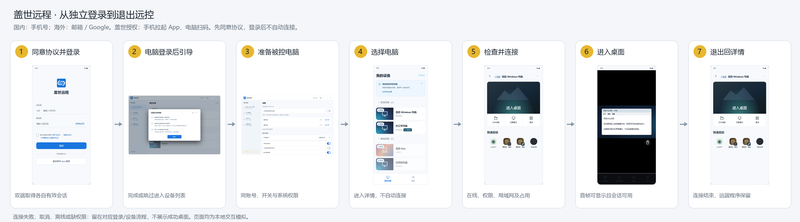

*图2-1：①两端同意协议并登录同一盖世账号；②电脑端首次登录成功后完成或跳过使用引导；③电脑端配置允许被控与系统权限；④另一端选择电脑；⑤检查状态并发起连接；⑥首帧可显示且会话可用；⑦退出后回原设备详情，远端程序继续运行。移动端拉起盖世 App、电脑端扫码领取会话均在登录阶段完成，不自动建立远控。*

## 三、功能需求

### 3.1 移动端功能需求

#### 3.1.1 登录页

| 要素 | 内容说明 |
|---|---|
| 功能简介 | 手机号/邮箱验证码及第三方授权入口。 |
| 场景描述 | 无有效会话时打开独立 App，或退出账号后重新登录。 |
| 输入／前置条件 | 独立移动 App；地区来自发行版本/账号配置。仅 Demo 外部工具可切地区。 |
| 需求描述 | **图示：** 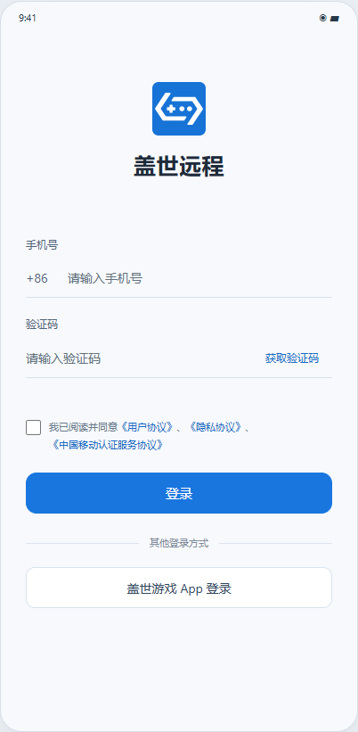 <em>图3-1 国内登录</em> 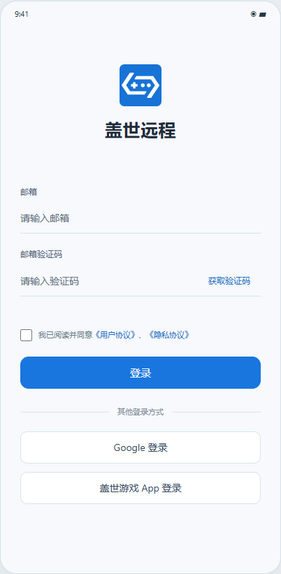 <em>图3-2 海外登录</em> 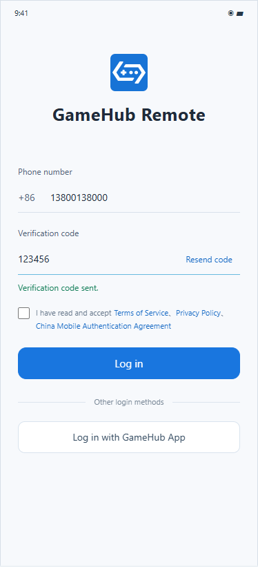 <em>图3-2a：英文界面演示；登录渠道仍由独立地区配置决定。</em> **详细说明：** **展示说明：** 1. 产品登录页品牌区只显示盖世游戏 Logo 和“盖世远程”，删除电脑插画、宣传标题/副文案，不显示原游戏、社区、游戏库底部栏。 /2026.10.28修改 2. 国内显示+86手机号、验证码、“获取验证码”“登录”“盖世游戏 App 登录”；海外显示邮箱、邮箱验证码、“获取验证码”“登录”“Google 登录”“盖世游戏 App 登录”。不显示微信、QQ和账号密码，移动端不显示供本机扫描的二维码。 3. 协议默认未勾选；App国内显示“我已阅读并同意《用户协议》《隐私协议》《中国移动认证服务协议》”，App海外只显示用户协议和隐私协议。 /2026.10.28修改 **交互说明：** 1. 协议未勾选时仍可填写手机号/邮箱和验证码，获取验证码及各登录入口保持可点击，不因未勾选禁用。获取验证码只校验当前账号格式，不要求先同意协议。点击登录、Google或盖世App登录入口时，未同意先提示“请先勾选协议”，保留表单，不提交登录、不启动第三方授权；提示不自动勾选协议。 2. Demo 国内手机号最多11位数字并按11位国内手机号校验；海外邮箱最多254字符，去首尾空格后校验邮箱格式；验证码最多6位数字。空值或格式错误不发送、不提交；未发送、非6位数字或已失效的验证码请求不能登录。Demo仅校验6位数字格式，不匹配固定码；正式产品仍由账号服务校验真实验证码。 /2026.10.28修改 3. 勾选同意后保留本次输入和仍有效的验证码，无需因勾选重新发码；点击“登录”校验本次验证码及协议，首次使用且无既有账号时按盖世账号体系完成登录即注册，不新增独立注册页；取得并核实有效会话后获取当前盖世UID设备。已同意时点击App/Google入口进入本次授权；异步成功前再次核对本次同意及尝试仍有效。 /2026.10.28修改 4. 点击协议标题只阅读对应内容，不自动勾选；关闭阅读返回时保留原输入和勾选值。 |
| 输出／后置条件 | 取得本独立 App 的有效盖世会话，首次进入“我的设备”；有仍有效的登录前目标则返回目标，目标失效回列表，不自动连接。 |
| 补充说明 | 1. 已有有效会话时直接进入设备列表，不重复授权。 2. 撤销同意作废旧验证码请求、验证码及未完成授权，晚到结果不得恢复；仍可在未勾选状态重新获取验证码，重新勾选保留此后新获取的有效验证码。切换评审地区清空输入并恢复未勾选，退出隔离旧请求。 3. 统一演示示例：国内手机号13600008000，海外邮箱player@example.com，Demo验证码支持任意6位数字（如000000、654321）。填写对应地区账号→点击获取验证码→填写验证码→勾选协议→点击登录；这是推荐演示顺序，未勾选时可获取验证码的规则不变。手机号/邮箱只需符合当前格式校验，不设示例账号白名单，不发送短信或邮件。254字符等为演示限制，正式国家码、长度、邮箱大小写、注册判断、发送间隔和有效期需与盖世账号组件核对。 /2026.10.28修改 4. 协议正文未接入时仅显示待接入预览，不编造条款；正式主体/版本/链接及国内App的中国移动适用认证方式见第五章。 /2026.10.28修改 |

#### 3.1.2 盖世 App／Google 授权页

| 要素 | 内容说明 |
|---|---|
| 功能简介 | 确认当前账号并返回独立 App。 |
| 场景描述 | 从移动登录页点击本地区可用的授权方式。 |
| 输入／前置条件 | 进入实际授权流程前需主动同意本地区登录协议；未同意时入口可点击，只提示“请先勾选协议”，不启动授权。Google仅海外；盖世App授权需能拉起已安装App。 |
| 需求描述 | **图示：** 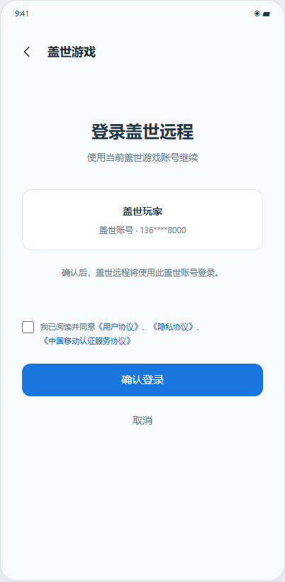 <em>图3-3 盖世授权确认模拟</em> 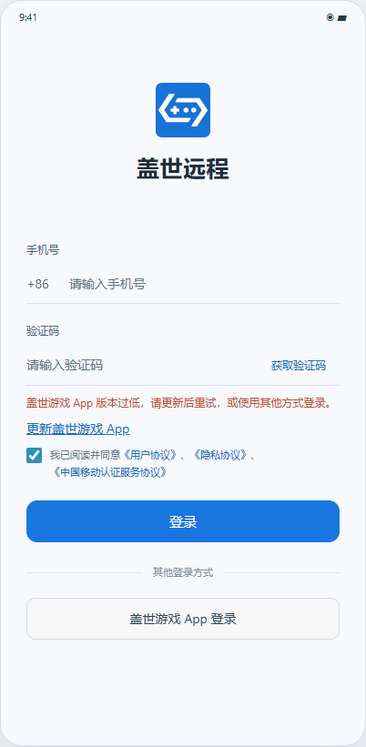 <em>图3-3a：已安装盖世版本不支持授权时，提示先更新，不进入成功态。</em> **详细说明：** **展示说明：** 1. 盖世侧显示当前使用账号及确认/取消；未登录先显示盖世自身登录。Google 使用该渠道原授权页，本产品不收集 Google 密码。图示为盖世侧模拟，不代替真实 Google 页面。 **交互说明：** 1. 盖世App版本支持且已登录时确认本次授权；未登录/失效时先完成盖世原登录/注册，再继续仍有效授权。本期仅支持从盖世远程拉起盖世游戏授权，不新增反向授权入口。 /2026.10.28修改 2. 确认后回到发起端，再次核对本次协议同意、授权和独立会话，均有效才取当前UID设备；不复制盖世App令牌，不要求绑定Steam/Epic。 3. 点击取消或拒绝，返回独立登录页，可重新选择本地区方式。 |
| 输出／后置条件 | 本次授权有效且独立 App 已取得盖世会话，返回登录前有效目标或设备列表。 |
| 补充说明 | 1. 打开外部 App、外部登录完成或模拟确认按钮均不代表独立 App 正式登录成功。 2. 未安装/无法拉起时留在登录页；国内可用手机号，海外可用邮箱/Google，不跳虚构下载地址。已安装但盖世版本不支持本次授权时，提示先更新盖世游戏，不进入授权或完成登录；更新完成后用户重新发起本次授权，不复用失效请求。最低支持版本及更新地址待接入，不编造版本号。 /2026.10.28修改 3. 网络失败、超时或未知结果就地显示未完成，不取设备；重试使用新授权。取消、撤勾、切地区和退出后的晚到回调不能恢复登录。 |

#### 3.1.3 我的设备与连接教程

| 要素 | 内容说明 |
|---|---|
| 功能简介 | 查看同账号电脑，了解添加电脑步骤。 |
| 场景描述 | 移动端登录后默认进入，或点击底部我的设备Tab返回。 |
| 输入／前置条件 | 当前独立App盖世会话有效；数据来自同UID设备服务。 |
| 需求描述 | **图示：** 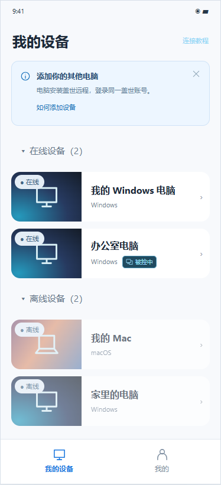 <em>图3-4：我的设备；顶部仅保留连接教程，底部为我的设备/我的。</em> **详细说明：** **展示说明：** 1. 页面采用浅色模式；标题为“我的设备”，右上只显示“连接教程”，不放设置、账户或扫一扫按钮。底部固定两个Tab：“我的设备”“我的”，当前选中我的设备；登录和远控页不显示这组根导航。 2. 列表取当前盖世UID下支持被控的电脑，按已有在线/离线分组显示名称、系统和状态；不把手机列为被控电脑。加载、确定空态和失败状态分开，不显示旧账号缓存。 3. 添加其他电脑提示显示安装独立客户端和登录同账号说明，右上有关闭按钮；长设备名在卡片省略，属性可查看原文，不截断存储。 **交互说明：** 1. 点击电脑卡片进入对应详情，不自动连接；点击我的Tab打开我的页，切Tab不退出账号，不建立或恢复旧远控。 2. 点击连接教程，说明目标电脑安装独立客户端、登录同账号、开启允许被控及系统权限；关闭回原页。点击提示卡关闭按钮，只隐藏本次演示中的提示卡，不删除设备；教程入口仍保留。 3. 失败时点击重试，以当前UID返回结果更新；账号过期停止受限操作并回登录。 |
| 输出／后置条件 | 显示当前账号设备或确定的空列表；选中电脑进入其详情，切换我的后显示当前账号资料。 |
| 补充说明 | 1. 移除横竖屏切换按钮和横屏设备工作区入口；竖屏浏览不改变设备与会话归属。 2. 正式排序、同值顺序、列表规模、分页与刷新周期沿用设备服务实际能力；旧设备迁移仍待接入。提示卡关闭记录是否跨启动保存需正式客户端核对，当前Demo不作持久化承诺。 |

#### 3.1.4 设备详情

| 要素 | 内容说明 |
|---|---|
| 功能简介 | 查看目标状态，发起控制、观看和工具。 |
| 场景描述 | 在移动列表选择一台电脑，或远控退出返回。 |
| 输入／前置条件 | 当前会话有效，目标属于当前 UID；允许控制与系统权限独立判断。 |
| 需求描述 | **图示：** 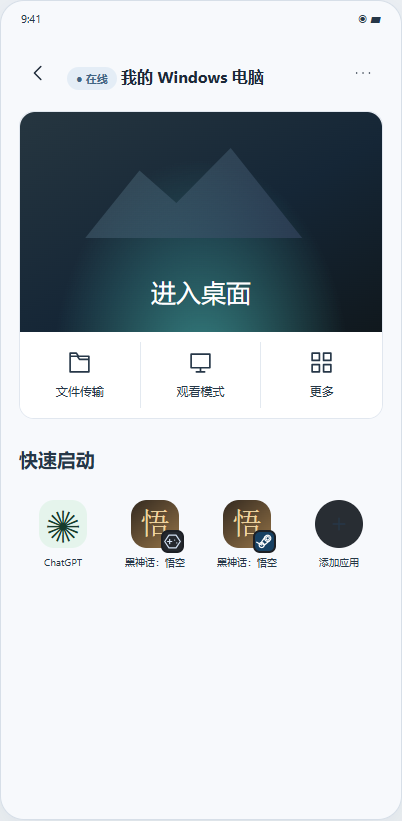 <em>图3-6 设备详情</em> **详细说明：** **展示说明：** 1. 在线、允许被控且无占用时，显示进入桌面、文件传输、观看模式和更多；进入详情不建立连接。 2. 在线但被其他主控占用时显示正在被控，沿用接管确认；禁控/缺权限显示“请在该设备的『设置』中开启允许远程控制。”，需要控制权限的入口不可用。 3. 离线显示“设备已离线”，在线操作不可用；Windows 可按原规则尝试开机，Mac 开机不可用。 **交互说明：** 1. 点击进入桌面或观看，核对实时在线、权限、网络可达性及占用；符合后显示连接中，避免重复发起。首帧可显示且会话可用才算连接成功。 /2026.10.28修改 2. 占用时确认接管才发起；取消不影响原会话。连接中取消回详情，失败/超时留在原流程，可检查设备后重试。跨网络不因非同一局域网而直接阻止；实际连接失败或超时保留原失败/重试路径，不显示连接成功。 /2026.10.28修改 3. 设备菜单保留属性、刷新、重命名、删除。重命名最多40个汉字、空值不提交、超限不能保存；取消不改，服务成功后更新。删除二次确认，取消不删；成功退出该详情并更新列表，不删除磁盘文件。 |
| 输出／后置条件 | 连接成功进入目标控制/观看会话；管理操作成功后更新该设备或列表。 |
| 补充说明 | 1. 手机不能替代目标电脑系统授权；刷新后按实时状态重判。 2. 连接失败、取消、离线、权限不足不显示成功桌面。删除的设备关系语义及旧关系迁移见第五章。 |

##### 页面子功能汇总

| 类型 | 图示 | 内容 | 说明 |
|---|---|---|---|
| 工具 | 设备详情上下文见图3-6 | 电源：Windows远程开机、重启、关机。 | **展示说明：** 1. 显示当前系统支持的电源入口，不支持项不可用。 **交互说明：** 1. 按已有确认流程发起；受理与完成分开，超时显示结果未知，不推断未执行；重新获取在线状态后才允许连接，关机/重启导致断开不画成普通网络重试。 |
| 快捷启动 | 设备详情上下文见图3-6 | ChatGPT、盖世游戏、Steam及添加应用。 | **展示说明：** 1. 按设备隔离应用列表，手机一排四项、超出换行；游戏保留既有虚拟按键开关/布局，仅游戏已启动的远控会话支持横屏；其他页面保持竖屏；仅观看时隐藏可操作虚拟按键。 /2026.10.28修改 **交互说明：** 1. 点击盖世游戏启动远端盖世客户端；Steam直接打开远端Steam，未登录由用户在原生页面登录，本产品不代登或收集凭证。只有可信远端结果才算启动成功。 |
| 工具工作区 | 设备详情上下文见图3-6 | ChatGPT历史、附件、发送/停止及桌面切换。 | **展示说明：** 1. 沿用当前移动工作区，不新增模型、收费或生产授权。 **交互说明：** 1. 保持已有历史/附件/发送/停止交互，退出账号清账号缓存；真实GPT接入仍在本期范围外。 |

#### 3.1.5 远程桌面与操作面板

| 要素 | 内容说明 |
|---|---|
| 功能简介 | 控制/观看电脑画面及输入。 |
| 场景描述 | 移动端连接目标成功后进入。 |
| 输入／前置条件 | 首帧可显示且会话可用；输入须为控制模式，目标权限仍有效。 |
| 需求描述 | **图示：** 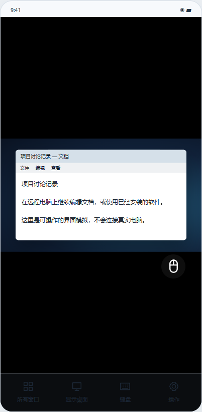 <em>图3-7 移动远控</em> **详细说明：** **展示说明：** 1. 画面按原比例；竖屏16:9居中、上下留黑，不拉伸。仅当前为远控会话且游戏已启动时支持横屏适配；普通远控桌面及其他页面保持竖屏。 /2026.10.28修改 2. 操作、显示、键盘、更多使用当前面板；悬浮鼠标默认收起，可点击展开及长按空白/握柄拖动。 **交互说明：** 1. 展开/收起/切面板不结束会话；操作面板内切开关或虚拟方案保留滚动位置，其余面板从顶部显示。 2. 悬浮鼠标限位到可见范围，可到右侧和底部黑区，拖动不扩大画面或触发点击；收起面板不重新连接。 3. 仅观看阻止键鼠、文本、窗口、虚拟按键和显示设置等写操作，保留退出、声音及恢复操作；恢复后才能输入，普通重连不继承上次仅观看。 4. 退出直接结束连接并返回原详情，无新增确认，远端程序继续运行；显示/声音/窗口/桌面切换以远端确认结果为准。 |
| 输出／后置条件 | 控制模式可向当前目标输入；观看模式只观看；主动退出后结束本端连接并返回原设备详情。 |
| 补充说明 | 1. 被接管、断网、离线或权限撤销，立即停止输入、释放按键并显示结束/需重连；恢复网络不重放断开输入。 2. 远端不支持或设置失败保留原有效值，不以按钮选中代替成功；多物理屏能力需实测。 |

##### 页面子功能汇总

| 类型 | 图示 | 内容 | 说明 |
|---|---|---|---|
| 输入面板 | 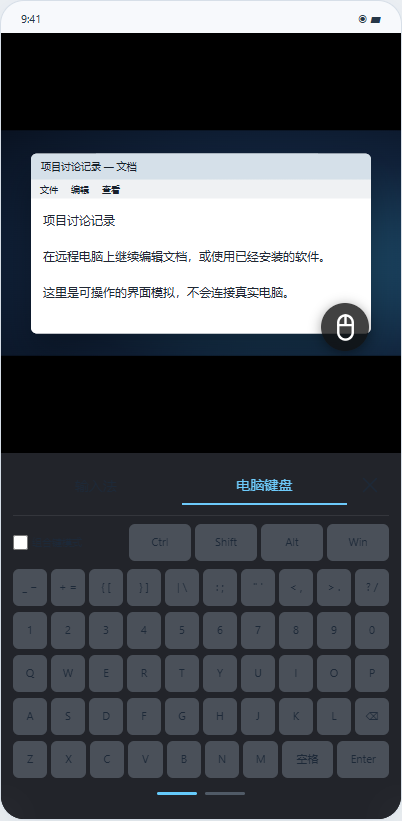 <em>图3-8 双页电脑键盘</em> | “输入法”“电脑键盘”两Tab及组合模式。 | **展示说明：** 1. 输入法用真实输入框唤起手机系统键盘；电脑键盘第一页数字/字母/常用键，第二页Esc/Tab/F1–F12/导航/方向。修饰键按目标系统显示Ctrl/Alt/Win或Control/Option/⌘，组合模式与四修饰键同排。 **交互说明：** 1. 左右滑动或点分页换页，保留组合模式和修饰键选择；中文候选确认后提交，组合中不重复发送，回车换行不代替远端发送。组合默认关；开启后选修饰键再点目标键，发送一次释放选择、模式保持开；关闭模式/键盘、失焦/退出释放选择，仅观看禁输入。输入长度和长文本发送沿用V3.10对应规则，本轮不新增上限。 |
| 虚拟按键方案 | 复用交互线框见图3-31 | 原切换虚拟按键布局/映射方案入口。 | **展示说明：** 1. 按截图保留排行、自定义、图标管理器等主页结构，标明复用盖世已有模块。 /2026.10.28修改 **交互说明：** 1. 打开后可演示列表、搜索、详情、应用复制及既有编辑分享等交互；游戏中编辑始终横屏，创建先确认名称和类型，有修改时返回弹保存确认。各级返回/关闭不结束原会话，仅观看时不可写入或应用布局。 /2026.10.28修改 |

#### 3.1.6 文件传输页

| 要素 | 内容说明 |
|---|---|
| 功能简介 | 选择目录和手机文件，管理传输任务。 |
| 场景描述 | 从移动设备详情、更多或会话进入。 |
| 输入／前置条件 | 当前会话及目标文件权限有效；沿用当前Demo文件能力。 |
| 需求描述 | **图示：** 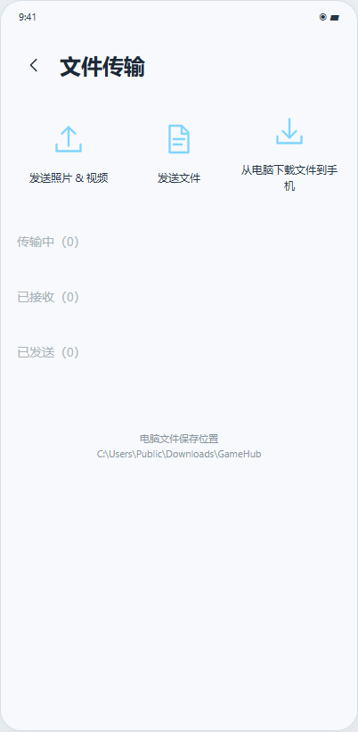 <em>图3-9 移动文件传输</em> **详细说明：** **展示说明：** 1. 显示远端目录、手机文件选择与当前任务状态/目标路径；样例不发送真实文件。 **交互说明：** 1. 选择文件按原授权和选择规则发起；接收端确认后才显示完成。 2. 暂停、继续、取消、失败重试和同名处理沿用V3.10；返回回原来源，清完结记录不删磁盘文件。 |
| 输出／后置条件 | 接收端确认的任务显示完成，其余保留实际任务状态与目标路径。 |
| 补充说明 | 1. 断网不标完成；选择数量、目录授权、文件限制与同名规则沿用原能力，不新增格式/大小/数量上限。 2. 退出账号终止本端任务并隔离账号缓存，真实传输中断与缓存规则接入见第五章。 |

#### 3.1.7 我的

| 要素 | 内容说明 |
|---|---|
| 功能简介 | 静态显示个人账号，使用扫一扫、帮助、更新、关于及退出登录。 |
| 场景描述 | 移动端已登录，点击底部我的Tab。 |
| 输入／前置条件 | 当前独立App盖世会话有效；头像、昵称和UID由当前盖世身份提供。 /2026.10.28修改 |
| 需求描述 | **图示：** 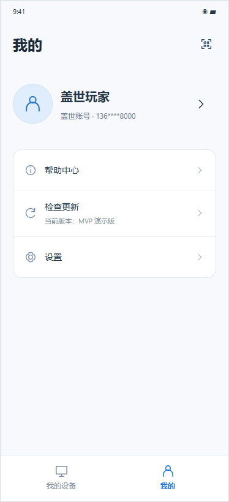 <em>图3-10：我的；无顶部标题栏，退出图标紧挨昵称右侧、扫一扫位于右上，其下为帮助中心、检查更新和关于。</em> 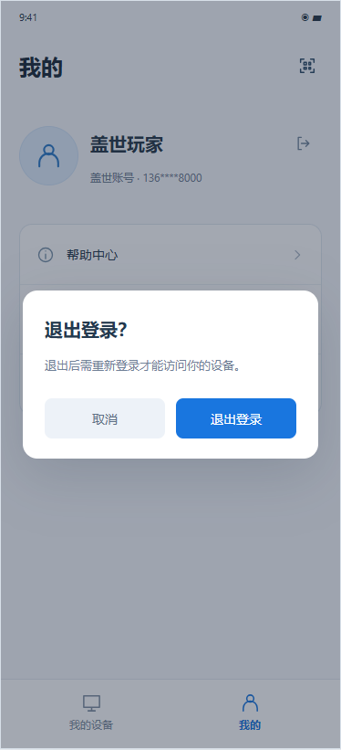 <em>图3-10a：我的页上方显示退出登录确认框。</em> **详细说明：** **展示说明：** 1. 不显示顶部“我的”标题及其标题栏，右上保留扫一扫；账号区显示静态头像、昵称，昵称正下方统一显示UID标签及当前盖世UID，退出图标紧挨昵称右侧，不放在整行最右端，不显示退出文字；图标按钮的aria-label和title均为“退出登录”。除退出按钮外，头像和账号资料静态展示，不显示右箭头，不作为按钮或入口。 /2026.10.28修改 2. 下方依次显示帮助中心、检查更新、关于；检查更新行显示当前版本和右箭头，不在列表底部重复放退出登录。底部为我的设备/我的两个Tab，当前选中我的。不显示设置入口，也不保留独立设置页。 3. 页面使用浅色样式，不提供风格、浅色模式或黑夜模式选项。Demo显示演示头像、昵称和UID；正式账号资料来自当前账号，版本信息在检查更新行展示。新账号使用账号体系提供的默认头像/昵称；用户在盖世游戏修改后，本端重新获取账号资料时同步，不开放本端编辑。Demo的UID为按账号派生的稳定演示编号，同账号跨端一致；真实UID待账号服务接入。 /2026.10.28修改 **交互说明：** 1. 点击头像、昵称或其他静态资料区域不跳转、不展开弹层、不显示反馈；只有昵称右侧的退出图标打开退出登录确认框，不增加头像上传或账号编辑。 2. 点击扫一扫、帮助中心、关于，分别打开对应页面；关闭或返回后回我的。点击我的设备Tab回设备列表，不自动连接电脑。 3. 点击检查更新，留在我的页检测；有新版本显示更新通知弹窗，已是最新版本则显示Toast“已是最新版本”。不进入检查更新子页面，不保留旧行内绿色结果。 4. 点击昵称右侧退出图标，显示二次确认框：标题“退出登录？”，说明“退出后需重新登录才能访问你的设备。”，按钮“取消”和“退出登录”。打开确认框不退出账号、不清理任务。 5. 点击取消或按Esc关闭确认框，保留当前账号、我的页及进行中的任务。点击确认框的退出登录后，才结束本端会话、未完成扫码确认和任务，清理设备、选中目标、临时授权和账号缓存，回独立登录页；不退出盖世游戏App或其他电脑。 |
| 输出／后置条件 | 取消退出保留原账号、页面与任务；确认退出后显示独立登录页。其他入口显示当前账号资料或进入所选页面。 |
| 补充说明 | 1. 账号失效后回登录，不能继续扫码确认；退出或切账号后不显示上一账号资料。再次登录按UID获取设备，不恢复旧连接。 2. Demo只模拟会话和任务清理；真实撤销及传输中断需接入，页面清空不等于服务端解绑，不删除磁盘文件。 3. 退出账号二次确认仅用于账号退出，不改变远控会话退出的原有规则。 |

##### 页面子功能汇总

| 类型 | 图示 | 内容 | 说明 |
|---|---|---|---|
| 原页操作／弹窗 | 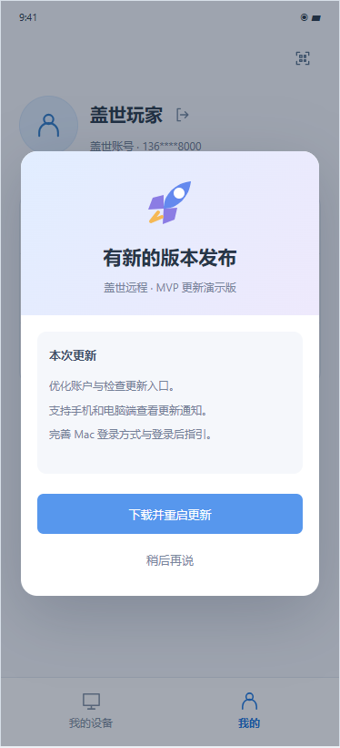 <em>图3-24：我的页上方显示更新通知弹窗。</em> | 检查更新、当前版本、右箭头及更新通知。 | **展示说明：** 1. 我的页检查更新行显示当前版本和右箭头；有更新时显示参照图的渐变背景、火箭插画、演示新版本说明及“下载并重启更新”“稍后再说”两个按钮。已是最新版本不弹更新通知，只显示Toast“已是最新版本”。 2. 不新增更新子页面，不显示旧行内绿色检查结果。版本与更新内容使用演示版本，不冒充真实发布版本。 **交互说明：** 1. 点击检查更新留在我的页检测；检查中不可重复发起。有更新打开本次通知，已最新显示上述Toast。 2. 点击稍后再说关闭通知并留在我的页，不下载；点击下载并重启更新仅模拟更新操作，不下载真实安装包、不执行真实安装或系统重启。 3. 离页或退出作废未完成检测及旧弹窗回调，返回不显示旧结果。外部评审工具可选择有更新/已最新，仅用于Demo状态演示，不是产品设置。 |

#### 3.1.8 帮助中心

| 要素 | 内容说明 |
|---|---|
| 功能简介 | 浏览帮助文章并搜索问题。 |
| 场景描述 | 从移动端我的页点击帮助中心。 |
| 输入／前置条件 | 使用当前Demo内置帮助文章；不依赖线上搜索服务。 |
| 需求描述 | **图示：**  <em>图3-22：移动端帮助中心；问题搜索与文章列表。</em> **详细说明：** **展示说明：** 1. 标题为“帮助中心”；顶部搜索框提示“搜索问题或关键词”，下方为常见问题文章，包含添加电脑、设备不显示、离线、扫码登录、Mac权限、观看/控制、文件、地区登录和退出登录说明。 2. 每篇文章显示标题和分类；搜索无匹配时显示“没有找到相关问题”及可尝试的登录、扫码、设备关键词。 **交互说明：** 1. 搜索框不另设业务输入长度上限，输入后立即在当前文章标题、分类和正文中匹配；忽略首尾空格及英文字母大小写，清空后恢复全部文章。不提交或持久保存搜索词。 2. 点击文章打开对应帮助详情；返回我的不修改账号、设备或会话。 |
| 输出／后置条件 | 按当前关键词显示匹配文章或确定的无结果状态；选择文章后显示其详情。 |
| 补充说明 | 1. 当前Demo为内置文章；正式内容采用静态H5，由运营提供并审核、服务端维护，客户端打开，更新文章不新增运营配置页。不新增反馈提交或客服流程。 /2026.10.28修改 |

#### 3.1.9 帮助详情

| 要素 | 内容说明 |
|---|---|
| 功能简介 | 阅读所选帮助文章。 |
| 场景描述 | 在移动端帮助中心点击一篇文章。 |
| 输入／前置条件 | 当前文章可在帮助列表中找到。 |
| 需求描述 | **图示：** 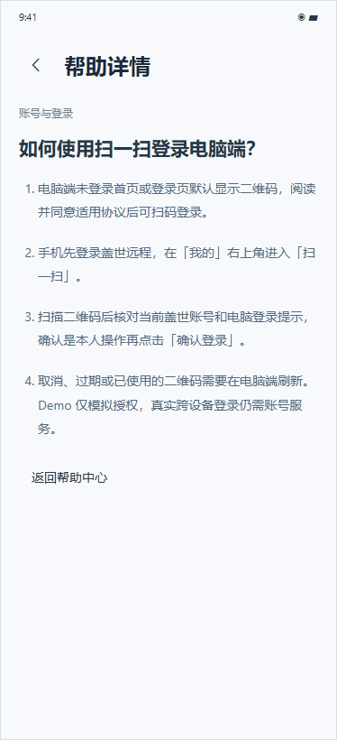 <em>图3-23：移动端帮助详情；分类、标题和步骤正文。</em> **详细说明：** **展示说明：** 1. 页面标题为“帮助详情”；正文显示所选文章分类、标题及操作步骤，底部保留返回帮助中心。 **交互说明：** 1. 点击左上返回或返回帮助中心按钮，回文章列表；文章只是说明，不自动开启系统权限、不建立远控、不发送文件。 |
| 输出／后置条件 | 显示所选文章完整内容，返回后恢复帮助中心。 |
| 补充说明 | 1. 文章不存在时显示“未找到这篇帮助，请返回帮助中心。”，仍可返回。 |

#### 3.1.10 关于

| 要素 | 内容说明 |
|---|---|
| 功能简介 | 阅读用户协议、隐私协议及信息清单，提供账号注销入口。 /2026.10.28修改 |
| 场景描述 | 移动端我的页点击关于。 |
| 输入／前置条件 | 独立客户端；正式协议及清单正文尚待接入。 |
| 需求描述 | **图示：**  <em>图3-25：移动端关于；协议/信息清单及已登录时的注销账号入口。</em> 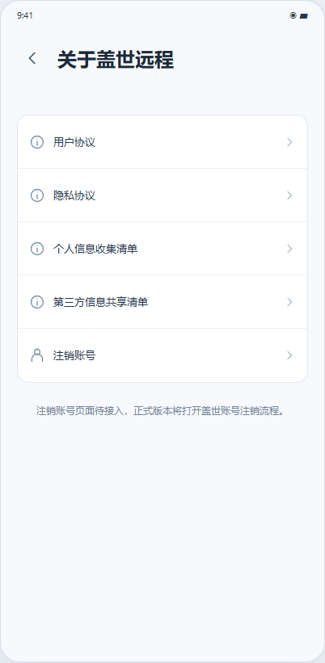 <em>图3-25a：点击注销账号后在原页显示待接入说明，不模拟注销完成。</em> **详细说明：** **展示说明：** 1. 页面标题为“关于盖世远程”；显示用户协议、隐私协议、个人信息收集清单、第三方信息共享清单四项；仅登录时在其后显示“注销账号”。不放检查更新、当前版本、Logo或产品介绍。 /2026.10.28修改 **交互说明：** 1. 点击协议或清单，当前Demo只就地显示“正式内容与地址待接入，当前 Demo 仅展示入口。”，不显示编造正文，不改变登录同意状态。返回回我的。 2. 点击注销账号，正式版本打开盖世账号注销H5流程；当前无正式地址时在现有说明区域显示“注销账号页面待接入，正式版本将打开盖世账号注销流程。”，不跳虚构网址、不退出账号或模拟注销成功。 /2026.10.28修改 |
| 输出／后置条件 | 显示四项条款/清单及登录态下的注销入口；未接入时显示相应说明，不改变账号状态。 /2026.10.28修改 |
| 补充说明 | 1. 关于页中的协议阅读不代表同意登录协议；中国移动认证服务协议仅在国内App登录场景展示，电脑客户端不展示。 /2026.10.28修改 2. 注销复用账号体系的既有H5，资格、确认步骤、生效及回传由该流程提供，不另拟规则；真实地址及结果衔接未接入前不宣称可完成注销。 /2026.10.28修改 |

#### 3.1.11 扫一扫与扫码登录确认

| 要素 | 内容说明 |
|---|---|
| 功能简介 | 扫描电脑登录码，并以当前盖世账号确认电脑端登录。 |
| 场景描述 | 从我的页右上扫一扫进入。 |
| 输入／前置条件 | 手机已登录；电脑端已生成仍有效的登录码，尚未勾选协议也可扫描并进入确认页。移动/电脑地区一致，码属于本产品本次电脑登录；确认登录仍需电脑端主动同意适用协议。 |
| 需求描述 | **图示：** 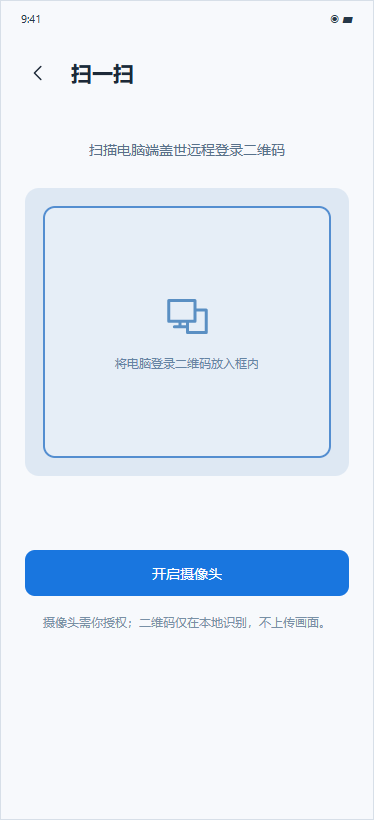 <em>图3-26：扫一扫；从我的进入。</em> 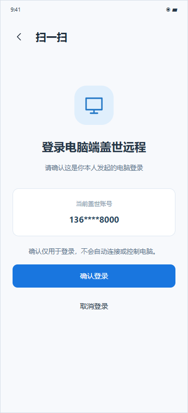 <em>图3-26a：电脑登录确认；确认仅登录，不自动远控。</em> **详细说明：** **展示说明：** 1. 扫一扫页显示关闭按钮、扫描区域和“扫描电脑端盖世远程登录二维码”；开启摄像头前显示授权说明。扫码确认页显示“登录电脑端盖世远程”、当前脱敏盖世账号、“确认登录”“取消登录”，明确确认仅用于登录。 2. 手机确认后显示“已确认本次登录”和返回电脑查看结果的说明；电脑端仍须取得并核实本次会话后才算登录成功。 **交互说明：** 1. 点击开启摄像头请求授权，仅本地识别二维码，不上传画面；识别正确且仍有效的登录码后停止摄像头，显示确认页。 2. 点击确认登录，再核对本次码、地区、有效状态及电脑端本次协议同意。未同意提示“请先勾选协议”，留在确认页，不确认、不领取会话；电脑勾选后保留仍有效的同一码，可再次确认。全部通过才提交当前账号对本次电脑登录的确认；点击取消登录使本次码失效，关闭扫码回我的页。 3. 关闭、返回、离开页面或退出账号时释放摄像头；点击完成返回原入口，不连接电脑、不替电脑开启允许被控。 |
| 输出／后置条件 | 当前有效登录码得到手机确认，手机回原入口；电脑领取成功后登录当前账号并加载其设备。 |
| 补充说明 | 1. 拒绝摄像头权限或浏览器不支持时就地说明，可重新授权后重试。非本产品登录码、地区不同、已取消/过期/已用码不能确认，提示电脑刷新后重新扫描。 2. Demo二维码为同源本地记录，只在共享同源存储的演示页面间模拟状态；真实跨设备身份认证未接通。外部评审模拟入口不属于正式App功能；不能用该按钮证明真实扫码服务成功。 |

#### 3.1.12 按键与布局（复用交互线框）

| 要素 | 内容说明 |
|---|---|
| 功能简介 | 以可操作的灰色线框演示盖世已有“按键与布局”模块的入口、子流程与返回路径。 /2026.10.28修改 |
| 场景描述 | 移动端从原切换虚拟按键布局／映射方案入口打开；游戏中进入编辑时始终横屏。 /2026.10.28修改 |
| 输入／前置条件 | 沿用原入口的登录与会话条件；写入和应用布局须处于可控制状态，仅观看不执行写操作。 /2026.10.28修改 |
| 需求描述 | **图示：** 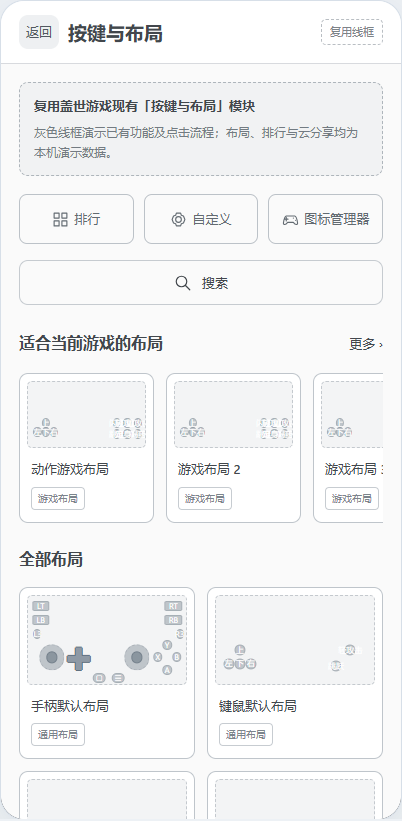 <em>图3-31：保留截图主页结构的可操作线框，演示复用盖世已有模块。</em> **详细说明：** **展示说明：** 1. 主页保持灰色线框，显示复用说明；上方保留“排行”“自定义”“图标管理器”和搜索，“适合当前游戏布局”为横向卡片，“全部布局”为双列卡片。 /2026.10.28修改 2. “我的方案／我的云分享”仅在自定义二级页内展示，不替换为独立三Tab主页。列表、数量与云端内容为演示数据，不代表真实排行或生产服务。 /2026.10.28修改 **交互说明：** 1. 点击排行或当前游戏区域的更多，打开相应列表；搜索可进入匹配结果，点击任一卡片打开详情。 /2026.10.28修改 2. 点击自定义进入我的方案/我的云分享；点击图标管理器进入图标列表。详情、编辑、应用、复制、发布、分享码导入和图标导入/删除均按下方既有功能闭环演示。 /2026.10.28修改 3. 返回/Esc逐层退回来源；关闭整个模块回原会话，不退出账号或结束远控。编辑有修改时点击返回，先显示保存确认；保存、不保存或取消后的处理见下方，语言切换保留当前输入和业务状态。 /2026.10.28修改 |
| 输出／后置条件 | 用户可完成所选既有交互的本地演示并返回原来源；演示成功只说明本次本地操作完成，不代表真实云同步或生产服务成功。 /2026.10.28修改 |
| 补充说明 | 1. 详情、编辑、云分享、分享码导入及图标管理复用盖世已有能力；创建名称及编辑行为按本次实机资料和用户确认写明，码位数、存储、排序、复制或导入等未改规则仍沿用对应模块，不另定一套。 /2026.10.28修改 2. 离开原会话、退出或切换账号后，旧编辑和异步结果不得写到其他账号或新会话。仅观看不写入或应用；失败/取消不显示成功，原有效数据保留。 /2026.10.28修改 3. 云分享目录只作本机模拟，真实云服务、审核及跨设备同步未接入。线框中的功能和按钮说明复用关系，不等于新建产品能力或真实服务已验收。 /2026.10.28修改 |

##### 页面子功能汇总

| 类型 | 图示 | 内容 | 说明 |
|---|---|---|---|
| 列表与搜索 | 主页入口见图3-31 | 排行、更多、搜索结果、布局卡片。 | **展示说明：** 1. 展示当前来源的布局列表及可返回入口；搜索无匹配时显示无结果状态。 /2026.10.28修改 **交互说明：** 1. 点击排行/更多进入对应列表；搜索按已有模块的名称匹配逻辑更新结果，清空后恢复列表。点击卡片进入该方案详情，返回回到进入前的列表/搜索来源。搜索输入及排序沿用既有模块，不另定规则。 /2026.10.28修改 |
| 详情 | 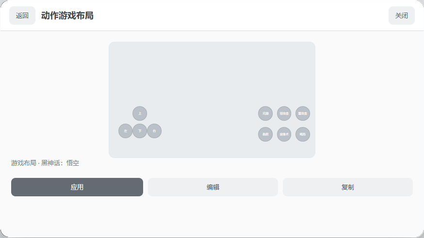 <em>图3-32：从卡片进入详情并操作。</em> | 预览、应用、编辑、复制及返回。 | **展示说明：** 1. 显示当前选中方案和已有可用操作，操作作用于该方案。 /2026.10.28修改 **交互说明：** 1. 点击应用后，本地演示按所选方案更新当前选择并返回会话；点击复制保存为我的方案，取消复制不创建副本。 /2026.10.28修改 2. 点击官方/他人方案的编辑，进入可保存为自己副本的编辑流程，不修改来源方案。返回回原列表，不自动应用。 /2026.10.28修改 |
| 自定义 | 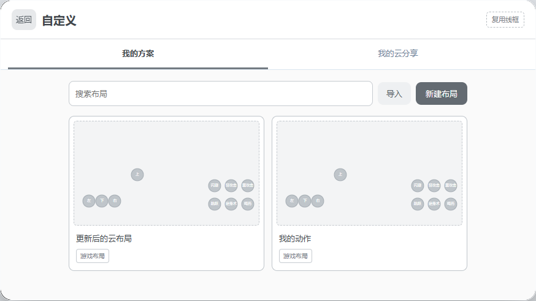 <em>图3-33：自定义二级页中的我的方案与我的云分享。</em> 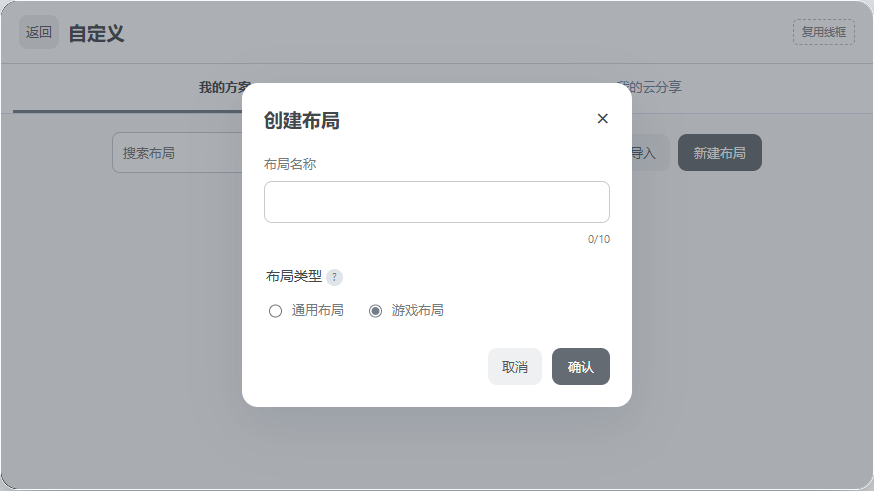 <em>图3-33a：输入名称并选择布局类型。</em> | 我的方案、我的云分享、新建、编辑、复制、发布及导入。 | **展示说明：** 1. 二级页显示我的方案/我的云分享，内容按当前账号区分；未有数据时提供已有的新建或导入入口。 /2026.10.28修改 2. 新建弹窗显示名称输入和字数“0/10”，最多输入10个字；布局类型为“通用布局／游戏布局”单选，默认选中游戏布局。名称和类型只在创建或另存弹窗填写。 /2026.10.28修改 **交互说明：** 1. 切换查看本地方案或自己的模拟云分享；点击新建先打开创建弹窗，填写有效名称并确认后，创建本地空布局并进入编辑；空名称不提交，超过10字不接受多余输入，取消不创建。 /2026.10.28修改 2. 点击已有方案可查看详情、编辑或复制，编辑时载入该方案已保存的控件、图层和位置；发布和分享码导入承接下方流程。返回回截图结构的主页，不替换主页导航。 /2026.10.28修改 |
| 编辑 | 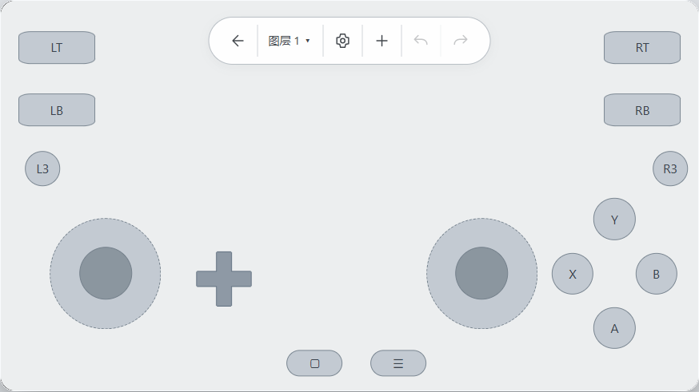 <em>图3-34：横屏满画布编辑已有方案。</em> 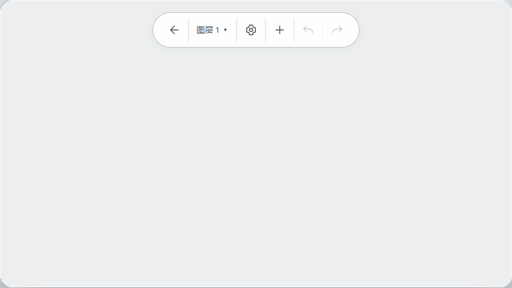 <em>图3-34a：创建后为空画布，不预置示例按键。</em> | 横屏画布、返回、图层、设置、添加、撤销、重做。 | **展示说明：** 1. 游戏中编辑始终横屏，画布占满编辑区域；未选中控件时，顶部按实机显示返回、图层、设置、添加、撤销和重做，不常驻保存按钮或名称/类型表单。新建方案显示空画布，已有方案显示自身布局，空布局允许保存。 /2026.10.28修改 **交互说明：** 1. 拖动控件调整位置，添加/删除改变当前草稿；撤销、重做可恢复控件及图层修改，无可恢复操作时对应按钮不可用。 /2026.10.28修改 2. 图层、设置、添加一次只展开一个面板；打开另一个时收起前一个，关闭面板保留草稿。返回时按下方保存确认处理，不自动应用布局或结束远控。 /2026.10.28修改 |
| 图层 | 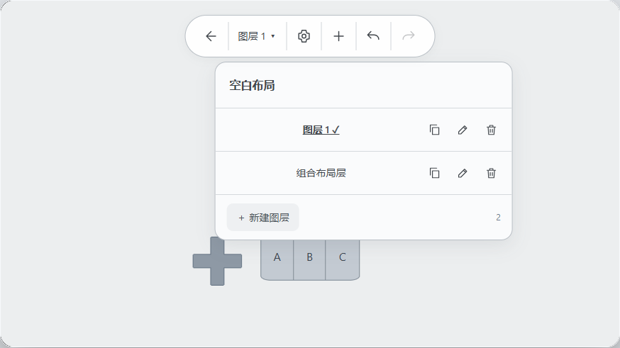 <em>图3-34b：图层列表及操作。</em> | 图层列表、复制、重命名、删除、新建。 | **展示说明：** 1. 显示当前方案的图层及当前选中项；只剩最后一个图层时，删除不可用。 /2026.10.28修改 **交互说明：** 1. 点击图层切换当前编辑层；复制当前层生成副本，重命名更新该层名称，新增创建图层，删除移除所选层及其控件。相关修改留在草稿内，最终随布局保存；取消操作不改原层。 /2026.10.28修改 |
| 设置 | 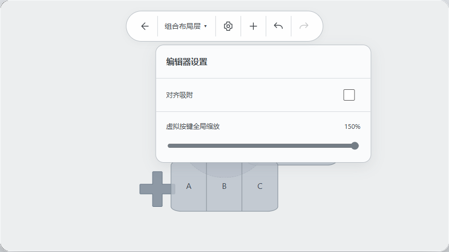 <em>图3-34c：对齐吸附及全局缩放。</em> | 对齐吸附、全局缩放。 | **展示说明：** 1. 设置面板显示对齐吸附开关和全局缩放控件，按当前布局显示已有值。 /2026.10.28修改 **交互说明：** 1. 开启吸附后，拖动按键按已有模块的对齐方式吸附；关闭后自由移动。调整全局缩放后，画布中的控件按所选比例预览，修改随布局保存。 /2026.10.28修改 |
| 添加 | 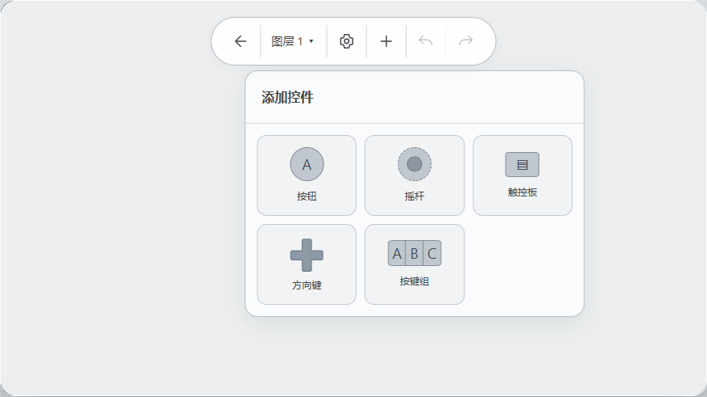 <em>图3-34d：五类可添加控件。</em> | 按钮、摇杆、触控板、方向键、按键组。 | **展示说明：** 1. 添加面板显示按钮、摇杆、触控板、方向键、按键组五类控件。 /2026.10.28修改 **交互说明：** 1. 选择一类后，将对应控件加入当前图层，可继续拖动或删除；关闭面板不添加控件，不改已有草稿。控件映射沿用盖世原模块，本Demo只演示可操作线框。 /2026.10.28修改 |
| 控件选中 | 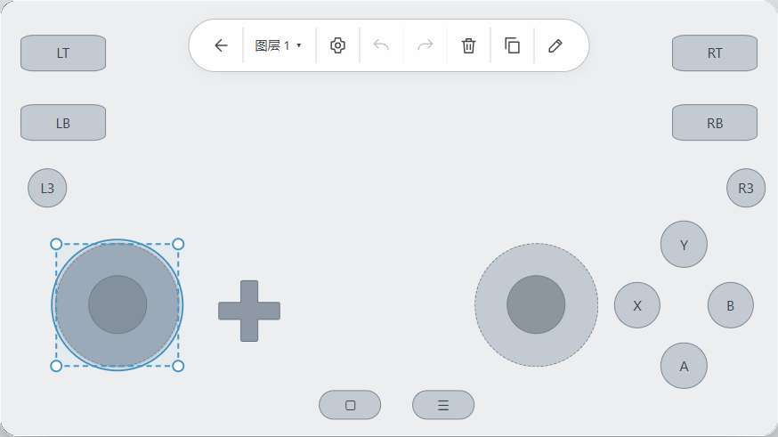 <em>图3-34e：蓝色选中边界及顶部控件操作。</em> | 选中边界、删除、复制、编辑、四角缩放。 | **展示说明：** 1. 选中控件显示蓝色高亮边界，顶部添加入口替换为删除、复制、编辑；返回、图层、设置、撤销和重做保留。摇杆选中时显示四角缩放点。 /2026.10.28修改 **交互说明：** 1. 点击控件选中，点击画布空白处取消选中并恢复普通工具栏。删除移除选中控件，复制在当前图层生成该控件副本；编辑打开对应属性面板。 /2026.10.28修改 2. 拖动摇杆四角缩放点调整控件尺寸；删除、复制和缩放均修改当前草稿，可撤销、重做，并随布局保存后恢复。 /2026.10.28修改 |
| 摇杆属性 | 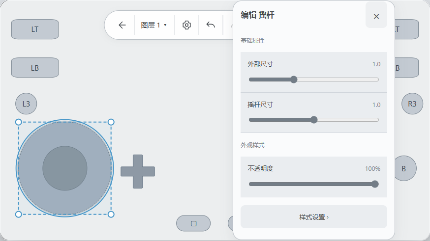 <em>图3-34f：摇杆尺寸、不透明度及样式入口。</em> | 编辑摇杆、外部尺寸、摇杆尺寸、不透明度、样式设置、关闭。 | **展示说明：** 1. 选中摇杆后点击编辑，面板标题显示“编辑 摇杆”。基础属性包含外部尺寸和摇杆尺寸滑条，外观样式包含不透明度滑条及带箭头的样式设置入口，右上角显示关闭按钮。 /2026.10.28修改 2. 各项显示当前控件值；未调整的示例为外部尺寸1.0、摇杆尺寸1.0、不透明度100%，已保存控件按自身值显示，不在每次打开时重置。 /2026.10.28修改 **交互说明：** 1. 调整滑条后，画布即时预览对应外部尺寸、摇杆尺寸或透明度；修改进入当前草稿，支持撤销、重做，并随布局保存。点击右上角关闭收起面板，保留草稿，不直接保存布局。 /2026.10.28修改 2. 样式设置复用盖世已有入口，内部页面和样式选项沿用原模块；本轮未提供其内部规则，不据截图新增样式能力。 /2026.10.28修改 |
| 返回保存 | 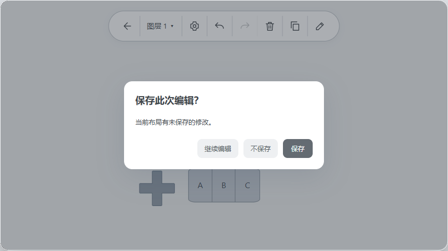 <em>图3-34g：修改后返回，先确认是否保存。</em> | 保存、不保存、取消。 | **展示说明：** 1. 返回编辑页来源时，若草稿有修改，弹出保存确认，提供保存、不保存和取消；没有修改则直接返回。 /2026.10.28修改 **交互说明：** 1. 点击保存，我的方案更新原方案；官方或他人方案先确认副本名称和类型，再保存到我的方案，来源方案保持不变。保存成功后回到来源页面，不自动应用。 /2026.10.28修改 2. 点击不保存，丢弃本次草稿并返回，保留进入编辑前的数据；点击取消，关闭确认并继续编辑，草稿保留。保存或另存失败留在编辑流程，保留草稿供修正或重试，不显示成功；取消另存也保留草稿。 /2026.10.28修改 |
| 分享与导入 | 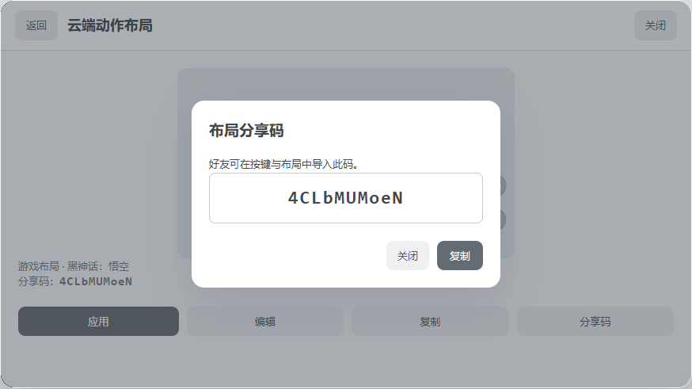 <em>图3-35：演示发布和分享码，不代表真实云服务已接通。</em> | 发布、分享码展示/复制、分享码导入。 | **展示说明：** 1. 复用既有发布表单与分享码界面；名称、码格式及更新规则由原模块提供，本稿不另定。 /2026.10.28修改 **交互说明：** 1. 从我的方案确认发布后更新本机模拟云目录，并展示本次分享码；取消不发布。点击复制按剪贴板实际结果反馈，失败可手动复制，不伪报成功。 /2026.10.28修改 2. 输入可获取的有效分享码后，导入自己的方案并直接进入编辑；无效码显示原错误提示，不产生成功副本。各弹窗关闭回原来源，不重新登录或连接。 /2026.10.28修改 |
| 图标管理 | 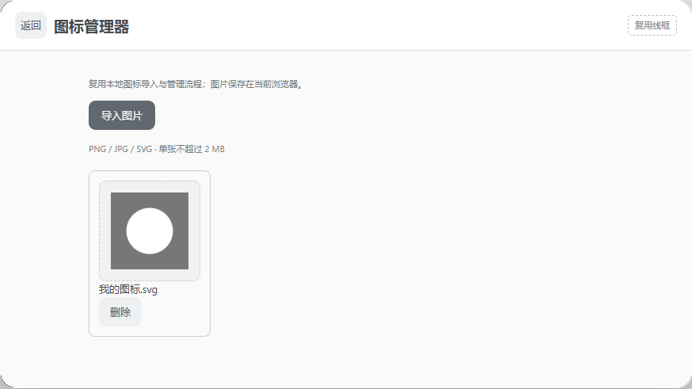 <em>图3-36：实际导入本地图片预览，并可确认删除。</em> | 本地导入、预览、删除确认与返回。 | **展示说明：** 1. 显示已有图标及当前账号导入的本地图标；导入成功后展示所选图片的实际预览。 /2026.10.28修改 **交互说明：** 1. 点击导入打开本地文件选择；取消选择不改列表，读取/校验成功才增加图标，失败保留原列表并说明失败。格式与大小等规则沿既有模块，不另定产品限制。 /2026.10.28修改 2. 删除需确认，取消保留图标，确认后移除该图标；返回回模块主页。上述操作只影响本地演示，不宣称图片已上传云端。 /2026.10.28修改 |

### 3.2 电脑端功能需求

#### 3.2.1 登录页

| 要素 | 内容说明 |
|---|---|
| 功能简介 | 本地区验证码/Google和电脑登录码扫码登录。 |
| 场景描述 | 电脑客户端启动时无有效会话，或退出当前账号后进入。 |
| 输入／前置条件 | 独立电脑客户端；地区来自发行版本/账号配置，Demo外部工具/URL只供评审。 |
| 需求描述 | **图示：** 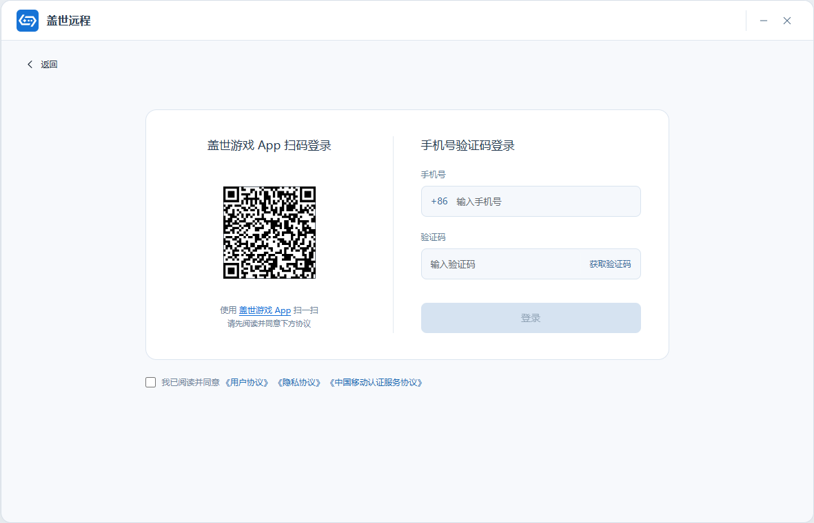 <em>图3-13 国内电脑登录</em> 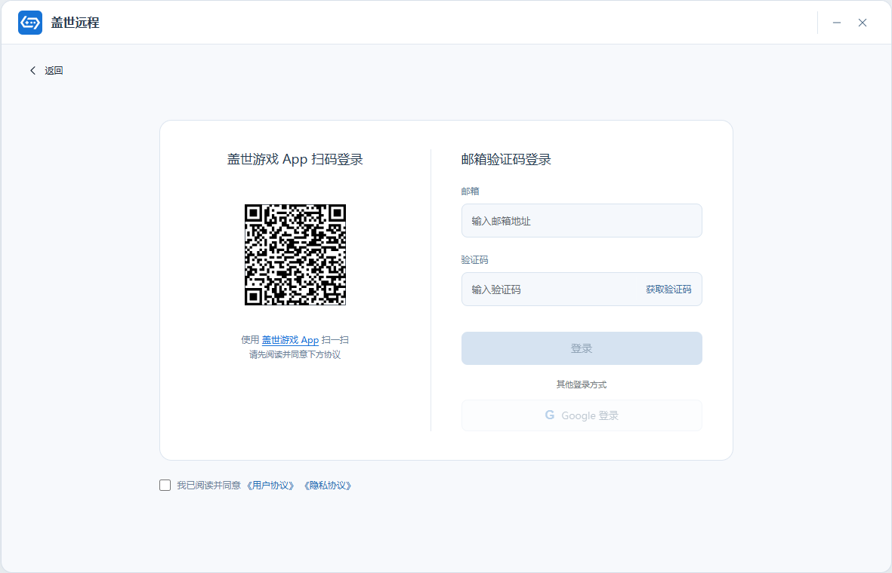 <em>图3-14 海外电脑登录</em> 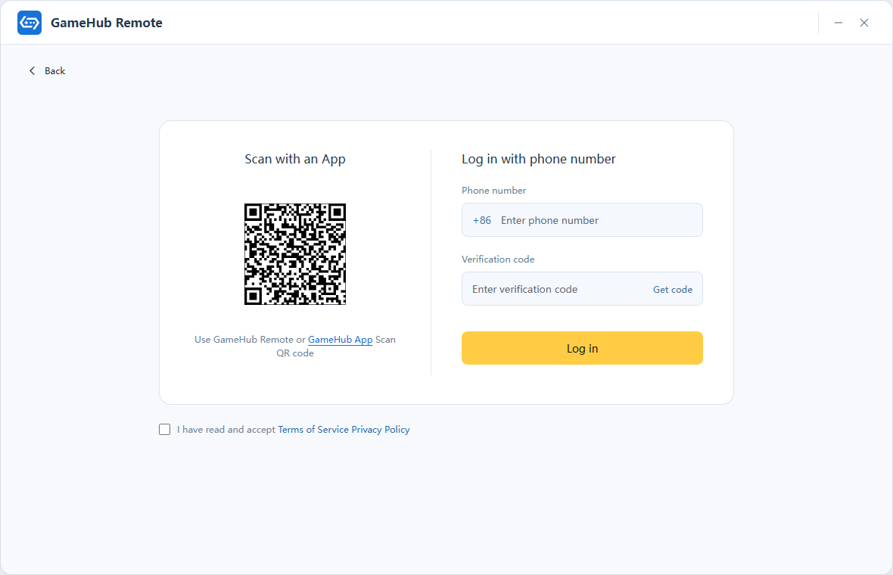 <em>图3-14a：英文界面演示；语言切换不改变地区、二维码或表单状态。</em> **详细说明：** **展示说明：** 1. 未登录启动或退出账号后直接展示完整登录页，不再先显示独立欢迎首页或要求点击登录后展开表单。品牌区只盖世游戏Logo和“盖世远程”，无电脑插画、宣传标题/副文案。左侧显示“App扫码登录”及电脑登录二维码，说明“使用盖世远程或盖世游戏App扫码登录”，右侧国内手机号验证码；海外邮箱验证码及Google，不显示账号密码/微信/QQ。未登录时右上不显示账户和更多。 /2026.10.28修改 2. 底部协议默认未勾选：电脑客户端国内和海外均仅显示《用户协议》《隐私协议》，不含《中国移动认证服务协议》。未同意时仍展示可扫描的登录码，允许进入手机确认页；表单、获取验证码及登录/Google入口不因未勾选而禁用。扫码本身不代表确认或登录成功。盖世游戏下载链接仍可打开对应官网，不作为唯一扫码来源。 /2026.10.28修改 **交互说明：** 1. 未同意时可以填写并获取验证码。点击登录或Google入口时，未勾选先提示“请先勾选协议”，保留输入，不提交登录或启动授权；点击扫码确认登录时也校验电脑端协议，未同意显示同样提示，不确认或领取会话。点击协议只阅读，不替用户同意。 2. 国内Demo为+86、11位手机号；海外邮箱最多254字符，去首尾空格后校验格式；验证码最多6位数字。空值/格式错不发送、不提交；未发送、非6位数字或验证码请求失效不登录。仅Demo接受任意6位数字，正式验证码仍由账号服务校验。统一演示使用国内手机号13600008000或海外邮箱player@example.com，先获取验证码、填写任意6位数字、勾选协议再登录；不发送短信邮件，符合当前格式的其他手机号/邮箱也可模拟登录，不设账号白名单。Mac既有sr-fill填入的13800138000/demo@gamehub.test同样可用。正式规则复用盖世组件并核对。 /2026.10.28修改 3. 初始登录码绑定本发起端，未同意也可扫描至待确认；勾选同意保留仍有效的同一码、扫码状态、输入及验证码，更新本次同意状态，无需重扫或重取验证码。撤勾使旧码和请求失效，生成新的可扫描但未同意的码，旧扫码确认不能复用。支持已登录盖世远程App的我的→扫一扫，或盖世游戏App扫码后确认；两者确认的均为本次电脑登录。真实码协议、支持版本和跨App联调仍需接入，Demo不证明生产扫码兼容。二维码不是设备被控码，不继承Steam/Epic会话。 /2026.10.28修改 4. Google仅海外，同意后走渠道原授权，不收集Google密码；验证码、Google和扫码在最终异步完成/领取前均复核本次协议同意和请求有效性，首次使用且无既有账号时按盖世账号体系完成登录即注册；取得有效会话后才获取当前UID工作区。 /2026.10.28修改 5. 点击“盖世游戏 App”在浏览器打开对应地区的官网下载入口：国内 https://gamehub.xiaoji.com/zh-cn/，海外 https://gamehub.xiaoji.com/en/。不发起登录或自动下载安装，不改变协议勾选状态。 |
| 输出／后置条件 | 独立电脑客户端取得有效盖世会话，进入当前UID设备工作区；本机尚未看过新版引导时显示引导，不自动开启被控或建立远控。 |
| 补充说明 | 1. 协议正式内容/地址未接入只显示待接入预览，不编造条款。邮箱254等为Demo限制，正式SDK输入规则、有效期和发送间隔待核对。 2. 验证码/Google/扫码任一成功后其余尝试失效；撤勾/离开登录/切地区/退出作废在途授权，晚到结果不得覆盖。切地区清空表单并恢复未勾选。 |

| 状态 | 进入／退出 | 表现与操作 | 结果与恢复 |
|---|---|---|---|
| 未同意 | 首次进入或撤勾 | 可填写、获取验证码、点击登录入口或扫描当前码；点击登录入口/扫码确认时提示“请先勾选协议”，不完成登录。 | 勾选保留当前有效码、扫码状态及验证码；撤勾废弃旧码/请求并生成可扫描的新码，仍须重新同意。 |
| 等待扫码 | 登录码有效，协议可未勾选 | 显示二维码和手机扫码说明，本地区表单可用。 | 扫码后进入待手机确认，不直接登录。 |
| 已扫码待确认 | 手机识别本次码 | 提示在手机确认，可取消本次登录；未同意时点击确认提示“请先勾选协议”，保留待确认。 | 勾选后可再次确认；未确认或未同意均不显示成功或设备数据。 |
| 确认后领取中 | 电脑已同意协议，且手机确认本次登录 | 电脑领取自己的会话，仍属处理中。 | 领取前复核协议及请求有效性，核实后才进入工作区，同一授权不可重复领取。 |
| 过期/取消/失败 | 授权终止或生成失败 | 扫码区域显示原因与重新生成，其他本地区方式可用。 | 旧码失效，重试用新授权；时效由账号服务决定。 |

#### 3.2.2 首次使用引导

| 要素 | 内容说明 |
|---|---|
| 功能简介 | 登录成功后说明远程自己电脑的准备步骤。 |
| 场景描述 | 本机首次取得有效盖世会话，且尚未完成或跳过新版登录后引导。 |
| 输入／前置条件 | 电脑端已登录；本机引导记录与账号、允许被控及系统权限分别记录。 |
| 需求描述 | **图示：** 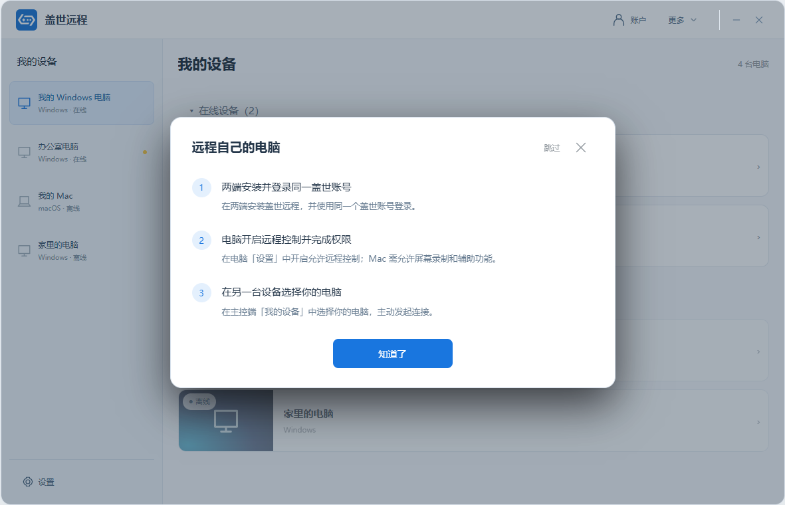 <em>图3-11：登录后在设备工作区显示首次引导。</em> **详细说明：** **展示说明：** 1. 登录之前不显示首次引导。首次登录成功后，在设备工作区显示“远程自己的电脑”引导，包含“两端安装并登录同一盖世账号”“电脑开启远程控制并完成权限”“在另一台设备选择你的电脑”，提供“知道了”“跳过”和关闭。 2. 不展示远程协助、设备码、收藏或会员；不承诺公网必定连接成功或未确定的画质、时长。 /2026.10.28修改 **交互说明：** 1. 点击知道了、跳过、关闭或按Esc，均关闭引导并记录本机已看过新版引导，留在我的设备列表，不再进入登录页。 2. 再次登录不重复提示已看过的新版引导；旧版登录前引导的完成记录不替代新版记录。连接教程仍可主动打开，首次引导重放只在已登录时的外部Demo评审工具显示。 |
| 输出／后置条件 | 本机记住已看过新版引导，显示当前账号设备列表。 |
| 补充说明 | 1. 登录失败、取消或未完成授权时不出现引导。 2. 完成或跳过只关闭引导，不退出账号、不自动连接、不开启被控权限。 |

#### 3.2.3 我的设备与连接教程

| 要素 | 内容说明 |
|---|---|
| 功能简介 | 电脑端查看同账号电脑并打开详情。 |
| 场景描述 | 本端登录后，或从详情返回设备工作区。 |
| 输入／前置条件 | 本端会话有效，服务返回当前UID电脑。 |
| 需求描述 | **图示：** 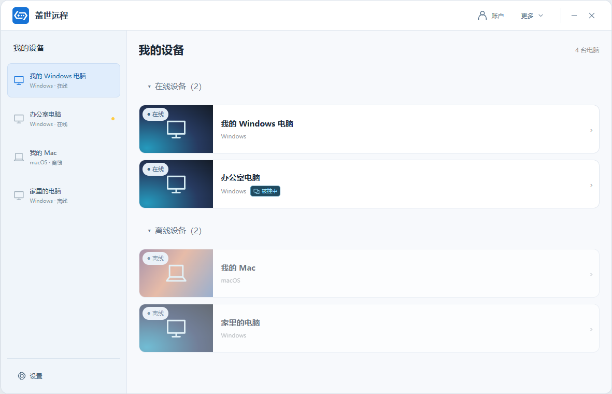 <em>图3-15 电脑设备工作区</em> **详细说明：** **展示说明：** 1. 列表取当前盖世 UID 下支持被控的电脑，按已有在线/离线分组显示名称、系统和状态；不把手机列为被控电脑，不新增远程协助。 2. 加载时显示加载态，不展示旧账号缓存或先下空列表结论；成功无电脑显示空态和连接教程，获取失败显示失败与重试。 3. 长名称在卡片中省略，属性可查看原文，不截断存储；Demo 样例顺序不作为正式排序。 4. 左侧为设备导航与底部“设置”入口，删除左下“这台Mac／本机未允许被控”状态块；右侧为设备内容；顶部右上显示独立账户按钮和更多按钮。更多下拉承接连接教程、帮助中心、检查更新和关于；退出登录图标放在账户面板昵称右侧，设置保留左侧入口，不显示手机旋转按钮。 **交互说明：** 1. 点击电脑卡片进入对应详情，不自动连接。 2. 连接教程说明目标电脑安装独立客户端、同账号登录及开启被控/系统权限；可从另一台电脑或手机主动连接，关闭回原页。 3. 列表失败可重试；账号过期停止操作并回登录，重新登录后重新获取，不连接旧账号缓存。 |
| 输出／后置条件 | 显示当前账号电脑/确定空态，选择后进入对应电脑详情。 |
| 补充说明 | 1. 下载、安装或点击知道了不代表登记成功；旧设备迁移与关系来源见第五章。 2. 正式排序、同值顺序、规模、分页与刷新周期沿用设备服务实际能力，未核对前不作数量/秒数承诺。 |

#### 3.2.4 设备详情

| 要素 | 内容说明 |
|---|---|
| 功能简介 | 电脑端查看目标状态，连接和管理设备。 |
| 场景描述 | 在电脑设备工作区选择一台目标电脑。 |
| 输入／前置条件 | 会话有效，目标属于当前UID；目标允许被控及系统权限独立判断。 |
| 需求描述 | **图示：** 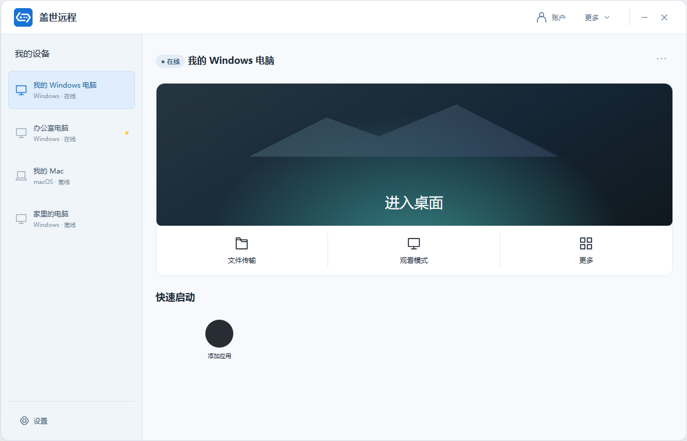 <em>图3-16 电脑设备详情</em> **详细说明：** **展示说明：** 1. 在线、允许被控且无占用时，显示进入桌面、文件传输、观看模式和更多；进入详情不建立连接。 2. 在线但被其他主控占用时显示正在被控，沿用接管确认；禁控/缺权限显示“请在该设备的『设置』中开启允许远程控制。”，需要控制权限的入口不可用。 3. 离线显示“设备已离线”，在线操作不可用；Windows 可按原规则尝试开机，Mac 开机不可用。 **交互说明：** 1. 点击进入桌面或观看，核对实时在线、权限、网络可达性及占用；符合后显示连接中，避免重复发起。首帧可显示且会话可用才算连接成功。 /2026.10.28修改 2. 占用时确认接管才发起；取消不影响原会话。连接中取消回详情，失败/超时留在原流程，可检查设备后重试。跨网络不因非同一局域网而直接阻止；实际连接失败或超时保留原失败/重试路径，不显示连接成功。 /2026.10.28修改 3. 设备菜单保留属性、刷新、重命名、删除。重命名最多40个汉字、空值不提交、超限不能保存；取消不改，服务成功后更新。删除二次确认，取消不删；成功退出该详情并更新列表，不删除磁盘文件。 |
| 输出／后置条件 | 控制/观看成功后显示目标远控窗口；管理成功更新设备或列表。 |
| 补充说明 | 1. 主控登录不能代替目标系统授权；公网与局域网均需目标在线、网络可达及权限有效。失败、取消、离线或权限不足留在原设备流程，不显示成功桌面。 /2026.10.28修改 2. 电源按系统能力及旧确认流程；受理不等于完成，超时显示未知，恢复在线后再连接；关机/重启断开不普通重试。 |

##### 页面子功能汇总

| 类型 | 图示 | 内容 | 说明 |
|---|---|---|---|
| 快捷启动 | 电脑详情上下文见图3-16 | ChatGPT、盖世游戏、Steam与添加应用。 | **展示说明：** 1. 当前设备应用列表隔离，不新增模型、收费或平台账号同步。 **交互说明：** 1. 盖世游戏/Steam启动远端原生客户端；Steam未登录由用户在远端完成，不收集凭证。游戏沿用既有启动设置，可信远端结果才算成功；真实GPT接入仍在范围外。 |

#### 3.2.5 设置

| 要素 | 内容说明 |
|---|---|
| 功能简介 | 设置本机被控权限、运行偏好及关闭窗口行为。 |
| 场景描述 | 电脑端左侧“设置”入口；更多菜单不再重复提供。 |
| 输入／前置条件 | 当前独立电脑客户端已登录；本机系统状态和本地有效偏好分别取得。 |
| 需求描述 | **图示：** 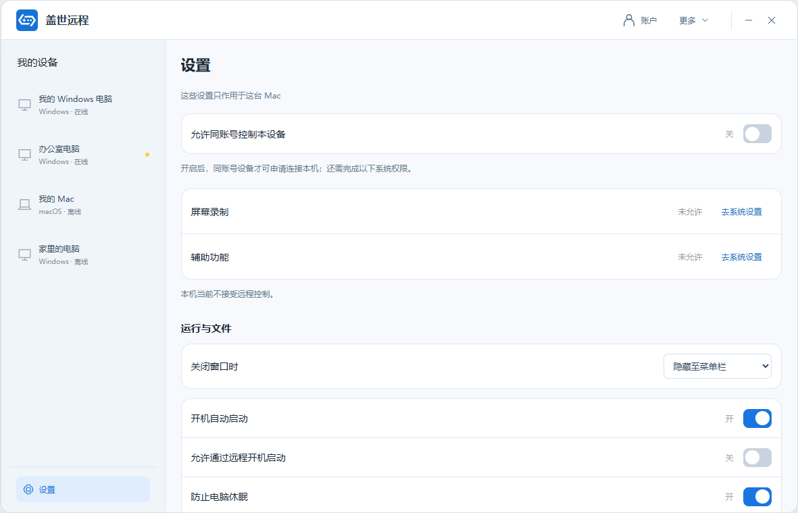 <em>图3-17 设置与本机被控权限</em> **详细说明：** **展示说明：** 1. 页面标题为“设置”，显示“允许同账号控制本设备”、屏幕录制/辅助功能权限状态及系统设置入口；登录、开关和权限分别判断。 2. 开机自启、允许远程开机、防休眠、文件接收路径沿用原Mac设置；是否可用按系统/版本判断，不合并开机自启与允许被控。 3. “关闭窗口时”为下拉选择，默认“隐藏至菜单栏”，另一个选项为“退出主程序”；重新进入显示本机已保存选择。 **交互说明：** 1. 开启允许被控后仍需系统权限；点击去系统设置，完成授权返回后重新检查；提交失败保留原有效状态，不把本地点击当生效。 2. 关闭开关保留账号登录，其他主控不能再发起控制；进行中会话的撤销按既有权限规则处理。 3. 选择关闭窗口行为后立即保存本机偏好，选择本身不关闭窗口、不退出账号。下次点击顶栏关闭时按当前选择执行，不新增确认弹窗。 |
| 输出／后置条件 | 按有效开关及系统实况展示本机是否具备被控条件，保存本机偏好；其他主控仍须主动连接。 |
| 补充说明 | 1. 首次安装权限以系统实况为准，登录不自动授权；生产默认值未核对前不承诺默认开启。Demo新安装默认不允许被控。 2. Windows权限/开机能力需按实际客户端验证，Demo的Mac表现不构成Windows发版承诺。 |

##### 页面子功能汇总

| 类型 | 图示 | 内容 | 说明 |
|---|---|---|---|
| 下拉选择 | 设置页面见图3-17 | 关闭窗口时：隐藏至菜单栏／退出主程序。 | **展示说明：** 1. 首次默认隐藏至菜单栏；之后按本机已保存偏好显示，不随账号退出而重置。 **交互说明：** 1. 隐藏至菜单栏仅收起窗口；再次显示恢复原工作状态，不视为退出账号。 2. 退出主程序停止本端远控、输入和文件临时任务，保留账号身份与本机偏好；重新打开回设备列表，原本未登录则仍为未登录，不恢复旧远控或任务。 3. 当前Demo只模拟隐藏、退出和恢复，不操作真实系统菜单栏或进程。 |

#### 3.2.6 远控窗口与控制中心

| 要素 | 内容说明 |
|---|---|
| 功能简介 | 使用本机键鼠控制/观看另一台电脑。 |
| 场景描述 | 电脑端详情主动连接成功后。 |
| 输入／前置条件 | 首帧可显示且会话可用；远端权限有效。 |
| 需求描述 | **图示：** 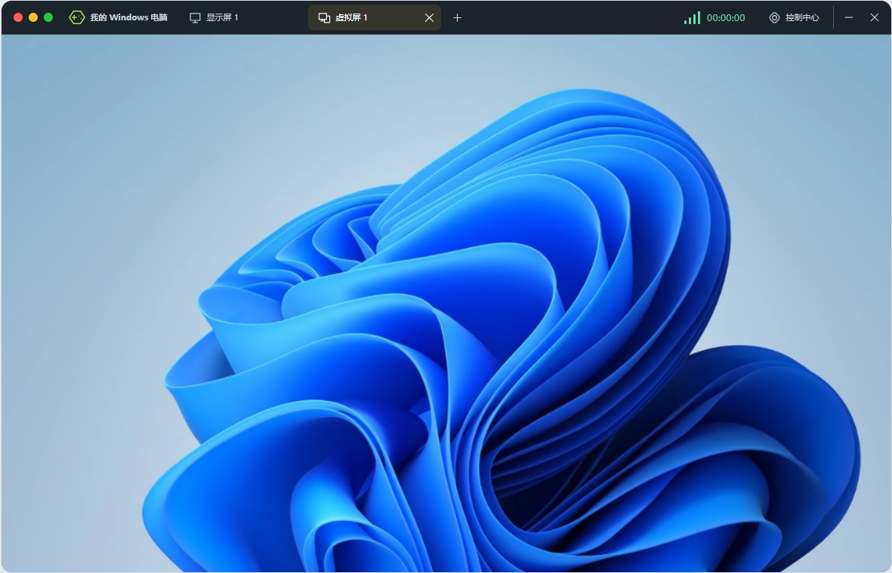 <em>图3-18 电脑远控</em> **详细说明：** **展示说明：** 1. 远控窗口与设备工作区分开，控制中心含显示、声音、观看、会话和文件入口；本机键鼠输入，不显示手机软键盘或悬浮鼠标。 **交互说明：** 1. 收起控制中心不结束连接；仅观看实际拦截写操作，恢复控制后才可输入。 2. 退出结束连接并返回原设备，远端程序保留；显示/质量调整使用远端确认结果。 |
| 输出／后置条件 | 本端在当前会话进行控制/观看，退出后返回原设备。 |
| 补充说明 | 1. 连接质量及弱网沿用旧规则，不新增延迟/码率阈值；恢复后显示实际连接状态。 2. 离线/权限撤销优先于弱网，停止输入、释放按键并显示结束/需重连，网络恢复不重放断开输入。 |

#### 3.2.7 文件传输页

| 要素 | 内容说明 |
|---|---|
| 功能简介 | 在本机与目标电脑间传文件。 |
| 场景描述 | 电脑端详情、更多或远控会话打开文件入口。 |
| 输入／前置条件 | 本端登录、设备及文件权限有效，沿用已有电脑文件模块。 |
| 需求描述 | **图示：** 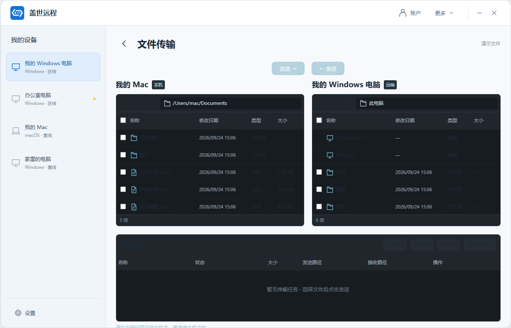 <em>图3-19 电脑文件传输</em> **详细说明：** **展示说明：** 1. 显示本机/远端双栏，任务状态与目标路径；样例任务不传真实文件。 **交互说明：** 1. 按原目录授权、选择及同名规则发起，接收端确认后才完成。 2. 暂停、继续、取消、失败重试沿用V3.10；返回原来源，清完成记录不删除磁盘文件。 |
| 输出／后置条件 | 任务以接收端结果展示完成或其他实际状态，保留路径。 |
| 补充说明 | 1. 网络中断不标成功；格式/大小/选择数量等沿用旧能力，不自定上限。 2. 退出终止本端任务并隔离账号缓存，真实清理与传输规则接入仍待核对。 |

#### 3.2.8 顶栏与个人账号

| 要素 | 内容说明 |
|---|---|
| 功能简介 | 提供教程、帮助、检查更新和关于入口，查看个人账号并退出登录。 |
| 场景描述 | 电脑端点击顶栏窗口按钮；登录后可点击更多或独立账户按钮。 |
| 输入／前置条件 | 账户和更多需当前独立电脑会话有效；窗口最小化与关闭在登录前后均可操作。 |
| 需求描述 | **图示：** 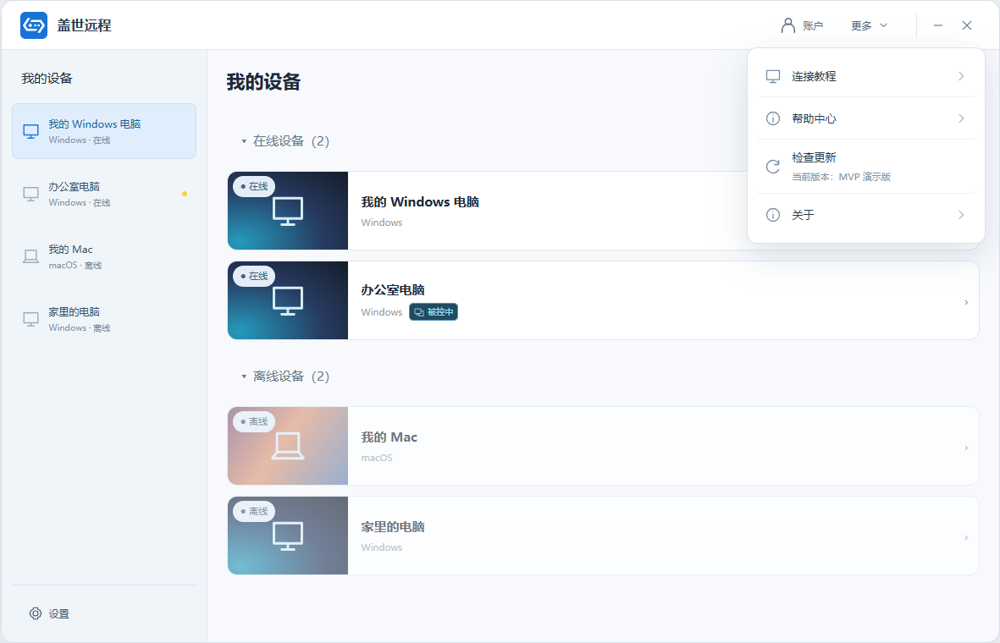 <em>图3-20：电脑端右上更多。</em> 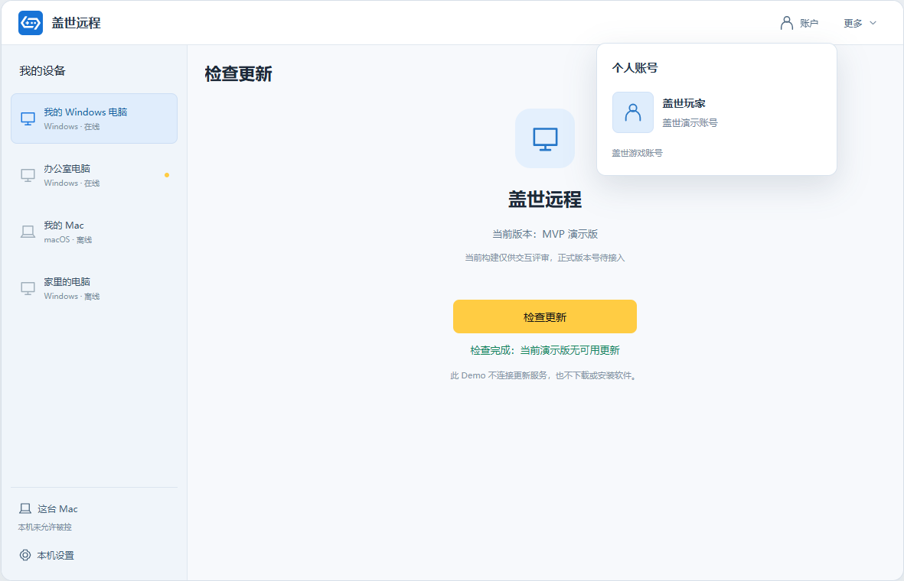 <em>图3-20a：电脑端独立账户面板、静态头像及退出图标。</em> 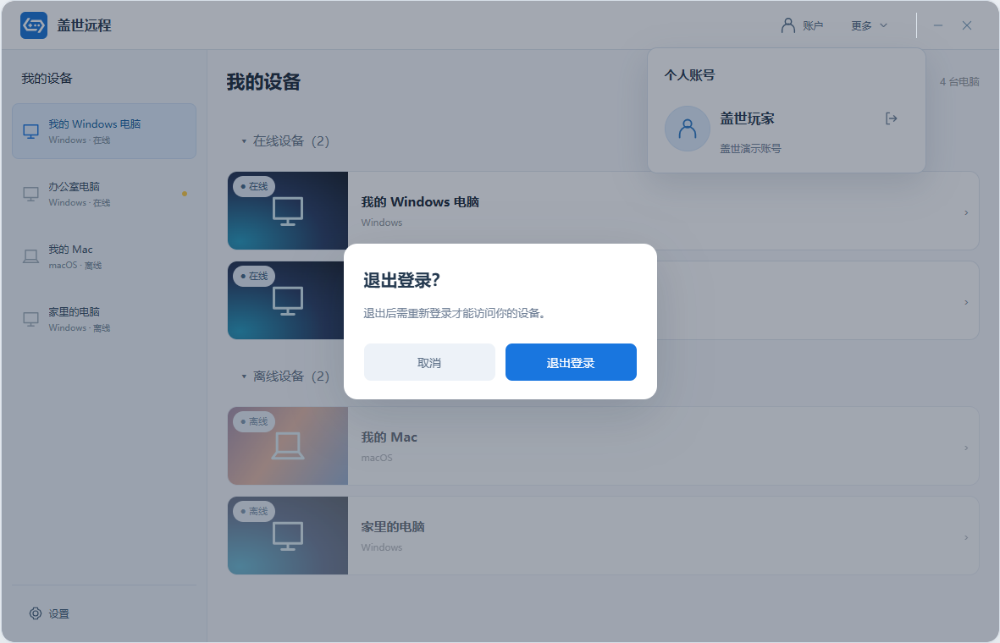 <em>图3-20b：当前工作区上方显示退出登录确认框。</em> **详细说明：** **展示说明：** 1. 仅登录后在顶部右上显示账户按钮和“更多”；登录页及退出后均隐藏这两个入口和已展开面板。点击更多只显示连接教程、帮助中心、检查更新、关于；不显示本机设置和退出登录。页面默认浅色，不显示风格或模式选项。 2. 顶栏右上提供最小化和关闭按钮，不受账户/更多隐藏影响。 3. 账户面板显示静态头像、当前昵称，昵称正下方统一显示UID标签及当前盖世UID，昵称右侧只显示退出图标，不显示退出文字；图标按钮的aria-label和title均为“退出登录”，不在面板底部重复放退出入口。头像不显示可点击反馈；当前Demo用演示头像，正式资料由盖世账号体系提供；新账号使用其默认头像/昵称，盖世侧修改后本端重新获取资料时同步，不开放本端编辑。Demo按账号派生稳定的演示UID，同账号跨端一致，不冒充服务端真实UID。 /2026.10.28修改 **交互说明：** 1. 点击更多的连接教程、帮助中心或关于，进入对应页面；点击检查更新留在当前工作区检测；有新版本显示更新通知弹窗，已是最新版本显示Toast“已是最新版本”，不打开子页面、不保留旧行内绿色结果；点击菜单外部或关闭后回原工作区，不修改当前设备。 2. 点击顶栏账户打开当前个人账号面板；头像仅展示，点击不产生提示或其他操作，不新增头像上传或账号编辑。 3. 点击账户面板昵称右侧退出图标，显示二次确认框：标题“退出登录？”，说明“退出后需重新登录才能访问你的设备。”，按钮“取消”和“退出登录”。打开确认框不退出账号、不清理任务。 4. 点击取消或按Esc关闭确认框，保留当前账号、原工作区及进行中的任务。点击确认框的退出登录后，才结束本端会话、未完成授权和任务，清设备、选中目标、临时授权及账号缓存，回登录页并隐藏账户和更多；不退出盖世App或其他电脑；已看过的新版首次引导不重弹。再次登录按UID取数据，不恢复旧连接。 |
| 输出／后置条件 | 取消退出保留原账号、页面与任务；确认退出后显示登录页。其他入口进入所选页面或显示当前个人账号。 |
| 补充说明 | 1. 真实会话撤销、传输清理和退出后的离线记录仍待接入；页面清空不等于服务端解绑。未登录时不显示个人设备或旧账号资料。 2. 本确认仅用于退出账号；退出远控会话与退出主程序继续沿用各自原规则。退出主程序不退出账号，窗口关闭仍按既有偏好执行，不新增该确认框。 |

##### 页面子功能汇总

| 类型 | 图示 | 内容 | 说明 |
|---|---|---|---|
| 原页操作／弹窗 | 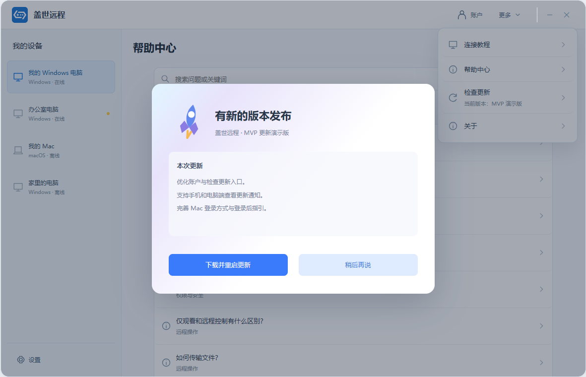 <em>图3-29：当前工作区上方显示更新通知弹窗。</em> | 更多菜单中的检查更新、当前版本、右箭头及更新通知。 | **展示说明：** 1. 更多菜单的检查更新行显示当前版本和右箭头；有更新时显示参照图的渐变背景、火箭插画、演示新版本说明及“下载并重启更新”“稍后再说”两个按钮。已是最新版本不弹更新通知，只显示Toast“已是最新版本”。 2. 不新增更新子页面，不显示旧行内绿色结果；版本与更新内容均为演示信息。 **交互说明：** 1. 点击检查更新留在原工作区检测，不改变选中设备；检查中不可重复发起。有更新显示通知，已最新显示上述Toast。 2. 点击稍后再说关闭通知，保留原页面；点击下载并重启更新仅模拟更新操作，不下载真实安装包、不重启真实系统或进程。 3. 离页或退出作废未完成检测及旧弹窗回调；外部评审工具可选择有更新/已最新，只改变Demo状态，不作为正式设置。 |
| 窗口操作 | 顶栏位置见图3-20 | 最小化、关闭及恢复。 | **展示说明：** 1. 顶栏右上显示最小化和关闭按钮；未登录时仍可使用。 **交互说明：** 1. 点击最小化仅收起窗口，保留当前页面、账号与任务；恢复后回原状态。 2. 点击关闭按设置中的“关闭窗口时”执行：隐藏至菜单栏或退出主程序，不新增确认弹窗。退出主程序不等于退出账号。 3. Demo通过客户端外部评审区模拟恢复最小化/隐藏窗口或重新打开；该入口不属于正式产品页内功能。 |

#### 3.2.9 帮助中心

| 要素 | 内容说明 |
|---|---|
| 功能简介 | 浏览电脑端帮助文章并搜索问题。 |
| 场景描述 | 电脑端更多→帮助中心。 |
| 输入／前置条件 | 当前Demo使用双端一致的内置帮助文章。 |
| 需求描述 | **图示：** 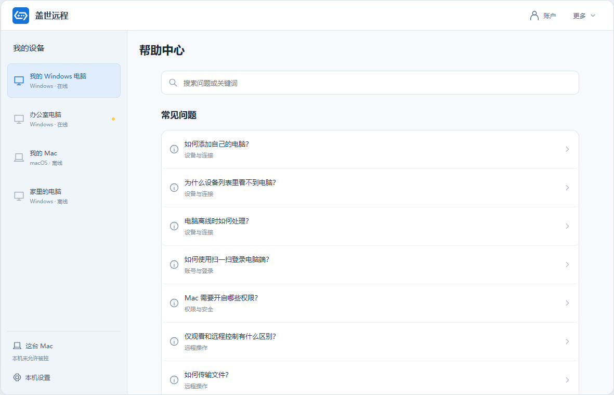 <em>图3-27：电脑端帮助中心；问题搜索和文章列表。</em> **详细说明：** **展示说明：** 1. 标题为“帮助中心”；顶部显示搜索问题或关键词，列表显示添加电脑、设备/离线、扫码、权限、远控、文件和账号等文章的标题及分类。无匹配显示“没有找到相关问题”。 **交互说明：** 1. 输入后立即匹配标题、分类和正文；不另设业务输入长度上限，忽略首尾空格和英文字母大小写，清空恢复全部文章，不提交或持久保存搜索词。 2. 点击文章打开帮助详情；查看说明不建立远控或改变系统设置。 |
| 输出／后置条件 | 显示匹配文章或确定无结果状态，选择文章后进入对应详情。 |
| 补充说明 | 1. 正式帮助内容采用静态H5，由运营提供并审核、服务端维护，客户端打开；一期不新增运营配置页、客服或反馈提交流程。 /2026.10.28修改 |

#### 3.2.10 帮助详情

| 要素 | 内容说明 |
|---|---|
| 功能简介 | 阅读当前文章的完整操作说明。 |
| 场景描述 | 电脑端帮助中心选择文章。 |
| 输入／前置条件 | 所选文章存在。 |
| 需求描述 | **图示：** 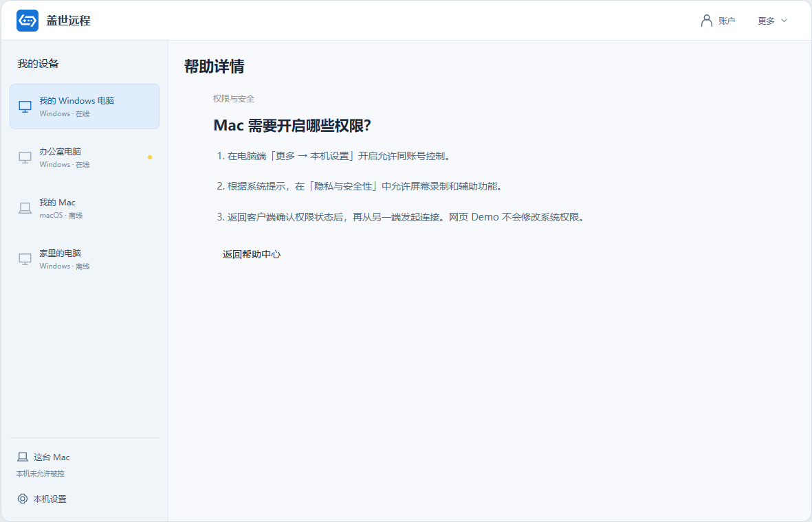 <em>图3-28：电脑端帮助详情。</em> **详细说明：** **展示说明：** 1. 显示帮助详情标题、文章分类、标题和步骤正文，保留返回帮助中心按钮。 **交互说明：** 1. 点击返回帮助中心回文章列表；正文中的步骤为说明，不自动修改权限、登录、发起连接或传输。 |
| 输出／后置条件 | 显示所选文章，或返回帮助文章列表。 |
| 补充说明 | 1. 文章不存在时显示未找到说明并保留返回。 |

#### 3.2.11 关于

| 要素 | 内容说明 |
|---|---|
| 功能简介 | 阅读电脑客户端协议与信息清单，提供账号注销入口。 /2026.10.28修改 |
| 场景描述 | 电脑端更多→关于。 |
| 输入／前置条件 | 正式协议及信息清单待接入。 |
| 需求描述 | **图示：** 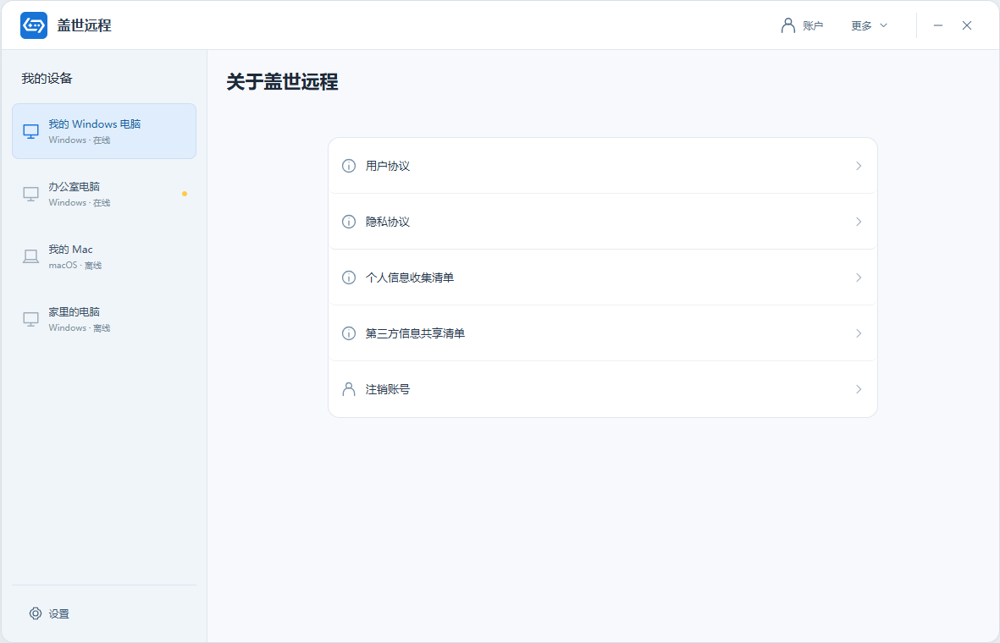 <em>图3-30：电脑端关于；协议/信息清单及已登录时的注销账号入口。</em> **详细说明：** **展示说明：** 1. 标题为“关于盖世远程”；显示用户协议、隐私协议、个人信息收集清单、第三方信息共享清单；仅登录时在列表后显示“注销账号”。不放检查更新、版本、Logo或产品介绍。 /2026.10.28修改 **交互说明：** 1. 点击协议或清单只显示正式内容与地址待接入说明，不编造正文，也不改变登录协议同意状态。 2. 点击注销账号，正式版本打开盖世账号注销H5流程；当前无正式地址时在现有说明区域显示“注销账号页面待接入，正式版本将打开盖世账号注销流程。”，不跳虚构网址、不退出账号或模拟注销成功。 /2026.10.28修改 |
| 输出／后置条件 | 显示四项条款/清单及登录态下的注销入口；未接入时显示相应说明，不改变账号状态。 /2026.10.28修改 |
| 补充说明 | 1. 电脑客户端不展示中国移动认证服务协议，国内和海外登录均只要求本端用户协议与隐私协议；未提供的正式正文不由Demo代写。 /2026.10.28修改 2. 注销复用账号体系的既有H5，资格、确认步骤、生效及回传由该流程提供，不另拟规则；真实地址及结果衔接未接入前不宣称可完成注销。 /2026.10.28修改 |

## 四、支撑及非功能需求

### 4.1 埋点与数据需求

**数据结论：**改造原远程入口与登录归因，复用连接、会话、文件、电源、游戏和工具事件。旧“游戏库入口曝光/点击”不再作为独立版入口转化；保留历史数据原含义，独立产品按产品和版本区分。Demo 不向生产上报。

本轮我的/帮助搜索/版本/关于为页面与入口调整，不新增统计目标或埋点；扫码继续归入电脑端登录尝试，不将手机扫描或确认记作登录成功。埋点先保留当前事件设计；接入新自有平台或Firebase的选择、接口和迁移口径待数据团队确认，不同时重复计数。按键与布局本轮提供可操作的复用交互线框，Demo不向生产上报业务事件；正式接入盖世已有模块时沿用其有效事件与数据口径，具体映射需核对，本地演示成功不能作为真实云服务成功。以下三项为既有独立登录改造的新增事件；每项包含登录业务参数及产品归属。账号、事件ID、客户端版本、环境等SDK公参复用原字典，接入前核对映射。 /2026.10.28修改

#### 4.1.1 指标口径

| 指标名称 | 口径 | 去重与时间窗口 | 数据源与用途 |
|---|---|---|---|
| 登录完成率 | success尝试数÷有start的尝试数；取消、过期、未知结果仍在分母并单列。 | 同一完整自然日，按发起日归属；同一login_attempt_id只计一次。 | remote_login_start/result；按客户端、渠道和版本比较。 |

登录访问→设备列表成功→连接成功按同一账号和访问归因，独立文件操作不计作连接失败。时区、迟到回补、SDK公参与原remote事件映射沿用V3.10 §4.1，接入前核对命名冲突，不新增无依据目标值。

#### 4.1.2 埋点事件

| 事件 | 页面/类型 | 触发与成功 | 参数 |
|---|---|---|---|
| remote_login_view | 双端登录页／新增 | 实际显示登录页时上报；同一次登录访问去重，重渲染不重复曝光。 | login_visit_id, client_side, product |
| remote_login_start | 双端登录页／新增 | 同意协议且真正提交验证码登录、发起Google/跨App授权或扫码确认请求时上报；仅输入、获取验证码、展示/扫描二维码、阅读协议或未同意拦截不记录开始，重试使用新尝试标识。 | login_visit_id, login_attempt_id, client_side, login_method, product |
| remote_login_result | 双端登录页／新增 | 本次登录产生可确认结果时上报；success须本独立客户端取得有效会话。每次尝试只保留一个有效终态，晚到旧结果不能覆盖失效授权。 | login_visit_id, login_attempt_id, client_side, login_method, result, reason, product |

原 `remote_entry` 改为独立产品进入设备工作区的曝光/点击，不再使用游戏库/Mac商店入口值；入口改造后的 `entry` 枚举及历史兼容映射由数据接入确认，阻塞该事件联调。`remote_device_list` 及连接、会话、文件、电源、游戏、工具事件复用 V3.10 §4.1 的业务参数、触发和去重，仅补充 `product=standalone_remote`。独立版使用新的产品归属区分历史数据，不重写历史事件含义。 本轮公网纳入一期后，连接事件不再继承旧稿“仅上报network_scope=lan”或“非LAN即not_same_lan拦截”的规则；网络范围按真实连接来源记录，公网取值及历史兼容映射由数据团队确认，未确认前不得伪报lan或连接成功。该变更不放宽Windows远程唤醒原有的目标系统、网络及辅助设备条件。 /2026.10.28修改

#### 4.1.3 参数说明

| 参数 | 类型/必填 | 说明 | 枚举/示例 |
|---|---|---|---|
| login_visit_id | string／登录事件必填 | 一次登录页访问标识。 | 例：lv_20261026_01；同次登录页重渲染复用。 |
| login_attempt_id | string／start、result 必填 | 一次真正发起的登录尝试；重试使用新值。 | 例：la_20261026_01。 |
| client_side | string／必填 | 本事件所属独立客户端。 | mobile＝移动 App；desktop＝电脑客户端。 |
| login_method | string／start、result 必填 | 本次发起方式；不将模拟按钮作为生产渠道。 | phone_sms＝国内手机号验证码；email_code＝海外邮箱验证码；google＝海外 Google 授权；gamehub_app＝移动端拉起盖世 App；gamehub_qr＝电脑端扫码。 |
| result | string／result 必填 | 本次可确认的登录结果。 | success＝取得有效会话；failed＝明确失败；cancelled＝取消；expired＝授权过期；unknown＝未确认结果。 |
| reason | string／非成功 result 必填、成功不传 | 失败原因分类，不传服务原始敏感信息。 | user_cancel＝用户取消；not_installed＝无法拉起；network＝网络失败；auth_expired＝授权失效；account_expired＝盖世登录态失效；other＝其他明确失败；unknown＝未知。 |
| product | string／本节事件必填 | 区分历史嵌入式和本次独立产品。 | standalone_remote＝独立远程产品。 |

### 4.2 账号、权限与兼容

两端以同一服务端UID识别盖世共用账号，独立产品各自建立会话；首次登录即注册，生成的账号可在盖世游戏使用。头像昵称及UID从同一账号体系获取，两端均在昵称正下方显示UID标签及当前盖世UID，本端只展示。扫码及跨 App 登录必须绑定本次发起端；取消、过期或刷新后旧授权不可继续使用。跨 App 返回需要恢复发起端页面；会话未核实前不读取设备。账号服务异常时保留仍可用的本地区登录方式，具体 SDK、授权回调和会话撤销方案由账号团队与客户端核对。 /2026.10.28修改

屏幕录制、输入控制、文件读写、应用扫描和电源权限仍按被控系统分别判断。主控已登录不能替代目标电脑的系统授权；手机号、邮箱、验证码、Google 凭证、授权码、令牌及锁屏密码不写入埋点，不自动读取或保存系统锁屏密码。

未改远控区域的精确参数及旧交互以V3.10 §3.1.3～3.1.7a、§3.1.10～3.1.16及对应当前模块为基线，按键与布局本轮按3.1.12演示可操作的复用线框，创建及编辑按最新实机资料校正，其余业务规则沿用盖世已有模块；本稿已替换其嵌入式入口、登录前置和仅局域网范围，不继承游戏库/商店外壳，也不将模拟内容视为真实服务。 /2026.10.28修改

### 4.3 协议、隐私与素材

| 需求项 | 具体要求 |
|---|---|
| 登录协议 | App国内展示用户协议、隐私协议、中国移动认证服务协议，App海外展示用户协议及隐私协议；电脑客户端国内和海外均仅展示用户协议及隐私协议，不展示中国移动认证服务协议。默认未同意；允许输入、获取验证码和扫描有效二维码进入确认。登录/第三方授权入口可点击，未同意提示“请先勾选协议”且不提交或发起授权；扫码确认也受电脑端本次有效同意约束。异步完成和扫码领取前再次校验，撤勾/切区/退出隔离旧请求；点击协议或官网下载链接不自动同意。 /2026.10.28修改 |
| 正式语言与官网包 | 一期提供中文、英文，语言随官网下载的对应安装包确定，正式客户端不设语言切换。官网露出盖世远程Android、iOS、Windows、Mac下载入口并关联对应语言包；实际可下载平台、版本、架构和包地址待确认，不放虚构下载地址。 /2026.10.28修改 |
| Demo语言 | 双端Demo顶部外部评审区常驻“中文”“English”按钮，点击即时切换当前界面文案并记忆选择，刷新或再次打开沿用已选语言。语言与国内/海外地区独立：国内继续手机号渠道，海外继续邮箱/Google，扫码及盖世授权规则不变；切换语言不改输入、协议勾选、账号登录态、当前页面、请求/验证码/二维码和进行中任务，不重新发起或作废请求。按钮不是正式产品地区入口，不新增设置页。本文界面文案以中文为例，英文提供对应含义；用户输入、手机号、邮箱、验证码及业务标识不随语言改写。 /2026.10.28修改 |
| 正式配置 | 帮助与协议采用静态H5，运营提供内容、服务端维护，客户端提供入口；一期不建文章/协议后台配置页。协议按盖世远程实际功能、采集信息及已接入SDK整理并经法务审核，不直接改产品名后沿用无关条款；主体、版本和正式地址待核对；中国移动实际认证方式仅针对国内App核对，不涉及电脑客户端。未提供正文时Demo仅显示待接入预览，不新增运营商一键登录能力。 /2026.10.28修改 |
| 更新与渠道 | 安装包保留渠道标识，检查更新沿用盖世的官网/应用商店分渠道规则；独立产品更新源与盖世游戏配置分开，后台账号权限可复用。正式版本、下载地址、商店跳转及失败恢复按适用渠道接入，Demo仅模拟检测和下载结果。 /2026.10.28修改 |
| 公网接入 | 一期支持公网与局域网；打洞/转发策略、自研或供应商、成本及容量须进一步评估。收费、免费画质、时长与用户限量尚未定案，界面不新增套餐、限额或免费承诺。实际网络不可达、服务失败或超时不标连接成功。 /2026.10.28修改 |
| 应用交付 | 独立应用需准备软著、ICP、签名、商店应用及实际功能匹配的协议/采集和共享清单；正式资料经相应审核后接入。先准备本地最小可运行包用于软著材料，不改变一期包含公网的产品范围，不将会议口头日期写成发版承诺。 /2026.10.28修改 |
| 素材 | 登录使用盖世游戏现有Logo和“盖世远程”工作名；正式独立品牌及盖世远程下载地址待确认；盖世游戏 App 的下载入口使用国内 https://gamehub.xiaoji.com/zh-cn/、海外 https://gamehub.xiaoji.com/en/。UU资料仅参考结构和流程，不复制其品牌/协议或额外能力。 |

## 五、待确认项

| 问题 | 建议或条件式选项 | 影响 | 阻塞范围 |
|---|---|---|---|
| 独立入口埋点与上报平台 | 新增独立产品归属；原entry的独立移动/电脑入口值、公网network_scope枚举及历史兼容映射、新平台或Firebase承接、接口切换由数据团队核对。 | 入口转化、网络归因和历史报表。 | 阻塞入口及公网埋点联调，不阻塞页面。 /2026.10.28修改 |
| 正式产品名、图标、独立客户端下载地址与协议主体 | 目前用“盖世远程”工作名；盖世游戏 App 使用已核对的地区官网，独立盖世远程下载地址仍待提供。 | 发版素材、协议与安装教程。 | 阻塞正式品牌/下载/协议，不阻塞本地流程评审。 |
| 首发系统、组件限制及地区配置 | 国内手机号、海外邮箱/Google、盖世授权及正式中英文语言包已确认；Windows/Mac先覆盖主流系统与架构，精确支持表、移动平台包、SDK、正式输入长度和地区配置待确认。 | Mac/Windows权限、表单与渠道联调。 | 阻塞真实客户端与渠道验收，不阻塞已确认页面。 |
| 国内App中国移动协议配置 | 仅国内App展示，电脑客户端不展示；核对App纯短信或运营商认证方式，以及实际主体/链接，不据协议名新增一键登录。 | 国内App协议准确性和认证联调。 | 仅阻塞国内App正式配置，Demo仅展示交互；电脑客户端的移除规则已确认。 /2026.10.28修改 |
| 跨 App 授权、扫码服务及会话撤销 | 账号身份复用，按独立产品签发会话；盖世远程与盖世游戏App均须支持扫码；待核对码协议、最低兼容版本、旧版更新地址、地区限制、回跳、取消、失效及旧码失效。 | 移动授权、电脑扫码、退出与切账号。 | 阻塞真实登录联调；Demo 仅模拟。 |
| 旧设备关系是否迁移、退出是否保留离线记录 | 推荐先核对设备服务的产品归属；不得默认把盖世游戏登录过的所有电脑直接列出。 | 同账号列表、删除、退出后的其他端状态。 | 阻塞设备迁移和解绑服务语义，当前样例列表仅供交互评审。 |
| 新安装被控默认值与权限状态 | 按系统实况显示；未授权不显示可被控。 | 首次设置和正在进行会话的权限撤销。 | 阻塞系统权限/被控实测，不阻塞设置页面评审。 |
| 公网连接方案与资源规则 | 公网已纳入一期；打洞/转发策略、自研或供应商、成本与容量需调研验证，收费、画质、时长及限量另行确认。 | 连接失败恢复、容量、体验及商业化。 | 阻塞真实公网服务与资源规则验收，不影响已确认的一期公网范围；Demo不证明服务已接通。 /2026.10.28修改 |
| 帮助文章与更新服务正式来源 | 当前Demo仅内置文章，更新结果由外部评审工具模拟有更新/已最新；下载并重启按钮仅演示，不接真实更新服务。正式文章采用运营审核的静态H5；版本以安装包为准，独立更新源与官网/应用商店渠道、下载失败恢复及重启安装流程待接入。 | 双端帮助与检查更新。 | 阻塞正式内容及真实更新服务/下载重启验收，不阻塞Demo交互评审。 |
| 按键与布局复用接入 | 详情、编辑、云分享和分享码导入复用盖世已有模块；需核对独立客户端入口、账号、模块版本及数据接入映射，不在本Demo另定业务规则。 | 已有模块在独立客户端中的实际接入。 | 本轮交付可操作的本地复用演示，未代表真实模块或云分享服务接入完成。 /2026.10.28修改 |
| 注销H5地址与结果衔接 | 双端关于中的注销入口已确定；复用盖世账号注销H5，真实URL、登录校验、取消返回和成功回传后本端处理需账号服务核对。 | 注销页面打开、共享账号状态及任务清理。 | 阻塞真实注销联调，不阻塞待接入入口展示；不以点击入口判注销成功。 /2026.10.28修改 |
| 账号相关缓存与传输任务在退出时如何清理 | 建议终止本端操作并隔离账号缓存，不删除用户磁盘文件。 | 未完成任务、再次登录及隐私。 | 阻塞退出账号的真实传输接入，Demo 不执行真实文件操作。 |

## 六、附录

### 6.1 参考文档

| 文档 | 位置 | 有效范围 |
|---|---|---|
| 用户最新按键与布局截图 | 当前会话提供的排行/自定义/图标管理器页面截图、七张盖世布局创建和编辑实机图，以及补充的控件选中与摇杆属性两图 | 主页结构及V4.12创建、横屏画布、图层、设置、添加、选中和属性的依据；修改后返回弹保存确认由用户明确，其他未改规则沿用原模块。 |
| 旧按键云分享Demo | demos/虚拟按键与布局/按键云分享-gemini-demo.html及同名txt；icon-manager-demo.html | 既有复制、编辑、发布、导入、图标与返回交互参考；V4.11按用户截图保留主页结构，不新建另一套业务规则。 |
| 2026/10/28 二次评审 | C:/Users/z3635/Downloads/盖世远程需求变更2次评审.txt | 一期公网、账号UID与注销、双App扫码、正式语言包、内容维护及按键编辑/云分享；网络成本方案仍待定。 |
| 盖世串流一期PRD V3.10 | 盖世串流一期PRD.md | 旧远控交互及数据字典；嵌入式入口和登录已替换。 |
| 独立产品与登录讨论稿、状态卡 | 独立远程电脑-产品形态与登录链路-评审稿.md；远程电脑状态卡.md D-049～D-077 | 独立双端、账号、地区渠道、协议及MVP范围。 |
| UU本地实机及本轮五图 | 串流功能/网易UU/；调研/截图/A01～A28；assets/inputs-20261026/ | 独立结构、设备/远控与键盘、首次引导及登录布局参考。 |
| 盖世移动端扫码Mac需求、APP链路埋点 | 本地既有需求资料 | 二维码状态和历史渠道线索；不继承Steam/Epic同步成功条件，不替代现行渠道联调。 |

### 6.2 原型／Demo 索引

| 产物 | 位置 | 说明 |
|---|---|---|
| 统一评审入口 | index.html | 当前双端及本文阅读入口。 |
| 移动端 Demo | mobile.html | 国内/海外登录、我的设备/我的两Tab、扫一扫、帮助、原页更新、关于及既有远控，均为模拟。 |
| 电脑端 Demo | mac.html | 地区登录/扫码、登录后首次引导、设备与权限、更多/账户及支持页，均为模拟。 |
| PRD阅读版 | prd.html | 与本文同源的本地HTML，不替代Markdown正文。 |
